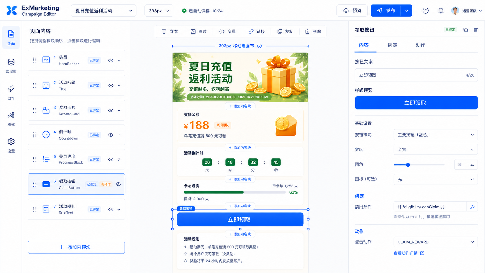
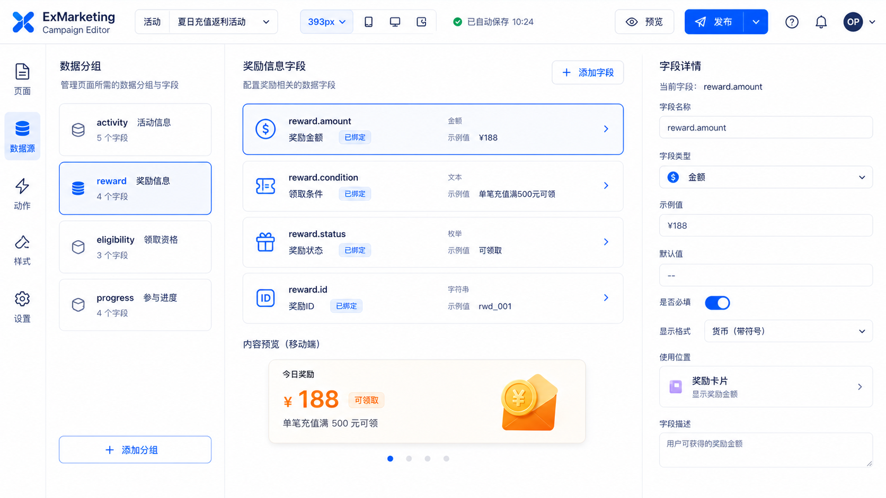
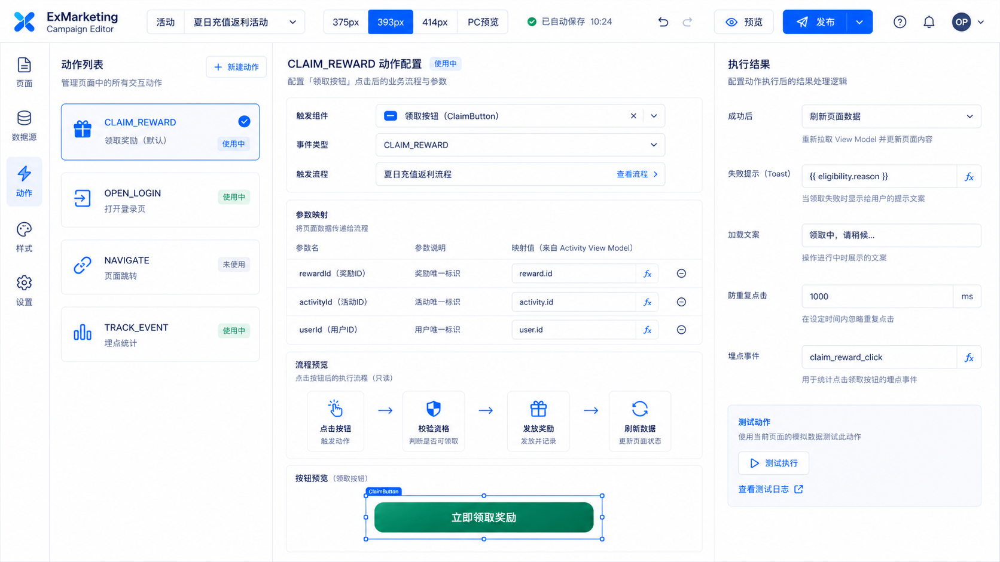
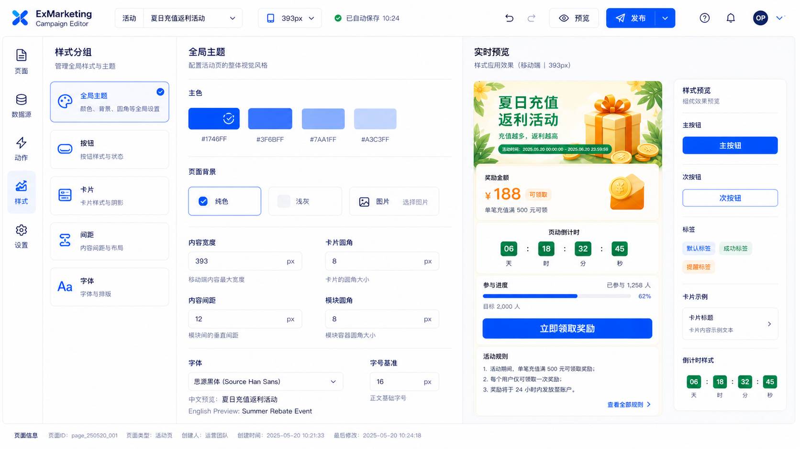
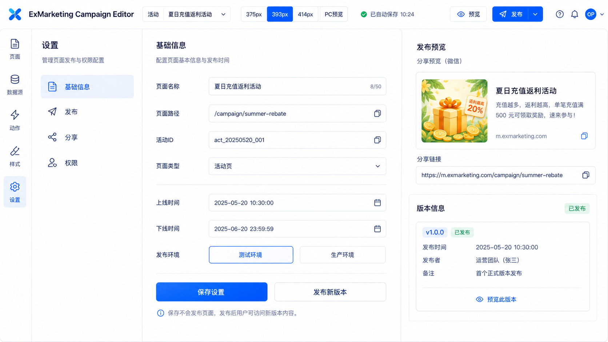
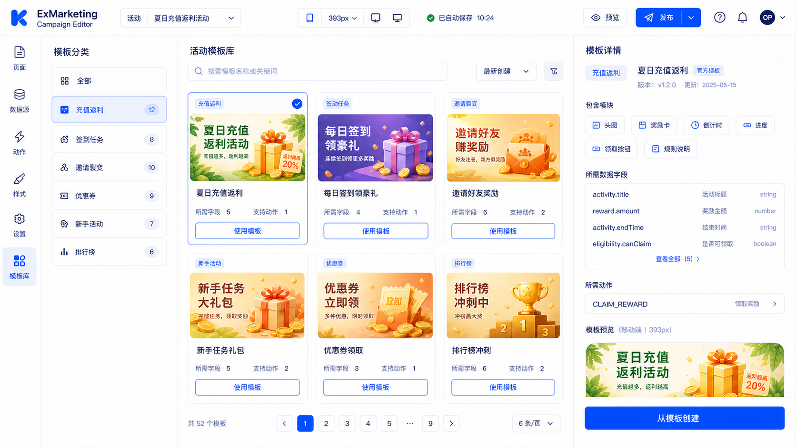
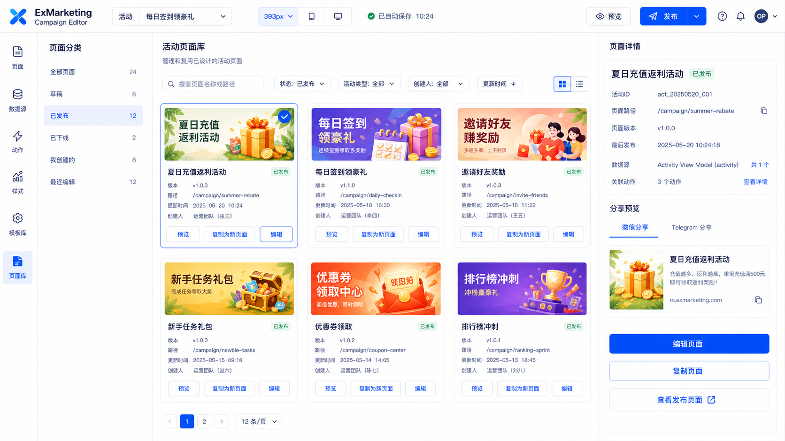

# ExMarketing Campaign Editor 设计与实施方案

本文档定义 ExMarketing Campaign Editor 的产品形态、信息架构、核心数据结构和实施步骤。目标是把 ExMarketing 现有活动流程能力扩展为可运营配置的移动端活动页编辑器。

## 结论

Campaign Editor 不做 Figma / Penpot 式自由设计工具，也不做通用 HTML 页面生成器。第一版定位为：

> 移动端优先的营销活动内容块编辑器 + 动态数据绑定 + 工作流动作绑定。

页面编辑体验接近富文本内容块编辑器：运营按内容块组织活动页，系统负责约束移动端布局、绑定活动数据、触发 workflow event、发布活动页。

## 目标

- 支持运营配置通用营销活动页，例如充值返利、每日签到、邀请好友、新手任务、优惠券领取。
- 页面默认面向移动端，编辑态使用 375 / 393 / 414px 宽度长页面画布，不套手机外框。
- 预览态再使用 iPhone / Android 外框验证真实终端效果。
- 页面内容由受控业务内容块组成，避免任意 HTML / JS 注入。
- 内容块可以绑定 Activity View Model 字段。
- 按钮类内容块可以触发 ExMarketing workflow event。
- 发布产物可版本化、可回滚、可审计。

## 非目标

- 不实现自由画布、图层、钢笔、复杂约束布局等专业设计工具能力。
- 不支持运营输入任意 JavaScript。
- 第一版不做 PC 独立设计器。PC 打开可居中展示移动端页面，后续再扩展 PC 模板。
- 第一版不做复杂 A/B 测试、灰度流量、多人协作评论。
- 第一版不直接从 Penpot / Figma 一键转生产页面。

## 技术选型：Puck

页面设计器技术框架采用 Puck。Puck 只负责编辑器层的可视化内容块编排、字段配置和拖拽体验，不直接作为生产页面的业务运行时。

职责边界：

```text
Puck：
- 内容块拖拽、排序、选择
- 内容块字段编辑
- 编辑态预览
- 输出结构化页面数据

ExMarketing：
- Activity View Model 数据源
- workflow event 动作绑定
- 页面 schema 存储和版本管理
- 发布、权限、审计
- C 端 runtime 渲染和安全控制
```

采用 Puck 的原因：

- ExMarketing 前端是 React / Vite，Puck 与现有技术栈匹配。
- Puck 允许使用自定义 React 组件，适合沉淀受控营销内容块。
- 页面保存为结构化数据，而不是运营自由编辑 HTML。
- 可以把编辑器体验和生产 runtime 解耦，便于发布版本快照和安全审计。

使用约束：

- 不开放任意 HTML / JS 组件。
- Puck 组件必须映射到 ExMarketing 受控内容块。
- Puck 输出数据需要转换为 ExMarketing Campaign Page schema。
- 线上 runtime 不直接依赖编辑器状态，不执行运营输入脚本。
- 绑定表达式第一版只支持白名单字段路径。

Puck 配置映射示例：

```text
Puck component HeroBanner    -> ExMarketing block HeroBanner
Puck component RewardCard    -> ExMarketing block RewardCard
Puck component Countdown     -> ExMarketing block Countdown
Puck component ProgressBlock -> ExMarketing block ProgressBlock
Puck component ClaimButton   -> ExMarketing block ClaimButton
Puck component RuleText      -> ExMarketing block RuleText
```

技术流向：

```text
Puck Editor
-> Puck data
-> normalizeCampaignSchema()
-> campaign_page.schema
-> publish version snapshot
-> Campaign Runtime renderer
```

## 产品信息架构

编辑器保持统一外壳：

```text
顶部 Header：活动选择 / 设备宽度 / 自动保存 / 预览 / 发布
左侧主导航：页面 / 数据源 / 动作 / 样式 / 设置 / 模板库 / 页面库
中间工作区：当前能力的主要操作区域
右侧面板：当前项详情、配置或预览
```

左侧主导航固定为：

```text
页面
数据源
动作
样式
设置
模板库
页面库
```

不要使用顶部大模块导航，避免从编辑器变成传统后台设置中心。

## 设计效果图

效果图按当前确定的信息架构分类：页面、数据源、动作、样式、设置。五个工作区共用同一个编辑器外壳，避免在不同页面之间出现不同产品形态。

### 页面设计

页面设计是主工作区，使用移动端宽度长页面画布。左侧管理页面内容结构，中间编辑活动内容块，右侧配置当前选中内容块。



### 数据源

数据源工作区只管理活动页可绑定的 Activity View Model 字段。它不是数据库管理后台，也不暴露 workflow 内部节点。



### 动作

动作工作区负责把页面交互绑定到 ExMarketing workflow event，例如领取按钮触发 `CLAIM_REWARD`。



### 样式

样式工作区负责全局主题、按钮、卡片、间距和字体。系统主题使用蓝色，但活动素材不被强制染色。



### 设置

设置工作区负责发布路径、上线时间、发布环境、分享预览和版本信息，保持编辑器上下文，不做传统后台设置中心。



### 模板库

模板库用于从标准活动模板快速创建页面。模板关注可复用的页面结构、默认样式、所需数据字段和所需动作。



### 页面库

页面库用于管理已经设计好的活动页面，包括草稿、已发布、已下线和最近编辑页面。运营可以预览、编辑、复制为新页面或查看发布页。



## 视觉与交互原则

### 系统主题

Campaign Editor 继承 ExMarketing 全局 Azure Symphony 主题，具体 token 以 [TailAdmin UI 标准](tailadmin-ui-standard.zh-CN.md) 为准。

```text
Light Mode：白底、浅灰分割、#1746ff 作为主按钮和关键选中态
Dark Mode：深蓝背景、浅蓝强调、#7aa1ff 作为主操作色
```

使用规则：

- 主按钮、发布按钮使用 `--theme-accent`。
- hover / pressed 使用 `--theme-accent-strong`。
- 选中描边使用 `--theme-accent-border` 或 `--theme-accent`。
- Tab / 左侧导航激活态使用 `--theme-accent-soft` + `--theme-accent-strong`。
- 页面背景使用 `--theme-page`。
- 面板背景使用 `--theme-surface`。
- 边框使用 `--theme-border`。
- 圆角：8px 为主
- 页面设计、数据源、动作、样式、设置、模板库、页面库都必须同时支持白天和黑夜模式。

活动素材不跟随系统主题色。活动头图、礼盒、金币、优惠券、节日素材可以使用绿色、金色、橙色、红色等运营视觉。

### 移动端编辑

编辑态：

```text
移动端宽度长页面画布
不套手机外框
高度自然增长
内容块纵向堆叠
支持滚动编辑
```

预览态：

```text
iPhone / Android 外框
真实安全区
真实滚动
按钮点击模拟
```

设备宽度：

```text
375px：iPhone SE / 小屏
393px：默认移动端宽度
414px：大屏手机
PC 预览：居中展示移动端页面
```

## 页面：页面设计

页面设计是主工作区，承担 80% 的日常编辑。

布局：

```text
左侧：页面内容结构
中间：393px 移动端长页面画布
右侧：当前内容块配置
```

页面内容结构示例：

```text
头图 HeroBanner
活动标题 Title
奖励卡片 RewardCard
倒计时 Countdown
参与进度 ProgressBlock
领取按钮 ClaimButton
活动规则 RuleText
FAQ FAQBlock
```

内容结构行能力：

- 拖拽排序
- 显示 / 隐藏
- 已绑定标识
- 有动作标识
- 复制
- 删除

中间画布能力：

- 内容块直接选中
- 选中态蓝色描边
- 块间 `+ 添加内容块`
- 长页面滚动
- 画布宽度标识，例如 `393px 移动端画布`
- 底部移动端校验提示：无横向溢出、点击区域正常、长页面可滚动

右侧配置分为：

```text
内容
绑定
动作
```

例如选中 `ClaimButton`：

```text
内容：
- 按钮文案：立即领取
- 按钮样式：主按钮
- 宽度：全宽
- 固定底部：开 / 关

绑定：
- 禁用条件：{{ !eligibility.canClaim }}
- 显示条件：{{ user.loggedIn }}

动作：
- 点击动作：CLAIM_REWARD
- 成功后：刷新页面数据
- 失败提示：{{ eligibility.reason }}
```

## 内容块设计

第一版只做活动页高频内容块。

| 内容块 | 用途 | 关键配置 |
| --- | --- | --- |
| HeroBanner | 活动头图 | 图片、标题、副标题、活动时间 |
| Title | 活动标题 | 文案、对齐、绑定字段 |
| RewardCard | 奖励信息 | 奖励名称、金额、条件、图片 |
| Countdown | 倒计时 | 结束时间、格式、过期文案 |
| ProgressBlock | 参与进度 | 当前值、目标值、百分比、人数 |
| ClaimButton | 领取按钮 | 文案、禁用条件、点击动作 |
| RuleText | 活动规则 | 富文本、编号列表 |
| FAQBlock | 常见问题 | 问题列表、折叠状态 |

后续扩展：

```text
CouponList
TaskList
InviteBlock
LoginPrompt
FormBlock
RankingBlock
```

## 页面：数据源

数据源页只管理活动页可绑定字段，不做数据库后台。

布局：

```text
左侧：数据分组
中间：字段卡片
右侧：字段详情
```

数据分组：

```text
activity 活动信息
reward 奖励信息
eligibility 领取资格
progress 参与进度
user 用户信息
```

Activity View Model 示例：

```json
{
  "activity": {
    "id": "act_20250520_001",
    "title": "夏日充值返利活动",
    "startTime": "2025-05-20T00:00:00+08:00",
    "endTime": "2025-06-20T23:59:59+08:00"
  },
  "reward": {
    "id": "rwd_001",
    "amount": 188,
    "currency": "CNY",
    "condition": "单笔充值满 500 元可领",
    "status": "AVAILABLE"
  },
  "eligibility": {
    "canClaim": true,
    "reason": ""
  },
  "progress": {
    "current": 1258,
    "target": 2000,
    "percent": 62
  },
  "user": {
    "id": "u_001",
    "loggedIn": true
  }
}
```

字段详情：

```text
字段名称：reward.amount
类型：金额
示例值：¥188
默认值：--
使用位置：奖励卡片
```

绑定表达式第一版只支持简单路径：

```text
{{activity.title}}
{{reward.amount}}
{{activity.endTime}}
{{progress.percent}}
{{eligibility.canClaim}}
```

复杂表达式后续再扩展，避免第一版失控。

## 页面：动作

动作页只管理页面动作到 workflow event 的绑定，不做流程设计器。

布局：

```text
左侧：动作列表
中间：动作配置
右侧：执行结果
```

第一版动作：

```text
CLAIM_REWARD
OPEN_LOGIN
NAVIGATE
TRACK_EVENT
```

`CLAIM_REWARD` 配置示例：

```text
触发组件：领取按钮
事件类型：CLAIM_REWARD
触发流程：夏日充值返利流程
参数映射：
- rewardId -> reward.id
- activityId -> activity.id
- userId -> user.id
```

结果处理：

```text
成功后：刷新页面数据
失败提示：{{ eligibility.reason }}
加载文案：领取中...
防重复点击：1000ms
埋点：claim_reward_click
```

运行链路：

```text
点击按钮
-> 前端调用活动事件 API
-> ExMarketing workflow 执行
-> 返回最新 Activity View Model
-> 页面刷新状态
```

## 页面：样式

样式页管理全局样式，不做完整设计系统。

布局：

```text
左侧：样式分组
中间：全局样式配置
右侧：实时预览
```

样式分组：

```text
全局主题
按钮
卡片
间距
字体
```

第一版配置：

```text
主色
页面背景
内容宽度
卡片圆角
内容间距
字体
主按钮样式
```

注意：全局主色影响系统化 CTA、选中态、链接，不改变活动头图和奖品素材颜色。

## 页面：设置

设置页管理发布基本信息，不做复杂发布中心。

布局：

```text
左侧：设置分组
中间：基础信息
右侧：发布预览
```

设置分组：

```text
基础信息
发布
分享
权限
```

基础字段：

```text
页面名称
页面路径
活动 ID
上线时间
下线时间
发布环境
```

右侧发布预览：

```text
分享卡片
页面 URL
版本状态
发布状态
```

## 页面：模板库

模板库用于降低运营创建成本。它不是素材市场，而是带有业务约束的活动页模板集合。

布局：

```text
左侧：模板分类
中间：模板列表
右侧：模板详情
```

模板分类：

```text
全部
充值返利
签到任务
邀请裂变
优惠券
新手活动
排行榜
```

模板卡片展示：

```text
模板缩略图
模板名称
活动类型
所需字段数量
支持动作数量
使用模板
```

模板详情展示：

```text
包含模块：
- 头图
- 奖励卡
- 倒计时
- 参与进度
- 领取按钮
- 规则说明

所需数据字段：
- activity.title
- reward.amount
- activity.endTime
- eligibility.canClaim

所需动作：
- CLAIM_REWARD
```

模板创建流程：

```text
选择模板
-> 从模板创建
-> 生成页面草稿
-> 检查缺失数据字段和动作
-> 进入页面设计
```

第一版模板建议：

```text
夏日充值返利
每日签到领豪礼
邀请好友奖励
新手任务礼包
优惠券领取
排行榜冲刺
```

## 页面：活动页面库

活动页面库用于管理已经设计好的活动页。它解决的是“复用已有页面”和“管理历史页面”，不是模板创建。

布局：

```text
左侧：页面分类
中间：活动页面列表
右侧：页面详情
```

页面分类：

```text
全部页面
草稿
已发布
已下线
我创建的
最近编辑
```

页面卡片展示：

```text
页面缩略图
页面名称
状态
版本
路径
更新时间
创建人
预览
复制为新页面
编辑
```

页面详情展示：

```text
活动 ID
页面路径
页面版本
最后发布时间
关联数据源
关联动作
分享预览
编辑页面
复制页面
查看发布页
```

页面库和模板库的区别：

| 能力 | 模板库 | 页面库 |
| --- | --- | --- |
| 主要目的 | 新建页面 | 管理和复用已有页面 |
| 内容状态 | 标准模板 | 草稿 / 已发布 / 已下线 |
| 是否绑定具体活动 | 通常不绑定 | 绑定具体 activityId |
| 是否有发布路径 | 无 | 有 |
| 常用动作 | 从模板创建 | 编辑、预览、复制、查看发布页 |

## 数据结构

### Campaign Page

```json
{
  "id": "page_20250520_001",
  "activityId": "act_20250520_001",
  "name": "夏日充值返利活动",
  "path": "/campaign/summer-rebate",
  "device": {
    "defaultWidth": 393,
    "supportedWidths": [375, 393, 414]
  },
  "theme": {
    "primaryColor": "#1746ff",
    "cardRadius": 8,
    "contentGap": 12,
    "fontFamily": "system"
  },
  "blocks": [],
  "status": "DRAFT",
  "version": "v1.0.0"
}
```

### Block

```json
{
  "id": "block_claim_001",
  "type": "ClaimButton",
  "name": "领取按钮",
  "visible": true,
  "props": {
    "text": "立即领取",
    "variant": "primary",
    "width": "full",
    "fixedBottom": false
  },
  "bindings": {
    "disabled": "{{ !eligibility.canClaim }}",
    "visible": "{{ user.loggedIn }}"
  },
  "action": {
    "type": "CLAIM_REWARD",
    "payload": {
      "rewardId": "{{ reward.id }}",
      "activityId": "{{ activity.id }}"
    }
  }
}
```

### Page Version

```json
{
  "id": "ver_001",
  "pageId": "page_20250520_001",
  "version": "v1.0.0",
  "status": "PUBLISHED",
  "schemaSnapshot": {},
  "publishedBy": "operator_001",
  "publishedAt": "2025-05-20T10:30:00+08:00"
}
```

### Campaign Template

```json
{
  "id": "tpl_summer_rebate",
  "name": "夏日充值返利",
  "category": "充值返利",
  "thumbnail": "/assets/templates/summer-rebate.png",
  "requiredFields": [
    "activity.title",
    "reward.amount",
    "activity.endTime",
    "eligibility.canClaim"
  ],
  "requiredActions": ["CLAIM_REWARD"],
  "schemaTemplate": {},
  "status": "ACTIVE",
  "version": "v1.2.0"
}
```

## 后端接口建议

### 页面管理

```text
GET    /api/campaign-pages?activityId=:activityId
GET    /api/campaign-pages?status=PUBLISHED
POST   /api/campaign-pages
GET    /api/campaign-pages/:pageId
PUT    /api/campaign-pages/:pageId
POST   /api/campaign-pages/:pageId/publish
GET    /api/campaign-pages/:pageId/versions
POST   /api/campaign-pages/:pageId/versions/:versionId/rollback
POST   /api/campaign-pages/:pageId/clone
```

### 模板库

```text
GET  /api/campaign-templates
GET  /api/campaign-templates/:templateId
POST /api/campaign-templates/:templateId/create-page
```

### View Model

```text
GET /api/activities/:activityId/view-model
```

返回当前用户视角的活动页面数据。编辑器预览可传 mock user 或 preview mode。

### 动作事件

```text
POST /api/activities/:activityId/events
```

请求：

```json
{
  "eventType": "CLAIM_REWARD",
  "source": "campaign_page",
  "pageId": "page_20250520_001",
  "blockId": "block_claim_001",
  "payload": {
    "rewardId": "rwd_001"
  }
}
```

响应：

```json
{
  "ok": true,
  "viewModel": {}
}
```

## 前端实现建议

页面设计页基于 Puck 实现，但外层工作台、数据源、动作、样式、设置、模板库、页面库仍使用 ExMarketing 自己的 React 页面和 TailAdmin 风格组件。

目录建议：

```text
frontend/admin-flow/src/pages/campaign-editor/
frontend/admin-flow/src/components/campaign-editor/
frontend/admin-flow/src/components/campaign-blocks/
frontend/admin-flow/src/components/campaign-puck/
frontend/admin-flow/src/lib/campaign-editor/
frontend/admin-flow/src/lib/campaign-runtime/
```

核心模块：

```text
CampaignEditorPage
EditorShell
LeftNav
PageOutline
PuckPageDesigner
PuckComponentRegistry
PuckFieldAdapters
CampaignSchemaNormalizer
BlockRenderer
BlockInspector
DataSourceWorkspace
ActionWorkspace
StyleWorkspace
SettingsWorkspace
TemplateLibraryWorkspace
PageLibraryWorkspace
```

Puck 组件注册建议：

```text
HeroBannerPuckConfig
TitlePuckConfig
RewardCardPuckConfig
CountdownPuckConfig
ProgressBlockPuckConfig
ClaimButtonPuckConfig
RuleTextPuckConfig
FAQBlockPuckConfig
```

每个 Puck config 只暴露允许运营编辑的字段。例如 `ClaimButton` 只暴露文案、样式、宽度、固定底部、禁用条件、点击动作，不暴露任意 CSS 和 JS。

渲染原则：

- 页面设计编辑态使用 Puck 管理内容块选择、拖拽和字段编辑。
- Puck data 保存前必须转换为 ExMarketing Campaign Page schema。
- Runtime 复用受控 block renderer，但不加载 Puck 编辑器能力。
- Schema 是唯一保存源，不保存 HTML。
- 发布时可生成静态 JSON + runtime 页面，也可 SSR/CSR 加载 schema 渲染。
- 编辑器 preview 可以使用 Puck preview，生产 runtime 必须使用 ExMarketing runtime renderer。

## 存储建议

第一版可新增三类表：

```text
campaign_page
campaign_page_version
campaign_page_publish
campaign_template
```

`campaign_page` 保存草稿 schema。

`campaign_page_version` 保存发布快照，确保线上版本不会被草稿修改影响。

`campaign_page_publish` 保存路径、环境、发布时间、发布人、状态。

`campaign_template` 保存内置模板和后续运营沉淀模板。

后续如需协作、审计、素材库，再扩展：

```text
campaign_asset
campaign_page_audit_log
```

## 安全约束

- 禁止运营输入任意 JS。
- Puck 只允许注册 ExMarketing 白名单内容块。
- Puck 字段配置必须经过 schema normalizer 校验后才能保存。
- 富文本需要白名单清洗。
- 图片上传限制类型、大小、域名和扫描策略。
- 动作类型必须来自后端白名单。
- payload 只能引用允许的 View Model 字段。
- 发布前必须校验 schema、绑定字段、动作权限、移动端横向溢出。
- 线上 runtime 不暴露内部 workflow 结构。

## 实施计划

### Phase 1：静态原型

目标：先验证信息架构和编辑体验。

任务：

- 实现统一编辑器外壳。
- 实现左侧主导航：页面 / 数据源 / 动作 / 样式 / 设置 / 模板库 / 页面库。
- 引入 Puck 并封装 `PuckPageDesigner`。
- 注册第一批受控营销内容块 Puck config。
- 实现页面设计页静态交互。
- 实现移动端宽度长页面画布。
- 基于 Puck 实现内容块选中、排序、添加、删除的前端状态。
- 实现右侧内容 / 绑定 / 动作配置面板。

验收：

- 可以编辑夏日充值返利活动 demo 页。
- 画布不套手机外框。
- 375 / 393 / 414px 宽度切换可用。
- 页面结构与画布选中状态同步。

### Phase 2：Schema 与本地保存

目标：形成稳定页面 schema。

任务：

- 定义 Campaign Page schema。
- 定义 block schema。
- 定义 bindings / action schema。
- 定义 Puck data 到 Campaign Page schema 的转换器。
- 定义 Campaign Page schema 到 Puck data 的反向适配器。
- 接入本地 mock API 或 local storage。
- 实现 schema import / export 便于调试。

验收：

- 页面刷新后草稿可恢复。
- 修改内容块会稳定写入 schema。
- Puck data 和 Campaign Page schema 可以双向转换。
- Runtime renderer 可以按 schema 渲染页面。

### Phase 3：Activity View Model

目标：页面可以绑定真实活动数据。

任务：

- 后端提供 `GET /api/activities/:activityId/view-model`。
- 数据源页展示 View Model 字段。
- 内容块绑定字段。
- 编辑器支持预览数据。
- runtime 渲染时解析 `{{path.to.value}}`。

验收：

- 奖励金额、活动标题、倒计时、进度可从 View Model 渲染。
- 缺失字段有明确提示。
- 绑定字段可以显示使用位置。

### Phase 4：动作绑定

目标：按钮可以触发 ExMarketing workflow event。

任务：

- 后端提供 `POST /api/activities/:activityId/events`。
- 动作页配置 `CLAIM_REWARD`。
- ClaimButton 触发事件。
- 成功后刷新 View Model。
- 失败时展示 `eligibility.reason`。

验收：

- 点击领取按钮能触发 workflow。
- 重复点击有防抖。
- 成功 / 失败状态清晰。
- 审计日志能看到 pageId、blockId、eventType。

### Phase 5：发布与版本

目标：草稿和线上版本隔离。

任务：

- 新增页面发布接口。
- 发布时保存 version snapshot。
- runtime 按 published version 渲染。
- 设置页支持页面路径、上线时间、分享信息。
- 支持回滚到历史版本。

验收：

- 草稿修改不影响线上版本。
- 发布后可通过路径访问活动页。
- 发布版本可回滚。
- 分享预览信息正确。

### Phase 6：模板库与页面库

目标：提升运营创建和复用效率。

任务：

- 提供活动模板：
  - 夏日充值返利
  - 每日签到
  - 邀请好友
  - 新手任务
  - 优惠券领取
- 模板包含默认 blocks、样式和绑定需求。
- 新建页面时可从模板创建。
- 提供页面库：
  - 全部页面
  - 草稿
  - 已发布
  - 已下线
  - 我创建的
  - 最近编辑
- 支持复制已有页面为新页面。
- 支持从页面库进入编辑和发布页预览。

验收：

- 运营可以 1 分钟内从模板生成活动页草稿。
- 模板能提示缺失数据源和动作配置。
- 运营可以从已有活动页复制出新活动页。
- 页面库能按状态筛选草稿、已发布和已下线页面。

## 详细实施步骤

本节把 Phase 拆成可以逐步开发、评审和验收的工程任务。建议按顺序推进，不要先做复杂模板库和发布中心。

### Step 0：技术验证

目标：确认 Puck 能满足移动端内容块编辑器的核心交互。

前端任务：

- 在 `frontend/admin-flow` 新增一个临时实验页面。
- 安装并引入 Puck。
- 注册 3 个最小内容块：
  - `HeroBanner`
  - `RewardCard`
  - `ClaimButton`
- 验证内容块可以添加、排序、选中、编辑字段。
- 验证画布可以限制为 393px 宽度，并且不套手机外框。
- 验证 Puck data 可以导出为 JSON。

后端任务：

- 暂无后端依赖，使用本地 mock 数据。

产物：

```text
Puck 技术验证页面
最小 Puck component config
一份导出的 Puck data 样例
```

验收：

- 能在编辑器里完成添加模块、改文案、排序、选中按钮。
- 画布表现为移动端长页面，而不是自由设计画布。
- Puck data 结构可被后续转换器消费。

风险：

- 如果 Puck 默认布局过于 Page Builder，需要在外层限制编辑器 UI，避免变成通用设计器。
- 如果某些字段编辑器不符合 ExMarketing UI，需要自定义 field renderer。

### Step 1：编辑器外壳

目标：建立统一的 Campaign Editor 产品外壳，后续所有页面复用。

前端任务：

- 新增 `CampaignEditorPage`。
- 新增 `EditorShell`：
  - 顶部 Header
  - 左侧竖向主导航
  - 中间工作区
  - 右侧上下文面板
- 主导航固定：
  - 页面
  - 数据源
  - 动作
  - 样式
  - 设置
  - 模板库
  - 页面库
- Header 固定：
  - 活动选择
  - 375 / 393 / 414 / PC 预览
  - 自动保存状态
  - 预览
  - 发布
- 视觉遵循 TailAdmin UI 标准和 Azure Symphony 蓝色。

后端任务：

- 暂无强依赖，可先使用 mock activity list。

产物：

```text
CampaignEditorPage
EditorShell
LeftNav
Header
WorkspaceRouter
```

验收：

- 所有工作区切换时外壳不变。
- 不出现顶部大模块导航。
- 视觉和已确定效果图一致。

### Step 2：Puck 页面设计工作区

目标：完成“页面”工作区的核心编辑能力。

前端任务：

- 新增 `PuckPageDesigner`。
- 新增 `PuckComponentRegistry`。
- 注册 MVP 内容块：
  - `HeroBanner`
  - `Title`
  - `RewardCard`
  - `Countdown`
  - `ProgressBlock`
  - `ClaimButton`
  - `RuleText`
  - `FAQBlock`
- 左侧实现 `PageOutline`：
  - 展示当前 blocks 顺序
  - 支持选中同步
  - 支持拖拽排序
  - 展示已绑定 / 有动作 badge
- 中间画布：
  - 默认 393px
  - 支持 375 / 414 切换
  - 不套手机外框
  - 块间展示 `+ 添加内容块`
- 右侧实现 `BlockInspector`：
  - 内容
  - 绑定
  - 动作

后端任务：

- 暂无真实保存接口时，先落 local storage。

产物：

```text
PuckPageDesigner
PageOutline
BlockInspector
第一批 block config
```

验收：

- 运营可以完成夏日充值返利 demo 页的内容编辑。
- 内容块可以排序、复制、删除。
- 选中 `ClaimButton` 后右侧可以配置文案、禁用条件、点击动作。

### Step 3：Campaign Schema 适配层

目标：建立 Puck data 和 ExMarketing schema 的边界，避免运行时直接依赖编辑器数据。

前端任务：

- 新增 `CampaignSchemaNormalizer`。
- 实现：
  - `puckDataToCampaignSchema(puckData)`
  - `campaignSchemaToPuckData(schema)`
  - `validateCampaignSchema(schema)`
- 对每个 block 做 schema 校验：
  - 必填字段
  - 字段类型
  - 绑定表达式格式
  - action 类型白名单
- 支持 schema import / export。

后端任务：

- 定义后端 DTO。
- 确认 schema 字段命名和数据库 JSON 存储格式。

产物：

```text
Campaign Page schema
Block schema
Normalizer
Validator
Schema 示例文件
```

验收：

- Puck 编辑后可以生成稳定 Campaign schema。
- Campaign schema 可以反向加载回 Puck 编辑器。
- 非法 action、非法 binding、未知 block type 会被阻止保存。

### Step 4：草稿保存

目标：页面草稿可以保存、恢复和自动保存。

后端任务：

- 新增 `campaign_page` 表。
- 新增接口：

```text
GET  /api/campaign-pages/:pageId
POST /api/campaign-pages
PUT  /api/campaign-pages/:pageId
```

- 保存字段：
  - page id
  - activity id
  - name
  - path
  - schema
  - status
  - updated by
  - updated at

前端任务：

- 接入草稿保存 API。
- 实现自动保存状态：
  - 保存中
  - 已自动保存
  - 保存失败
- 避免每次输入都立刻保存，使用 debounce。
- 保存失败时保留本地临时草稿。

产物：

```text
campaign_page migration
页面 CRUD API
自动保存能力
```

验收：

- 刷新页面后草稿可以恢复。
- 保存失败不会丢失当前编辑内容。
- 草稿修改不会影响已发布版本。

### Step 5：Activity View Model 数据源

目标：让页面内容块可以绑定真实活动数据。

后端任务：

- 新增：

```text
GET /api/activities/:activityId/view-model
```

- 从活动配置、用户状态、奖励状态、进度状态组装 View Model。
- 编辑器 preview mode 支持 mock user 或默认 demo 数据。

前端任务：

- 实现“数据源”工作区。
- 按分组展示：
  - activity
  - reward
  - eligibility
  - progress
  - user
- 内容块绑定字段时，从 View Model 字段列表选择。
- Runtime renderer 支持解析：

```text
{{activity.title}}
{{reward.amount}}
{{eligibility.canClaim}}
```

产物：

```text
Activity View Model API
DataSourceWorkspace
Binding picker
Simple path resolver
```

验收：

- 奖励金额可由 `reward.amount` 渲染。
- 按钮禁用状态可由 `eligibility.canClaim` 控制。
- 字段缺失时编辑器能提示使用位置和错误。

### Step 6：动作绑定

目标：页面按钮能触发 ExMarketing workflow event。

后端任务：

- 新增：

```text
POST /api/activities/:activityId/events
```

- 支持事件：
  - `CLAIM_REWARD`
  - `OPEN_LOGIN` 前端动作无需 workflow
  - `NAVIGATE` 前端动作无需 workflow
  - `TRACK_EVENT`
- workflow event 记录：
  - pageId
  - blockId
  - eventType
  - userId
  - payload

前端任务：

- 实现“动作”工作区。
- 右侧动作配置支持：
  - 成功后刷新数据
  - 失败提示
  - 加载文案
  - 防重复点击
  - 埋点事件
- Runtime 点击 `ClaimButton` 时调用事件 API。

产物：

```text
ActionWorkspace
Action schema
Event API
Runtime action executor
```

验收：

- 点击领取按钮能触发 workflow。
- 成功后页面奖励状态刷新。
- 失败时展示 `eligibility.reason`。
- 重复点击被防抖拦截。

### Step 7：Campaign Runtime

目标：线上页面使用独立 runtime 渲染，不依赖 Puck 编辑器。

前端任务：

- 新增 `campaign-runtime`。
- 实现 `CampaignPageRenderer`。
- 实现受控 block renderer：
  - `HeroBannerRenderer`
  - `RewardCardRenderer`
  - `CountdownRenderer`
  - `ProgressBlockRenderer`
  - `ClaimButtonRenderer`
  - `RuleTextRenderer`
  - `FAQBlockRenderer`
- Runtime 加载：
  - published schema
  - Activity View Model
- Runtime 执行：
  - binding resolver
  - action executor
  - error toast

后端任务：

- 提供 published page schema 查询能力。
- 支持按 path 查询发布页。

产物：

```text
Campaign Runtime
Published page route
Block renderer
Binding resolver
Action executor
```

验收：

- 发布页可独立访问。
- 线上页面不加载 Puck。
- 绑定和动作与编辑器预览一致。

### Step 8：发布和版本

目标：草稿、发布版本和线上访问隔离。

后端任务：

- 新增表：
  - `campaign_page_version`
  - `campaign_page_publish`
- 新增接口：

```text
POST /api/campaign-pages/:pageId/publish
GET  /api/campaign-pages/:pageId/versions
POST /api/campaign-pages/:pageId/versions/:versionId/rollback
```

- 发布时保存 schema snapshot。
- 发布前校验：
  - schema 合法
  - 绑定字段存在
  - action 合法
  - 页面路径唯一

前端任务：

- 实现“设置”工作区。
- 支持：
  - 页面路径
  - 上线时间
  - 下线时间
  - 发布环境
  - 分享预览
  - 版本信息
- 发布按钮调用 publish API。

产物：

```text
Publish API
Version snapshot
SettingsWorkspace
Published page access
```

验收：

- 草稿修改不影响线上页面。
- 发布后线上路径可访问新版本。
- 可以回滚到历史版本。

### Step 9：样式系统

目标：支持全局样式配置，但不变成自由 CSS 编辑器。

前端任务：

- 实现“样式”工作区。
- 支持配置：
  - 主色
  - 页面背景
  - 内容宽度
  - 卡片圆角
  - 内容间距
  - 字体
  - 主按钮样式
- 样式写入 campaign schema 的 `theme`。
- Runtime 根据 theme 渲染。

后端任务：

- 只保存 schema，无额外复杂逻辑。

产物：

```text
StyleWorkspace
Theme schema
Runtime theme applier
```

验收：

- 主按钮颜色可配置。
- 活动素材不被主题色强制染色。
- 主题变更后编辑器和 runtime 一致。

### Step 10：模板库

目标：从标准模板快速创建活动页。

后端任务：

- 新增 `campaign_template` 表。
- 新增接口：

```text
GET  /api/campaign-templates
GET  /api/campaign-templates/:templateId
POST /api/campaign-templates/:templateId/create-page
```

- 内置模板：
  - 夏日充值返利
  - 每日签到领豪礼
  - 邀请好友奖励
  - 新手任务礼包
  - 优惠券领取
  - 排行榜冲刺

前端任务：

- 实现“模板库”工作区。
- 支持分类、搜索、模板详情。
- 从模板创建页面草稿。
- 创建后提示缺失数据字段和动作配置。

产物：

```text
TemplateLibraryWorkspace
Template API
Seed templates
```

验收：

- 运营可以从模板创建草稿。
- 模板创建出的页面能进入页面设计工作区继续编辑。

### Step 11：活动页面库

目标：管理、复用和查看已设计活动页。

后端任务：

- 扩展页面列表查询：

```text
GET /api/campaign-pages?status=DRAFT
GET /api/campaign-pages?status=PUBLISHED
POST /api/campaign-pages/:pageId/clone
```

- 支持按 activityId、status、createdBy、updatedAt 查询。

前端任务：

- 实现“页面库”工作区。
- 支持：
  - 草稿
  - 已发布
  - 已下线
  - 我创建的
  - 最近编辑
- 支持预览、编辑、复制为新页面、查看发布页。

产物：

```text
PageLibraryWorkspace
Page list API
Clone page API
```

验收：

- 页面库可以找到已发布活动页。
- 可以复制旧页面生成新草稿。
- 页面详情能展示数据源、动作、分享预览和版本。

### Step 12：质量、权限和发布门禁

目标：上线前保证活动页可用、安全、可回滚。

前端任务：

- 发布前检查展示：
  - 页面结构合法
  - 数据绑定通过
  - 动作配置通过
  - 移动端无横向溢出
  - 点击区域正常
- 支持编辑器错误定位到具体 block。

后端任务：

- 发布接口强制校验。
- 权限控制：
  - 查看
  - 编辑
  - 发布
  - 回滚
- 审计日志记录：
  - 保存
  - 发布
  - 回滚
  - 复制
  - 动作触发

产物：

```text
Publish gate
Permission checks
Audit logs
Error locator
```

验收：

- 没有发布权限无法发布。
- 缺失绑定字段不能发布。
- 发布失败能明确定位原因。
- 任意线上版本可以追踪发布人和发布时间。

## MVP 范围建议

第一版只做：

```text
页面设计
数据源
动作
样式
设置
模板库
页面库
```

页面设计使用 Puck 实现内容块编辑体验，但运行时仍使用 ExMarketing Campaign Runtime。

内容块只做：

```text
HeroBanner
Title
RewardCard
Countdown
ProgressBlock
ClaimButton
RuleText
FAQBlock
```

动作只做：

```text
CLAIM_REWARD
OPEN_LOGIN
NAVIGATE
TRACK_EVENT
```

绑定只做简单路径表达式：

```text
{{activity.title}}
{{reward.amount}}
{{eligibility.canClaim}}
```

## 验收清单

- 编辑器外壳统一，没有顶部大模块导航。
- 页面设计页以移动端长页面编辑为核心。
- 编辑态不套手机外框。
- 预览态可以模拟手机外框。
- 左侧主导航固定为页面 / 数据源 / 动作 / 样式 / 设置 / 模板库 / 页面库。
- 白天和黑夜模式下都可读、可操作。
- 页面内容块可排序、选中、配置。
- 数据源只展示 Activity View Model，不暴露内部流程节点。
- 动作只绑定 workflow event，不暴露任意脚本。
- 样式只配置全局主题和基础视觉参数。
- 设置只配置发布、分享、权限和版本。
- 模板库可以从标准模板创建页面草稿。
- 页面库可以管理、编辑、复制已有活动页。
- 活动素材不被系统主题强制染色。
- 发布版本和草稿隔离。
