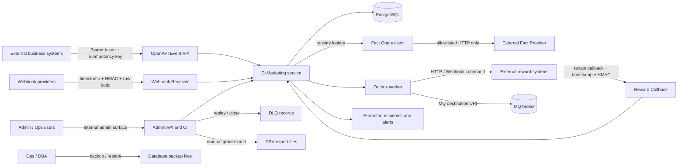

# ExMarketing Security Threat Model

## Scope

This threat model is the release security review baseline for ExMarketing. It covers:

- External entry points: OpenAPI Event API, Webhook Receiver, Reward Callback, Fact Query, Admin API/UI, DLQ operations, manual grant/export operations, metrics, backup/restore and Outbox sender flows.
- Assets: activity configuration and approval state, quota and quota reservations, grant orders, outbox and DLQ records, audit records, OpenAPI tokens, webhook and callback secrets, Fact Provider `authRef`, MQ runtime credential references, manual export files, backup files, metrics and incident evidence.
- Trust boundaries: public ingress, admin ingress, ExMarketing service process, PostgreSQL, MQ brokers, Service Providers, legacy external Fact Providers, external reward systems, local/export file storage, backup targets and monitoring systems.

Non-goals:

- This document does not replace penetration testing, SAST/DAST, dependency scanning or company-wide IAM design.
- This document records risks and follow-up work; it does not claim every control is already implemented or enabled in production.
- MQ Event In is not treated as an active documented ingress in this baseline. MQ Command Out and MQ runtime sender configuration are in scope.

## Assumptions

- Production OpenAPI events must run with `EX_MARKETING_REQUIRE_OPENAPI_AUTH=true`.
- Admin endpoints and `/admin/` are local or internal operations surfaces and must not be directly exposed to the public internet.
- Production uses PostgreSQL persistence, not the in-memory repository.
- Secrets are stored or referenced through runtime configuration, secret stores or mounted secret files, not in activity config, outbox payloads, audit payloads, metrics or public incident material.
- If a control is optional in local development, this model treats it as mandatory for production unless explicitly accepted by a release risk owner.

## Asset Inventory

| Asset | Sensitivity | Existing Controls | Gaps / Notes |
| --- | --- | --- | --- |
| Activity config and approval state | High | Tenant-scoped activity identity, versioned approval, high-risk L2 approval, audit records. | Production admin auth/RBAC is not fully specified. |
| Rule and reward config | High | Schema validation, safe formula evaluator, `targetRef` validation, unknown config rejection. | Needs release gate evidence that unsafe rule types remain disabled. |
| Quota and reservations | Critical | Conditional updates, frozen/confirm/release lifecycle, reconciliation and P0 alerts for conflicts. | Repair actions require business confirmation and audit. |
| Grant orders | Critical | Tenant-scoped locators, command/idempotency keys, callback conflict checks. | Export/download and long-term retention policy need hardening. |
| Outbox and DLQ | Critical | Retry/DLQ states, replay/close only from `DLQ`, operator/reason required, audit. | Bulk replay and provider-incident playbooks need strict operational controls. |
| Audit records | High | Stable actions and redacted source summaries. | Audit payload review is needed for new actions and public evidence. |
| OpenAPI tokens | Critical | Production token map scoped by tenant and source system. | Token rotation and storage process are not fully specified. |
| Webhook receiver secrets | Critical | HMAC-SHA256 with timestamp, allowed tenants/sources/IPs. | No nonce store is documented; replay window relies on timestamp plus idempotency. |
| Reward callback secrets | Critical | Tenant-scoped HMAC-SHA256 with timestamp and terminal-state conflict rejection. | No nonce store is documented; replay window relies on timestamp plus idempotent terminal handling. |
| Fact Provider `authRef` | Critical | Registry uses `tenant_id + fact_code`; `authRef` is a reference, not plaintext. | Secret backend/rotation process is out of scope and should be audited. |
| MQ runtime credentials/TLS refs | Critical | Broker endpoints, auth refs and TLS files live in runtime config; destination allowlist can constrain sends. | Runtime config exposure and allowlist completeness need release audit. |
| Manual export files | High | Export files have status, checksum and detail rows; duplicate export detail is blocked. | Access control, download audit, retention and encryption are not fully specified. |
| Backup files | High | Restore refuses same target, empty/unreadable backup and non-empty target by default; DSNs are redacted. | Backup encryption, retention, storage ACL and restore approval are not fully specified. |
| Metrics/logs/runbooks | Medium | Low-cardinality metrics labels; sensitive identifiers and raw provider errors are forbidden. | New metrics/log fields need review during release. |

## Data Flow And Trust Boundaries

Trust boundaries:

- Public ingress to ExMarketing: OpenAPI Event API, Webhook Receiver, Reward Callback and Fact Query.
- Admin ingress to ExMarketing: Admin API/UI, DLQ operations, manual grant/export, approval and simulation.
- Service to data stores: PostgreSQL and filesystem/export/backup targets.
- Service to external systems: Service Provider HTTP/RPC/MQ, legacy Fact Provider HTTP, Reward HTTP/Webhook and MQ broker.
- Monitoring boundary: metrics, alert labels, runbooks and incident material must stay redacted.

## External Entry Threats

| Entry | Main Assets | STRIDE Threats | Existing Controls | Gaps / Release Checks |
| --- | --- | --- | --- | --- |
| `POST /openapi/v1/events` | Inbox, participation, grant order, quota, outbox | Spoofing, Tampering, Repudiation, DoS | Bearer token scoped to tenant/source, fixed idempotency key, 1 MiB default body limit, duplicate/conflict handling. | Require production auth flag, token rotation plan, and audit evidence for auth failures. |
| `POST /openapi/v1/webhooks/{receiverCode}` | Inbox, mapping, quota, outbox | Spoofing, Tampering, Replay, Info disclosure | JSON only, timestamp + HMAC, allowed tenant/source/IP, optional idempotency key must equal mapped event key. | No nonce store is documented; enforce narrow timestamp window and use idempotency as replay containment. |
| `POST /openapi/v1/reward/callback` | Grant order, quota reservation, audit | Spoofing, Tampering, Replay, EoP | Tenant-scoped locator, timestamp + HMAC for configured tenants, conflict and opposite terminal-state rejection. | No nonce store is documented; release gate must verify all production tenants have callback secrets. |
| `POST /openapi/v1/facts/query` | Legacy Fact Provider registry, facts cache, rule inputs | SSRF, Info disclosure, DoS, Tampering | Enabled registry only, `authRef`, allowlist, private/local IP blocking, timeout and mapping. New workflow facts should use Service Interface + Provider + Resource governance. | Must test redirect handling, DNS rebinding, proxy env bypass and oversized/malicious JSON behavior. |
| Admin API/UI | Activity config, quota, approvals, manual grant, export, DLQ | Spoofing, EoP, Repudiation, Tampering | Local/internal-only documentation, operator/reason for high-impact actions, audit. | Production auth/RBAC/network exposure must be decided before release. |
| DLQ replay/close | Outbox, grant order, reward delivery | Tampering, Replay, Repudiation | Only `DLQ` can replay/close, `DLQ_CLOSED` cannot replay, operator/reason and audit. | Bulk operations need business confirmation, rate limits and runbook evidence. |
| Manual grant/export | Grant orders, export files, quota state | EoP, Info disclosure, Repudiation | Operator/reason, checksum, export detail uniqueness, audit actions. | Download access control, encryption, retention and download audit are not fully specified. |
| Outbox sender HTTP/Webhook/MQ | Reward commands, target refs, MQ credentials | SSRF, Secret leakage, Replay, DoS | `targetRef` validation, MQ destination URI only, runtime endpoints/auth/TLS refs, retry/DLQ. | HTTP/Webhook egress allowlist and redirect/DNS/proxy SSRF protection need release audit. |
| Metrics / alerts | Operational evidence | Info disclosure, DoS via cardinality | Sensitive and high-cardinality labels are forbidden; allowed label set is documented. | New metrics and public incident material need redaction review. |
| Backup/restore | Full business DB and audit history | Info disclosure, Tampering, DoS | DSN redaction, restore target safety checks, checksum/drift validation. | Backup encryption, storage ACL, retention and restore approval are release gaps. |

## Risk Matrix

| ID | Entry / Asset | STRIDE | Attack Path | Impact | Existing Controls | Gap | Severity | Likelihood | Risk | Remediation / Evidence |
| --- | --- | --- | --- | --- | --- | --- | --- | --- | --- | --- |
| TM-01 | OpenAPI Event API / grant path | Spoofing, Tampering | Attacker submits forged events or uses a token outside its tenant/source scope. | Unauthorized participation, grant orders and reward commands; possible cross-tenant reward loss. | Production auth flag, token tenant/source scope, idempotency key, request size limit. | Release must prove auth is enabled and token map is production-secret managed. | P0 | Medium | High | Add release gate evidence: `EX_MARKETING_REQUIRE_OPENAPI_AUTH=true`, token scope inventory and negative auth tests. |
| TM-02 | OpenAPI idempotency / quota | Replay, Tampering | Reuse an idempotency key with modified payload or repeat rewardable events. | Duplicate or inconsistent reward/participation/quota state. | Fixed `tenantId:sourceSystem:eventType:bizType:bizId` key, duplicate OK, conflict rejected. | Token rotation and source replay contracts need operational docs. | P1 | Medium | High | Keep duplicate/conflict tests in release suite; document source retry rules. |
| TM-03 | Webhook Receiver | Spoofing, Replay | Missing/invalid signature, stale timestamp or provider payload mapped into another tenant/source. | Forged event intake and downstream reward creation. | Timestamp + HMAC, allowed tenants/sources/IPs, mapped idempotency validation. | No nonce store is documented. | P1 | Medium | High | Document replay posture: narrow timestamp window plus standard event idempotency; add nonce store only if provider replay risk exceeds tolerance. |
| TM-04 | Reward Callback | Spoofing, Replay, Tampering | Attacker forges callback or replays old terminal update. | Unauthorized quota confirm/release and incorrect reward terminal state. | Tenant locator, timestamp + HMAC, duplicate same terminal is idempotent, opposite terminal conflicts are rejected. | No nonce store is documented; all production tenants must configure secrets. | P0 | Medium | High | Release gate verifies callback secret per tenant/channel and negative signature/timestamp tests. |
| TM-05 | Callback locator | EoP, Tampering | Use `commandId` from one tenant with `idempotencyKey` from another or conflicting order. | Cross-tenant status mutation or corrupted reward state. | Tenant participates in lookup; locator conflicts return `CALLBACK_LOCATOR_CONFLICT`. | None blocking. | P0 | Low | High | Keep conflict and cross-tenant callback tests as release evidence. |
| TM-06 | Legacy Fact Provider / HTTP Resource SSRF | Information Disclosure, EoP | Configure provider endpoint or HTTP Resource to private IP, localhost, metadata service or internal admin host. | Internal data exposure or internal service mutation through Fact Query or Service Provider execution. | Registry only for legacy facts; new model uses Service Provider + controlled HTTP Resource, host allowlist, private/local IP blocking, timeout. | Redirects, DNS rebinding and proxy environment variables need explicit checks. | P1 | Medium | High | Add SSRF hardening tests for redirects to private IP, rebinding between validation and connect, and disabled proxy env usage. |
| TM-07 | Fact Provider response | DoS, Tampering | Provider returns huge, slow or malicious JSON that breaks mapping or exhausts resources. | Event processing failure, latency spike, incorrect facts in rules. | Timeout, explicit mapping, success-only cache, metric reasons. | Response size and schema depth limits are not fully specified. | P2 | Medium | Medium | Add max response size/depth policy and Fact Query fail-rate alert review. |
| TM-08 | Admin exposure | Spoofing, EoP | Public internet reaches Admin API/UI or high-risk operations without auth/RBAC. | Activity activation, quota changes, manual grants, exports or DLQ replay by unauthorized users. | Docs state `/admin/` is local and not for public production exposure; actions require operator/reason. | Production auth/RBAC/network policy not fully specified. | P0 | Medium | High | Block release unless Admin is internal-only with network ACL or protected by authenticated gateway/RBAC. |
| TM-09 | Activity approval | Tampering, Repudiation | Operator bypasses approval or uses stale approved version for ACTIVE/SCHEDULED. | Unsafe campaign config and uncontrolled reward spend. | Versioned approval, submitter cannot self-approve, high-risk L2 approval. | Need release evidence for approval enforcement in Admin flows. | P1 | Medium | High | Include approval bypass/stale-version tests and audit checks. |
| TM-10 | `targetRef` HTTP/Webhook | SSRF, Secret leakage | Activity reward target points at internal host, redirect chain or URL carrying credentials. | Internal access through Outbox worker or leaked credentials in config/outbox/audit. | HTTP/Webhook must be URL; MQ `targetRef` rejects credentials/query/fragment. | HTTP/Webhook egress allowlist and redirect/private-IP protections are not fully documented. | P1 | Medium | High | Add egress allowlist and redirect/DNS/proxy checks for HTTP/Webhook sender before production. |
| TM-11 | MQ runtime config | Information Disclosure, Tampering | Broker endpoint or targetRef carries password/token or destination is too broad. | Credential leak or reward commands sent to unauthorized topics/queues. | Runtime config owns endpoints/auth/TLS; targetRef is destination URI; destination allowlist can reject sends into retry/DLQ. | Destination allowlist optional; runtime secret storage needs audit. | P1 | Medium | High | Require destination allowlist for production MQ senders and scan config for userinfo/query secrets. |
| TM-12 | Outbox semantics | Repudiation, Tampering | Treat `SENT` as final reward success or retry while provider is unhealthy. | User-visible reward mismatch or replay amplification. | Docs state `SENT` means delivery only; callback is terminal truth; retry/DLQ metrics and runbooks exist. | Operational dashboards must not mark reward as successful solely from `SENT`. | P1 | Medium | High | Release dashboard/reconciliation review must distinguish sent vs final callback. |
| TM-13 | DLQ replay/close | Replay, EoP, Repudiation | Replay many DLQ messages after provider incident or close without business approval. | Duplicate delivery attempts, unresolved customer rewards or audit gaps. | State guard, `DLQ_CLOSED` cannot replay, operator/reason required, audit. | Business confirmation is a runbook rule, not a hard permission model. | P1 | Medium | High | Add RBAC/approval task for DLQ replay/close; require audit evidence in incident review. |
| TM-14 | Quota reservation | Tampering, DoS | Race conditions, missing reservations or aggregate conflict during callback/release. | Budget over-deduct, frozen funds, inconsistent reward state. | Conditional updates, reservation lifecycle, P0 quota alerts and reconciliation. | Manual repair process must remain audited and business-approved. | P0 | Low | High | Keep quota conflict tests, P0 alert evidence and repair runbook. |
| TM-15 | Manual export files | Information Disclosure, Repudiation | Export file with grant/user details is downloaded or retained without controls. | Sensitive business/customer data leak. | Export file rows, checksums and audit actions for creation/status. | Access control, encryption, retention and download audit are not fully defined. | P1 | Medium | High | Create export security task: ACL, encryption or isolated storage, retention and download audit. |
| TM-16 | Backup files | Information Disclosure, Tampering | Backup copied to insecure storage or restored into wrong target. | Full DB leak or destructive restore. | DSN redaction, restore target safety checks, checksum/drift validation. | Encryption, storage ACL, retention and restore approval are not fully defined. | P1 | Medium | High | Create backup security task: encrypted storage, retention, ACL, approval and restore evidence. |
| TM-17 | Logs, audit, metrics | Information Disclosure | Sensitive tokens, payloads, targetRefs or high-cardinality identifiers appear in labels or public material. | Credential or customer data leak; Prometheus cardinality DoS. | Operations/runbook documents forbidden fields and allowed metric labels. | New code paths need redaction review. | P1 | Medium | High | Add release scan for forbidden labels/log snippets and review audit payload schemas. |
| TM-18 | Fact Provider authRef | Information Disclosure | Operator writes plaintext secret in `authRef`, mapping or provider error. | Secret disclosure through DB, logs or audit. | `authRef` is documented as reference only; raw provider errors forbidden in public material. | No automated validation of secret-reference format is documented. | P2 | Medium | Medium | Add validation/backlog task for allowed `authRef` schemes and redacted provider errors. |
| TM-19 | Metrics endpoint | Information Disclosure, DoS | `/metrics` is public or scraped by unauthorized parties. | Operational data leak and potential scrape load. | Operations docs say metrics are internal/local and label set is restricted. | Network ACL not represented in application config. | P2 | Medium | Medium | Release infra check: metrics only reachable by Prometheus/internal network. |
| TM-20 | Backup/restore command | Tampering, DoS | `--force` used against non-drill target or wrong DSN. | Data loss or destructive restore. | Same-target and non-empty target refusal; `--force` described as local drill only. | Human approval gate is not hard-coded. | P2 | Low | Medium | Add runbook checklist requiring two-person review for production restore. |

## Follow-Up Security Tasks

P0 tasks:

| Task | Problem | Entry / Asset | Suggested Control | Acceptance |
| --- | --- | --- | --- | --- |
| SEC-P0-01 OpenAPI production auth gate | Events can create reward state if auth is disabled. | OpenAPI Event API | Startup or release gate must fail production when `EX_MARKETING_REQUIRE_OPENAPI_AUTH` is not true and token scope inventory is missing. | Negative unauthenticated event test returns 401; scoped token cannot cross tenant/source; release evidence records config. |
| SEC-P0-02 Callback secret enforcement | Unsigned callbacks can finalize quota/reward if tenant secret is absent. | Reward Callback | Production tenant/channel registry must require callback secret, timestamp window and HMAC check. | Missing/old/bad signature tests reject before business mutation; all production tenants have secrets. |
| SEC-P0-03 Admin production exposure block | Admin can mutate high-value config if exposed without auth/RBAC. | Admin API/UI | Place Admin behind internal network or authenticated gateway/RBAC before public release. | External network cannot reach Admin; high-risk operation requires authenticated operator and is audited. |
| SEC-P0-04 Quota consistency release evidence | Quota aggregate conflicts can cause reward loss or over-deduct. | Quota / callback / DLQ | Keep conditional updates, P0 alerts, reconciliation and audited repair process as release gates. | Quota conflict tests pass; alert/runbook evidence exists; repair actions require business confirmation. |

P1 tasks:

| Task | Problem | Entry / Asset | Suggested Control | Acceptance |
| --- | --- | --- | --- | --- |
| SEC-P1-01 Webhook and callback replay posture | Current design documents timestamp and idempotency, not nonce persistence. | Webhook / Callback | Document allowed timestamp skew, idempotency replay handling and whether nonce storage is required per provider. | Replay within same payload is idempotent; modified replay is rejected; stale timestamp is rejected. |
| SEC-P1-02 Fact Provider SSRF hardening | Redirects, DNS rebinding and proxy env can bypass simple host/IP checks. | Fact Query | Validate final redirect targets, re-check resolved IP on connect where possible, disable ambient proxy use unless allowlisted. | Tests cover redirect to private IP, rebinding simulation and proxy env rejection. |
| SEC-P1-03 Outbox HTTP/Webhook egress allowlist | Reward target can become an SSRF path. | Outbox sender | Add or enforce destination allowlist, private/local IP blocking and redirect policy for HTTP/Webhook sender. | Internal/private targets and credential-bearing URLs are rejected or moved to retry/DLQ with redacted reason. |
| SEC-P1-04 MQ destination lock-down | Optional allowlist can allow accidental sends. | MQ sender | Require destination allowlist for production enabled MQ senders/resources. | Unknown destination enters retry/DLQ; config scan shows no userinfo/query secret material. |
| SEC-P1-05 DLQ operation approval | Replay/close is high impact but business confirmation is procedural. | DLQ | Add permission/approval or two-step operation for production replay/close. | Replay/close requires authorized operator, reason and business confirmation evidence in audit. |
| SEC-P1-06 Manual export protection | Export files contain grant/user/business data. | Manual export | Add ACL, encryption or isolated storage, retention, checksum verification and download audit. | Unauthorized users cannot download; audit records creator/downloader/reason; expired files are removed. |
| SEC-P1-07 Backup protection | Backups contain full DB and audit history. | Backup files | Encrypt backups, restrict storage ACL, define retention and require restore approval. | Backup evidence includes checksum, encrypted location, retention and redacted restore validation. |
| SEC-P1-08 Sensitive output review | New logs/metrics/audit can leak secrets or high-cardinality IDs. | Logs, metrics, audit, runbooks | Add release scan for forbidden labels/fields and review new audit payloads. | Metrics contain no forbidden labels; public incident template has redaction checklist. |

P2/P3 backlog:

- Add validation for `authRef` format to reduce accidental plaintext secret storage.
- Define Fact Provider response size/depth limits and mapping failure caps.
- Document token and secret rotation runbooks.
- Add production restore two-person checklist for non-drill restores.
- Add periodic review of Admin network ACL, metrics exposure and Alertmanager route receivers.

## Release Review Checklist

- Every external entry has a negative auth/signature/tenant test or documented compensating control.
- Every P0/P1 task is either completed before release or has an explicit security risk acceptance.
- Admin and metrics endpoints are internal-only or protected by an authenticated gateway.
- OpenAPI tokens, webhook secrets, callback secrets, Fact Provider auth refs and MQ auth refs are stored outside activity config, outbox payloads, audit payloads and logs.
- Webhook/callback replay controls explicitly state timestamp skew, idempotency behavior and nonce decision.
- SSRF protections cover allowlist, private/local IP, redirects, DNS rebinding and ambient proxy behavior for Fact Query and reward egress.
- DLQ replay/close, quota timeout release, manual grant and manual export require operator, reason, audit and business confirmation where customer-visible outcome can change.
- Manual export and backup files have checksum, access control, encryption or isolated storage, retention and audit evidence.
- Metrics labels and incident material exclude tokens, secrets, full payloads, full targetRefs and high-cardinality business identifiers.
