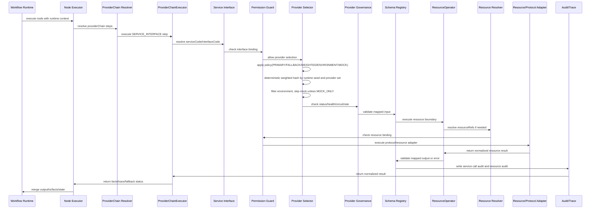

# ExMarketing 服务、接口、提供者和资源设计

本文档定义 ExMarketing 中工作流节点如何使用服务、接口、提供者和资源。它补充 [公共资源管理设计](resource-management-design.zh-CN.md)，用于把“业务编排”和“技术能力治理”拆开。

实施改造方案见 [ExMarketing 服务、接口、提供者和资源整体改造方案](service-interface-provider-resource-refactor-plan.zh-CN.md)。主设计文档回答“目标模型是什么”，改造方案文档回答“代码、DB、API、Executor、Studio 和迁移按什么顺序改”。

核心原则：

```text
节点表达业务编排，不表达基础设施连接。
服务表达业务能力归属。
接口表达能力契约。
提供者表达能力实现。
资源表达底层状态和基础设施。
```

节点不直接配置 HTTP URL、Redis 地址、DB 连接、MQ broker、密钥、SQL 或物理 topic。节点只引用已注册的服务接口、提供者策略或资源，并声明输入、操作和输出。

## 总体分层

ExMarketing 有两条主线。

### 业务编排线

```text
Workspace 工作区
  -> Folder 文件夹
    -> Workflow 流程
      -> Node 节点
```

这条线回答：

| 层级 | 职责 |
| --- | --- |
| `Workspace` | 租户、团队或业务域隔离边界 |
| `Folder` | 活动分类、权限分组和资产归档 |
| `Workflow` | 活动流程、版本、发布、审核和回滚 |
| `Node` | 具体业务编排、条件判断、事实查询、状态读写和副作用边界 |

### 能力资产线

```text
Workspace 工作区
  -> Service 服务
    -> Interface 接口
      -> Provider 提供者
        -> Resource 资源
```

这条线回答：

| 层级 | 职责 |
| --- | --- |
| `Service` | 一个稳定业务或技术能力，例如用户画像、风控、发奖、签到状态 |
| `Interface` | 服务暴露的能力契约，例如查询用户画像、评估风险、发送发奖命令 |
| `Provider` | 接口的具体实现，例如 HTTP、RPC、MQ、Plugin、自定义 TCP |
| `Resource` | Provider 或节点依赖的底层状态和基础设施，例如 Redis、DB、表、MQ topic、对象存储 |

两条线在节点处汇合：

```text
Workflow Node
  -> call Service.Interface
  -> select Provider by policy
  -> operate Resource
```

## 概念定义

### Node

`Node` 是工作流里的业务编排单元。它应该表达“这个活动下一步做什么”，而不是“怎么连 Redis/HTTP/DB”。

节点可以：

- 调用服务接口；
- 操作受控资源；
- 使用 Lua 或表达式调用已授权的成熟服务和方法；
- 读取上游输出并生成下游输出；
- 决定 PASS、BLOCK、RISK、SKIP 等路由。

节点不应该：

- 直接保存 endpoint、token、password、broker、driver；
- 直接执行任意 SQL；
- 直接访问未注册的 HTTP/RPC/MQ/TCP 目标；
- 绕过资源权限、租户隔离和审计。

### Service

`Service` 是能力归属。它代表一个业务或技术服务，而不是某个具体协议。

示例：

```text
user-profile-service
risk-evaluation-service
reward-grant-service
checkin-state-service
marketing-fact-service
```

`Service` 负责说明：

- 这个能力属于谁；
- 可以暴露哪些接口；
- 能被哪些工作区、文件夹、流程或节点使用；
- 是否需要审批、审计、限流或环境隔离。

### Interface

`Interface` 是能力契约。它定义服务能做什么、输入是什么、输出是什么、错误怎么表达。

示例：

```text
query-user-profile
evaluate-risk
read-checkin-state
upsert-checkin-state
publish-reward-command
```

接口不等于 HTTP/RPC/MQ。HTTP/RPC/MQ 是接口的实现协议，属于 Provider。

接口需要定义：

- `operation`：`CALL`、`PUBLISH`、`REQUEST_REPLY` 等；
- `inputSchemaRef`；
- `outputSchemaRef`；
- `errorSchemaRef`；
- 幂等键策略；
- 超时、重试和降级语义；
- 是否允许被 Lua/表达式调用。

### Provider

`Provider` 是接口的具体实现。一个 Interface 可以有多个 Provider。

示例：

```text
query-user-profile-http-primary
query-user-profile-redis-cache
query-user-profile-mock
reward-command-kafka-provider
checkin-state-redis-provider
```

Provider 负责说明：

- 使用什么协议：`HTTP`、`RPC`、`MQ`、`PLUGIN`、`TCP`、`LUA_ADAPTER`；
- 真实 endpoint、topic、method、method name、plugin action；
- 鉴权、密钥、header、序列化方式；
- 超时、重试、熔断、限流；
- fallback、灰度、环境绑定；
- 依赖哪些 Resource。

节点通常不直接绑定 Provider，而是绑定 `Service.Interface`，再由 `providerPolicy` 选择 Provider。只有调试、灰度或特殊活动才允许显式指定 Provider。

### Resource

`Resource` 是底层状态和基础设施。

示例：

```text
Redis
DB
DB Table
Mongo Collection
MQ Topic
Object Store
KV Namespace
Counter
Lock
```

Resource 负责说明：

- 类型和 adapter；
- 连接和密钥引用；
- namespace、key policy、schema；
- 支持的资源操作；
- 租户、工作区、文件夹、流程、节点权限；
- 审计和测试连接。

HTTP/RPC/TCP/MQ 在 ExMarketing 里容易混用，必须按“业务语义”和“底层能力”拆开理解：

- 作为 Provider 协议时，HTTP/RPC/MQ/TCP 表达某个 Service Interface 的实现方式；
- 作为 Resource 时，HTTP/MQ 表达一个受控底层 client、连接、topic、stream 或 adapter 能力；
- 普通业务节点不直接配置 URL、broker、topic、header、token 或连接参数；
- Provider 可以依赖 HTTP/MQ Resource 完成真实调用，节点只引用 Service Interface 或 Resource Ref。

简化判断：

```text
这个对象回答“调用哪个业务能力？” -> Service.Interface / Provider
这个对象回答“怎么连接底层系统？” -> Resource
```

## 推荐关系

标准关系：

```text
Node
  -> Service.Interface
  -> Provider
  -> Resource
```

直接资源操作关系：

```text
Node
  -> Resource
```

直接资源操作只适合状态、频控、锁、通用存储这类底层语义明确的节点，例如：

```text
activity-state
state-store
limit
quota
lock
lua-query
```

业务事实类能力优先走 `Service.Interface`，不要让普通业务节点直接读 DB 表。

## 协议边界和历史兼容

本节专门解决 HTTP/RPC/MQ 到底是 Provider 还是 Resource 的歧义。

### 核心定义

| 概念 | 表达什么 | 例子 | 谁引用 |
| --- | --- | --- | --- |
| `Service` | 稳定业务能力归属 | `user-profile-service` | Studio 目录、权限治理 |
| `Interface` | 业务能力契约 | `query-user-profile` | workflow 节点 |
| `Provider` | Interface 的一种实现 | `query-user-profile-http-primary` | ProviderSelector |
| `Resource` | 受控底层能力、连接、Topic、Store | `user-profile-http-client`、`marketing-kafka`、`default_user_profile_store` | Provider 或底层资源节点 |

一句话：

```text
Provider 表达“这个业务接口怎么实现”。
Resource 表达“底层连接、Topic、Store、Client 怎么受控使用”。
```

### HTTP 的边界

HTTP 有两种合法角色。

#### HTTP 作为 Provider 协议

用于表达某个业务接口通过 HTTP 实现：

```json
{
  "serviceRef": "user-profile-service",
  "interfaceRef": "query-user-profile",
  "code": "query-user-profile-http-primary",
  "protocol": "HTTP",
  "method": "POST",
  "path": "/api/user/profile/query",
  "authRef": "user-profile-auth",
  "resourceRefs": ["user-profile-http-client"]
}
```

含义：

- 这是 `query-user-profile` 接口的 HTTP 实现；
- provider 负责 request/response mapping、timeout、retry、schema；
- provider 可以引用一个 HTTP Resource 作为受控 client；
- workflow 节点不看 URL，只看 `serviceRef/interfaceRef`。

#### HTTP 作为 Resource

用于表达一个受控 HTTP client 或 endpoint 资源：

```json
{
  "code": "user-profile-http-client",
  "type": "HTTP",
  "driver": "REST",
  "scope": "WORKSPACE",
  "capabilities": ["CALL", "TEST_CONNECTION"],
  "config": {
    "endpointRef": "secret://user-profile/base-url",
    "path": "/profile/query",
    "allowlist": ["user.internal.example.com"],
    "blockedPrivateNetwork": true,
    "redirectPolicy": "DENY"
  }
}
```

含义：

- 这是底层 HTTP client/endpoint 的受控资源；
- 管理 SSRF、防重定向、host allowlist、secret、headers；
- 可以被 Provider 使用；
- 普通业务节点不应该直接选择它来表达“查询用户画像”，除非节点本身就是底层资源操作节点或兼容旧 workflow。

#### HTTP 禁止形态

workflow 节点里禁止直接出现：

```json
{
  "endpoint": "https://user.internal.example.com/profile",
  "headers": {
    "Authorization": "Bearer xxx"
  }
}
```

原因：

- 绕过 Service Interface 权限；
- 绕过 Provider 治理和 health/fallback；
- 绕过 Resource allowlist、secret 和审计；
- workflow definition 可能泄露密钥和内网地址。

### MQ 的边界

MQ 也有两种合法角色。

#### MQ 作为 Provider 协议

用于表达某个业务接口通过 MQ 实现：

```json
{
  "serviceRef": "reward-grant-service",
  "interfaceRef": "publish-reward-command",
  "code": "reward-command-kafka-provider",
  "protocol": "MQ",
  "method": "PUBLISH",
  "topic": "reward-command",
  "resourceRefs": ["marketing-kafka"]
}
```

含义：

- 这是 `publish-reward-command` 接口的 MQ 实现；
- Interface 决定这是 `PUBLISH` 还是 `REQUEST_REPLY`；
- Provider 负责 key、payload mapping、幂等、correlation id、timeout；
- Resource 负责真实 broker/topic/producer 权限。

#### MQ 作为 Resource

用于表达 Kafka/RabbitMQ/Pulsar 的受控 topic、stream 或 broker 连接：

```json
{
  "code": "marketing-kafka",
  "type": "MQ",
  "driver": "KAFKA",
  "capabilities": ["PUBLISH", "TEST_CONNECTION"],
  "config": {
    "clusterRef": "secret://mq/cluster",
    "topic": "reward-command",
    "producerAcks": "all"
  }
}
```

含义：

- 这是底层消息资源；
- 管理 broker、topic、凭据、生产权限、审计；
- 可以被 MQ Provider 或 `mq-publish` 这类底层节点使用。

#### MQ 禁止形态

workflow 节点里禁止直接出现：

```json
{
  "broker": "kafka.internal:9092",
  "topic": "reward-command",
  "username": "plain-user",
  "password": "plain-password"
}
```

### RPC / TCP / Plugin / Lua Adapter 的边界

| 协议 | Provider 角色 | Resource 角色 | 默认产品入口 |
| --- | --- | --- | --- |
| `RPC` | 表达接口通过 gRPC/Dubbo/Thrift 等实现 | 受控 client/channel、service discovery、TLS/auth | 不进默认 UI，先设计 |
| `TCP` | 表达接口通过自定义 TCP 协议实现 | 受控 endpoint、codec、TLS/auth | 默认禁用，需要安全评审 |
| `PLUGIN` | 表达接口由平台插件动作实现 | 插件包、插件运行时、插件配置 | 可用于注册插件动作 |
| `LUA_ADAPTER` | 表达接口由受控 Lua adapter 实现 | Lua script resource、执行沙箱 | 仅高级能力，不默认开放 |

RPC/TCP 不建议直接作为普通 Resource 类型暴露给业务用户。它们应先通过 Provider 协议封装成 Service Interface，再由平台控制底层 client resource。

### 节点引用规则

| 节点类型 | 推荐引用 | 不推荐/禁止 |
| --- | --- | --- |
| `fact-query` | `SERVICE_INTERFACE`，必要时 `RESOURCE` Store | 直接 URL、HTTP headers、DB table、broker |
| `activity-state` | `RESOURCE` Store/Redis | 直接 Redis 地址、SQL |
| `limit/quota/lock` | `RESOURCE` Counter/Lock 或对应 Service Interface | 直接 key prefix、Redis command |
| `outbox/callback` | Service Interface 或受控 HTTP/MQ Resource | 直接 webhook URL、topic、secret |
| `lua-query/code` | `service_call`、`resource_*` 受控函数 | `http.post`、`redis.get`、`db.query`、`mq.publish` |

### 历史兼容规则

历史上已经存在 `HTTP`、`MQ`、`PROVIDER` Resource，以及旧节点字段 `endpoint/providerEndpoint/providerCode/redisRef/grpcTarget/pluginCode`。兼容策略：

| 旧形态 | 兼容方式 | 新建配置是否允许 |
| --- | --- | --- |
| `resource.type=HTTP` | 继续作为受控 HTTP Resource 执行 | 允许，但定位为底层 client/resource |
| `resource.type=MQ` | 继续作为受控 MQ Resource 执行 | 允许，但定位为 topic/broker resource |
| `resource.type=PROVIDER` | 继续作为公共 Provider Resource 兼容 | 新业务优先建 Service Provider |
| 节点 `endpoint/providerEndpoint` | 运行时兼容读取 | 新 UI 不展示，不推荐保存 |
| 节点 `providerCode` | `FACT_SERVICE` 兼容 | 新 UI 不展示 |
| 节点 `redisRef/grpcTarget/pluginCode` | 兼容旧 draft | 新 UI 应改为 resourceRef 或 serviceRef/interfaceRef |

保存新 workflow 时的要求：

- 如果用户选择业务能力，保存为 `SERVICE_INTERFACE`；
- 如果用户选择底层状态/Store/Counter/Lock，保存为 `RESOURCE`；
- 不再主动生成 URL、broker、secret、headers、SQL、Redis 地址；
- 如果导入旧 draft，允许读取旧字段，但 UI 应提示迁移到 Service Interface 或 Resource Ref。

### 兼容期迁移节奏

旧 Provider/Resource 模型不能一次性删除，必须分阶段迁移，避免已发布 workflow 失效。

| 阶段 | 目标 | UI 行为 | Runtime 行为 | 发布策略 |
| --- | --- | --- | --- | --- |
| Phase 0: Read Compatible | 所有旧流程可打开、可执行 | 显示旧字段但标记“兼容模式” | 继续读取 `PROVIDER/FACT_SERVICE/endpoint/providerCode/redisRef` | 允许发布旧流程，但给 warning |
| Phase 1: New Writes Use New Model | 新建流程只写新模型 | 新 UI 只生成 `SERVICE_INTERFACE` 或 `RESOURCE` | 旧字段继续执行 | 新流程禁止保存直接 endpoint/secret/broker |
| Phase 2: Assisted Migration | 提供迁移建议和一键转换 | 打开旧流程时展示“迁移到服务接口/资源 Ref” | 旧字段执行时写 deprecation trace | 正式发布要求确认兼容风险 |
| Phase 3: Publish Gate | 阻止新增旧字段正式发布 | 旧字段只读展示 | 旧字段仍可执行已发布版本 | 新正式版本含旧字段时 BLOCK，除非 break-glass |
| Phase 4: Runtime Deprecation | 运行时逐步下线高风险旧字段 | UI 不再编辑旧字段 | 仅 allowlist 活动可执行旧字段 | 需要迁移完成报告 |

推荐时间线不写死日期，按覆盖率推进：

```text
新模型覆盖 80% 新建 workflow -> 进入 Phase 2
旧字段引用少于 20% 活跃 workflow -> 进入 Phase 3
旧字段引用为 0 或全部有豁免单 -> 进入 Phase 4
```

### 旧字段分类和处理

| 旧字段/旧来源 | 风险 | 自动迁移目标 | 迁移方式 |
| --- | --- | --- | --- |
| `source=PROVIDER` + `resourceRef` | 中 | `targetType=SERVICE_INTERFACE` 或 `RESOURCE` | 如果 resource type 是 PROVIDER 且有对应内置 service，转 Service Interface；否则保留 RESOURCE |
| `source=FACT_SERVICE` + `providerCode` | 中 | `SERVICE_INTERFACE` | 根据 providerCode 映射到内置 service/interface |
| `endpoint/providerEndpoint` | 高 | `ServiceProvider(protocol=HTTP)` + `Resource(type=HTTP)` | 创建受控 HTTP Resource 和 Service Provider，节点改引用 service/interface |
| `redisRef` | 中 | `Resource(type=REDIS)` | 创建或选择 Redis Resource，节点改 `resourceRef` |
| `grpcTarget` | 高 | `ServiceProvider(protocol=RPC)` | 创建 RPC Provider 和受控 client Resource |
| `pluginCode` | 中 | `ServiceProvider(protocol=PLUGIN)` | 映射到已注册 plugin action |
| `resource.type=PROVIDER` | 中 | `ServiceProvider` 或保留兼容 Resource | 新业务不再新增；旧资源可作为 provider 依赖保留 |

### 自动迁移规则

迁移工具输入：

```text
workflow draft/version
available services/interfaces/providers
available resources
built-in provider mapping
```

迁移决策：

```text
1. 如果旧 providerCode/resourceRef 能匹配内置事实服务，转为 SERVICE_INTERFACE。
2. 如果旧字段表达底层状态读写，转为 RESOURCE。
3. 如果旧 endpoint 是业务服务调用，创建 ServiceProvider + HTTP Resource 草案。
4. 如果无法确定业务语义，只标记 NEEDS_REVIEW，不自动改写。
```

迁移示例：旧 fact-query Provider Resource

```json
{
  "source": "PROVIDER",
  "resourceRef": "user-profile-provider",
  "onMiss": "BLOCK"
}
```

迁移为：

```json
{
  "targetType": "SERVICE_INTERFACE",
  "source": "SERVICE_INTERFACE",
  "serviceRef": "user-profile-service",
  "interfaceRef": "query-user-profile",
  "providerPolicy": "PRIMARY",
  "onMiss": "BLOCK"
}
```

迁移示例：旧 Redis 字段

```json
{
  "source": "REDIS",
  "redisRef": "daily_checkin_counter",
  "operation": "CHECK_AND_INCREMENT"
}
```

迁移为：

```json
{
  "targetType": "RESOURCE",
  "source": "RESOURCE",
  "resourceRef": "daily_checkin_counter",
  "operation": "CHECK_AND_INCREMENT"
}
```

### 迁移工具和 API 草案

建议提供只读分析和应用两个能力。

```text
POST /admin/v1/workflows/{activityId}/migration/service-interface/analyze
POST /admin/v1/workflows/{activityId}/migration/service-interface/apply
```

Analyze 返回：

```json
{
  "status": "NEEDS_REVIEW",
  "summary": {
    "legacySteps": 3,
    "autoMigratable": 2,
    "manualReview": 1
  },
  "items": [
    {
      "nodeId": "facts",
      "path": "config.providerChain[0]",
      "legacyType": "FACT_SERVICE",
      "recommendedTarget": "SERVICE_INTERFACE",
      "serviceRef": "user-profile-service",
      "interfaceRef": "query-user-profile",
      "confidence": "HIGH"
    }
  ]
}
```

Apply 要求：

- 只作用于 draft，不直接改已发布 version；
- 生成新的 draft revision；
- 保留 migration diff；
- 写 audit；
- 失败时不部分保存。

### 前端体验规则

前端需要同时支持“兼容可读”和“新建收敛”。

| 场景 | UI 行为 |
| --- | --- |
| 打开旧 workflow | 正常展示节点，旧字段区域显示“兼容模式” |
| 编辑旧 step | 默认提示迁移，不鼓励继续编辑旧字段 |
| 新建 step | 只允许选 `SERVICE_INTERFACE`、`RESOURCE`、`WORKFLOW_CONTEXT`、`LOCAL_CACHE` |
| 保存旧 step | 允许保存 draft，但正式发布给 warning 或 BLOCK，取决于阶段 |
| 一键迁移 | 显示迁移 diff，用户确认后写新 draft |

UI 文案建议：

```text
该节点仍使用旧 Provider/Resource 配置。建议迁移为 Service Interface 或 Resource Ref，以获得权限、审计、Schema 和 Provider 治理能力。
```

### Runtime Trace 和告警

旧字段执行时必须写 deprecation trace：

```json
{
  "legacyProviderMode": true,
  "legacyFields": ["providerCode", "endpoint"],
  "migrationTarget": "SERVICE_INTERFACE",
  "warningCode": "LEGACY_PROVIDER_CHAIN_USED"
}
```

指标建议：

| 指标 | 标签 |
| --- | --- |
| `exmarketing_legacy_provider_chain_total` | tenantId、activityId、nodeType、legacyType |
| `exmarketing_legacy_endpoint_usage_total` | tenantId、activityId、nodeId |
| `exmarketing_migration_suggestion_total` | targetType、confidence |

这些指标用于决定是否进入下一迁移阶段。

### 废弃门槛

废弃旧字段必须满足：

```text
1. 最近 30 天正式 execution 中旧字段调用为 0，或全部有豁免单。
2. 所有 active workflow draft/version 已完成迁移或标记 archived。
3. migration analyze 没有 HIGH confidence 未应用项。
4. runbook 已说明如何处理 legacy workflow。
5. release note 明确破坏性变更范围。
```

不可废弃条件：

- 仍有 active production workflow 使用直接 endpoint/providerCode；
- 仍有外部客户或运营活动依赖旧字段；
- 新模型缺少同等能力，例如某协议 Provider 尚未支持；
- 没有自动或半自动迁移工具。

### Break-glass 例外

如果生产故障期间必须使用旧字段，应走 break-glass：

```json
{
  "reason": "provider migration incident workaround",
  "expiresAt": "2026-07-01T00:00:00Z",
  "approvedBy": "owner/admin",
  "allowedLegacyFields": ["endpoint"],
  "activityId": "act_xxx"
}
```

规则：

- 必须有过期时间；
- 必须写审计；
- 只允许 OWNER/ADMIN；
- 不允许携带明文 secret；
- 到期后发布校验重新 BLOCK。

### 建模决策表

| 需求 | 应建模为 |
| --- | --- |
| 查询用户画像 | `user-profile-service.query-user-profile` Service Interface |
| 用户画像服务有 HTTP 实现 | `ServiceProvider(protocol=HTTP)` |
| HTTP base URL、allowlist、headersRef | `Resource(type=HTTP)` |
| 读取用户画像表 | `Resource(type=TABLE)`，通常由 Provider 依赖 |
| 发布发奖命令 | `reward-grant-service.publish-reward-command` Service Interface |
| 发奖命令走 Kafka | `ServiceProvider(protocol=MQ)` |
| Kafka topic / producer config | `Resource(type=MQ)` |
| 签到状态读写 | `Resource(type=TABLE/REDIS)` 或 `checkin-state-service` Interface |
| 次数限制/锁 | `Resource(type=REDIS, mode=COUNTER/LOCK)` |

### 文档和 UI 命名规则

为避免歧义，UI 和文档命名应遵循：

| 场景 | 推荐文案 | 避免文案 |
| --- | --- | --- |
| Service Provider | “接口实现 Provider” | “HTTP 资源” |
| HTTP Resource | “受控 HTTP Client Resource” | “用户画像 Provider” |
| MQ Resource | “受控 MQ Topic Resource” | “发奖服务” |
| Resource Ref | “底层资源 Ref” | “服务接口” |
| Service Interface | “业务能力接口” | “HTTP 接口地址” |

产品层应把“业务能力选择”和“底层资源选择”分成两个入口：

```text
业务能力：Service -> Interface -> ProviderPolicy
底层资源：Resource -> Operation -> Namespace/Key
```

## 对象示例

### Service

```json
{
  "code": "user-profile-service",
  "name": "用户画像服务",
  "serviceType": "EXTERNAL",
  "scope": "WORKSPACE",
  "workspaceId": "growth",
  "status": "ACTIVE",
  "owner": "user-platform",
  "tags": ["fact", "profile"]
}
```

### Interface

```json
{
  "serviceRef": "user-profile-service",
  "code": "query-user-profile",
  "name": "查询用户画像",
  "operation": "CALL",
  "inputSchemaRef": "user-profile-query-v1",
  "outputSchemaRef": "user-profile-v1",
  "idempotencyKeyTemplate": "${tenantId}:${subject.id}",
  "timeoutMs": 3000,
  "retryPolicy": "STANDARD",
  "luaCallable": true
}
```

### Provider

```json
{
  "serviceRef": "user-profile-service",
  "interfaceRef": "query-user-profile",
  "code": "query-user-profile-http-primary",
  "protocol": "HTTP",
  "endpointRef": "secret://user-profile/http-base-url",
  "method": "POST",
  "path": "/api/user/profile/query",
  "authRef": "user-profile-http-auth",
  "timeoutMs": 3000,
  "resources": [
    {
      "resourceRef": "user-profile-http-client",
      "usage": "CALL"
    }
  ]
}
```

### Resource

```json
{
  "code": "checkin-state-redis",
  "type": "REDIS",
  "mode": "KV",
  "scope": "WORKSPACE",
  "workspaceId": "growth",
  "status": "ACTIVE",
  "capabilities": ["READ", "WRITE", "UPSERT", "CAS"],
  "config": {
    "keyPrefix": "checkin:state"
  },
  "keyPolicy": {
    "allowedTemplates": ["${tenantId}:${activityId}:${subject.id}"]
  }
}
```

## 节点引用方式

### 调用服务接口

```json
{
  "providerChain": [
    {
      "targetType": "SERVICE_INTERFACE",
      "serviceRef": "user-profile-service",
      "interfaceRef": "query-user-profile",
      "operation": "CALL",
      "providerPolicy": "PRIMARY_WITH_FALLBACK",
      "inputMapping": {
        "tenantId": "${tenantId}",
        "userId": "${subject.id}"
      },
      "outputAs": "userProfile"
    }
  ]
}
```

### 操作资源

```json
{
  "providerChain": [
    {
      "targetType": "RESOURCE",
      "resourceRef": "checkin-state-redis",
      "operation": "READ",
      "namespace": "checkin",
      "keyTemplate": "${tenantId}:${activityId}:${subject.id}",
      "valuePath": "$.state",
      "outputAs": "checkinState",
      "onMiss": "BLOCK"
    }
  ]
}
```

### Lua 调用成熟服务和方法

Lua 只用于编排成熟服务、调用已注册方法、轻量数据转换、fallback 选择和输出组装。Lua 不直接访问 HTTP、Redis、DB、MQ 或密钥。

推荐暴露受控函数：

```lua
local profile = service_call("user-profile-service", "query-user-profile", {
  tenantId = ctx.tenantId,
  userId = ctx.subject.id
})

local state = resource_read(
  "checkin-state-redis",
  "checkin",
  ctx.tenantId .. ":" .. ctx.activityId .. ":" .. ctx.subject.id
)

if profile.level >= 3 and state.signedToday ~= true then
  emit({
    qualified = true,
    userProfile = profile,
    checkinState = state
  })
else
  block("NOT_QUALIFIED")
end
```

禁止暴露这类底层函数：

```lua
http.post("https://example.com/api", payload)
redis.get("raw-key")
db.query("select * from users")
mq.publish("raw-topic", payload)
```

## 操作类型

服务接口操作和资源操作应分开治理。

### 服务接口操作

| 操作 | 说明 |
| --- | --- |
| `CALL` | 同步调用 HTTP/RPC/Plugin/自定义协议 |
| `PUBLISH` | 发布消息，不等待业务结果 |
| `REQUEST_REPLY` | MQ 或异步通道上的请求响应 |
| `SUBSCRIBE_TRIGGER` | 订阅事件并触发标准事件 |

### 资源操作

| 操作 | 说明 |
| --- | --- |
| `READ` | 读取资源 |
| `WRITE` | 写入资源 |
| `UPSERT` | 不存在则创建，存在则更新 |
| `DELETE` | 删除资源项 |
| `APPEND` | 追加数组、列表或日志 |
| `INCREMENT` | 计数递增 |
| `CHECK_AND_INCREMENT` | 检查上限并原子递增 |
| `CAS` | 带版本或条件的比较更新 |
| `LOCK` | 获取锁 |
| `UNLOCK` | 释放锁 |

UI 上应根据 `targetType` 展示不同操作集合，避免把服务调用和资源读写混成一个无限扩张的 enum。

## providerChain Step 统一模型

`fact-query`、`activity-state`、`state-store`、`lua-query` 等节点可以逐步统一到同一种 step 结构。

```json
{
  "targetType": "SERVICE_INTERFACE | RESOURCE | WORKFLOW_CONTEXT | LOCAL_CACHE",
  "serviceRef": "",
  "interfaceRef": "",
  "providerRef": "",
  "providerPolicy": "PRIMARY",
  "resourceRef": "",
  "operation": "CALL",
  "namespace": "",
  "keyTemplate": "",
  "inputMapping": {},
  "valuePath": "",
  "outputAs": "",
  "onMiss": "NEXT",
  "timeoutMs": 3000
}
```

字段含义：

| 字段 | 说明 |
| --- | --- |
| `targetType` | 目标类型，决定调用服务接口还是操作资源 |
| `serviceRef` | 服务编码，`SERVICE_INTERFACE` 时必填 |
| `interfaceRef` | 接口编码，`SERVICE_INTERFACE` 时必填 |
| `providerRef` | 可选，指定具体提供者 |
| `providerPolicy` | 可选，未指定 provider 时的选择策略 |
| `resourceRef` | 资源编码，`RESOURCE` 时必填 |
| `operation` | 操作类型 |
| `namespace` | 资源命名空间或审计命名空间 |
| `keyTemplate` | 资源 key 模板 |
| `inputMapping` | 服务调用输入映射 |
| `valuePath` | 从响应或上下文读取的值路径 |
| `outputAs` | 写入节点上下文的输出名 |
| `onMiss` | 未命中时 `NEXT`、`BLOCK`、`EMPTY` |
| `timeoutMs` | 单步超时 |

## 字段级契约

本节把 Service、Interface、Provider 和 providerChain Step 的字段收敛成可开发、可测试的契约。文档里的“当前支持”表示当前代码必须满足；“规划支持”表示保留模型但运行时不能假装已经支持。

### ServiceDefinition

| 字段 | 类型 | 必填 | 默认值 | 校验和语义 |
| --- | --- | --- | --- | --- |
| `tenantId` | string | 是 | 无 | 租户隔离边界，不能为空 |
| `workspaceId` | string | 否 | `""` | `scope=WORKSPACE/FOLDER` 时应填写 |
| `folderId` | string | 否 | `""` | `scope=FOLDER` 时应填写 |
| `code` | string | 是 | 无 | 租户内唯一；推荐 kebab-case；内置服务 code 视为保留字 |
| `name` | string | 是 | 无 | UI 展示名 |
| `description` | string | 否 | `""` | 业务说明 |
| `serviceType` | enum | 是 | `EXTERNAL` | `INTERNAL`、`EXTERNAL`、`SYSTEM` |
| `scope` | enum | 是 | `WORKSPACE` | `SYSTEM`、`TENANT`、`WORKSPACE`、`FOLDER` |
| `status` | enum | 是 | `ACTIVE` | `ACTIVE`、`DRAFT`、`DISABLED`、`DELETED`；运行时只解析 `ACTIVE` |
| `owner` | string | 否 | `""` | 能力负责人或团队 |
| `tags` | string[] | 否 | `[]` | 用于目录、搜索和推荐 |
| `metadata` | object | 否 | `{}` | 只能是 JSON object，不能是数组或标量 |

错误码建议：

| 场景 | 错误码 |
| --- | --- |
| code/name/tenantId 缺失 | `SERVICE_DEFINITION_INVALID` |
| enum 非法 | `SERVICE_DEFINITION_INVALID_ENUM` |
| 非 ACTIVE 服务被运行时调用 | `SERVICE_DISABLED` |
| 服务不存在 | `SERVICE_NOT_FOUND` |

### ServiceInterface

| 字段 | 类型 | 必填 | 默认值 | 校验和语义 |
| --- | --- | --- | --- | --- |
| `tenantId` | string | 是 | 无 | 必须和 service 同租户 |
| `serviceRef` | string | 是 | 无 | 指向 `ServiceDefinition.code` |
| `code` | string | 是 | 无 | 同一 service 下唯一 |
| `name` | string | 是 | 无 | UI 展示名 |
| `operation` | enum | 是 | `CALL` | `CALL`、`PUBLISH`、`REQUEST_REPLY`、`SUBSCRIBE_TRIGGER` |
| `inputSchemaRef` | string | 否 | `""` | 输入 schema 版本引用 |
| `outputSchemaRef` | string | 否 | `""` | 输出 schema 版本引用 |
| `errorSchemaRef` | string | 否 | `""` | 错误响应 schema 版本引用 |
| `idempotencyKeyTemplate` | string | 否 | `""` | 副作用接口必须配置；只读查询可为空 |
| `timeoutMs` | number | 否 | `3000` | 非负数；`0` 表示使用系统默认 |
| `retryPolicy` | string | 否 | `STANDARD` | 第一阶段只作为标签保存；后续接策略注册表 |
| `luaCallable` | boolean | 否 | `false` | 只有 true 才允许 Lua/表达式调用 |
| `status` | enum | 是 | `ACTIVE` | 运行时只调用 `ACTIVE` 接口 |
| `metadata` | object | 否 | `{}` | 只能是 JSON object |

错误码建议：

| 场景 | 错误码 |
| --- | --- |
| serviceRef/code/name 缺失 | `SERVICE_INTERFACE_INVALID` |
| 父 service 不存在 | `SERVICE_NOT_FOUND` |
| 接口非 ACTIVE | `SERVICE_INTERFACE_DISABLED` |
| operation 不匹配 | `SERVICE_INTERFACE_OPERATION_UNSUPPORTED` |
| Lua 调用非 luaCallable 接口 | `SERVICE_INTERFACE_LUA_FORBIDDEN` |

### ServiceProvider

| 字段 | 类型 | 必填 | 默认值 | 校验和语义 |
| --- | --- | --- | --- | --- |
| `tenantId` | string | 是 | 无 | 必须和 service/interface 同租户 |
| `serviceRef` | string | 是 | 无 | 指向 service code |
| `interfaceRef` | string | 是 | 无 | 指向 interface code |
| `code` | string | 是 | 无 | 同一 interface 下唯一 |
| `name` | string | 是 | 无 | UI 展示名 |
| `protocol` | enum | 是 | `RESOURCE` | `RESOURCE` 当前支持；`HTTP/RPC/MQ/PLUGIN/TCP/LUA_ADAPTER` 为规划协议 |
| `endpoint` | string | 视协议 | `""` | HTTP/RPC/TCP 的逻辑 endpoint 或 endpointRef；禁止明文密钥 |
| `topic` | string | 视协议 | `""` | MQ topic/stream 逻辑名 |
| `method` | string | 视协议 | `""` | HTTP method、RPC method 或 plugin action |
| `path` | string | 视协议 | `""` | HTTP path 或 provider 内部 path |
| `authRef` | string | 否 | `""` | 鉴权引用；不能保存 secret 明文 |
| `resourceRefs` | string[] | 视协议 | `[]` | Provider 依赖的 Resource；`RESOURCE` provider 必须至少一个或在 config 里提供 targetResourceRef |
| `config` | object | 否 | `{}` | 协议扩展配置，必须是 JSON object |
| `weight` | number | 否 | `0` | `WEIGHTED` 策略使用；当前不参与运行时选择 |
| `priority` | number | 否 | `0` | `PRIMARY` 按 `priority ASC` 选择 |
| `environment` | string | 否 | `""` | `DEV/STAGING/PROD` 等环境标签 |
| `status` | enum | 是 | `ACTIVE` | 运行时只选择 `ACTIVE` provider |

错误码建议：

| 场景 | 错误码 |
| --- | --- |
| 父 interface 不存在 | `SERVICE_INTERFACE_NOT_FOUND` |
| Provider 非 ACTIVE | `SERVICE_PROVIDER_DISABLED` |
| 协议配置缺必要字段 | `SERVICE_PROVIDER_CONFIG_INVALID` |
| `RESOURCE` provider 无资源目标 | `SERVICE_PROVIDER_RESOURCE_REF_REQUIRED` |

### ProviderChainStep

| 字段 | 类型 | 必填 | 默认值 | 当前支持 | 校验和语义 |
| --- | --- | --- | --- | --- | --- |
| `targetType` / `source` | enum | 是 | 无 | 是 | `SERVICE_INTERFACE`、`RESOURCE`、`WORKFLOW_CONTEXT`、`LOCAL_CACHE`；旧 `PROVIDER/FACT_SERVICE` 兼容 |
| `serviceRef` | string | `SERVICE_INTERFACE` 必填 | 无 | 是 | 指向 service code |
| `interfaceRef` | string | `SERVICE_INTERFACE` 必填 | 无 | 是 | 指向 interface code |
| `providerRef` | string | 否 | `""` | 是 | 指定 provider code；为空则按策略选择 |
| `providerPolicy` | enum | 否 | `PRIMARY` | 仅 `PRIMARY` | 当前 validation 和 runtime 都必须拒绝非 `PRIMARY` 策略 |
| `resourceRef` | string | `RESOURCE` 必填 | 无 | 是 | 指向 Resource code |
| `operation` | enum | 否 | 目标默认 | 部分 | 服务接口默认 `CALL`；资源默认按节点语义 |
| `inputMapping` | object | 否 | `{}` | 规划 | 服务调用输入映射；当前不得用于绕过 schema |
| `valuePath` | string | 否 | `""` | 是 | 从响应提取输出 |
| `outputAs` | string | 否 | `""` | 部分 | 输出别名；未指定时按节点默认输出 |
| `timeoutMs` / `timeoutSeconds` | number | 否 | interface/provider 默认 | 部分 | `timeoutMs` 优先；旧字段 `timeoutSeconds` 兼容 |
| `onMiss` | enum | 否 | `NEXT` | 是 | `NEXT`、`BLOCK`；`EMPTY` 为规划语义 |

## Provider 选择策略

| 策略 | 说明 |
| --- | --- |
| `PRIMARY` | 只使用主 Provider |
| `PRIMARY_WITH_FALLBACK` | 主 Provider 失败后按顺序 fallback |
| `CACHE_ASIDE` | 先读缓存 Provider，未命中再读主 Provider |
| `WEIGHTED` | 按权重灰度选择 Provider |
| `ENVIRONMENT` | 按 DEV/STAGING/PROD 绑定 Provider |
| `MOCK` | 测试或预览时使用 Mock Provider |

Provider 策略属于服务治理，不应该由节点脚本硬编码实现。

### 策略执行语义

| 策略 | 当前状态 | 选择规则 | 失败处理 | 验收要求 |
| --- | --- | --- | --- | --- |
| `PRIMARY` | 当前支持 | 如果指定 `providerRef`，直接使用该 provider；否则选择 `status=ACTIVE` 且 `priority` 最小的 provider | provider 失败后按 step 的 `onMiss` 或节点失败策略处理，不自动 fallback | 非 ACTIVE provider 不可选；同 priority 按更新时间/code 稳定排序 |
| `PRIMARY_WITH_FALLBACK` | 第一阶段已在 `fact-query` 落地 | 按 `priority ASC` 依次尝试 ACTIVE provider | 当前第一阶段 provider 执行失败会尝试下一候选；后续补错误分类后再区分 4xx/schema/auth 是否 fallback | trace 必须记录每个尝试的 provider 和失败原因 |
| `CACHE_ASIDE` | 规划支持 | 先选择 `config.role=CACHE` 或 `tags/cache` provider，miss 后选择 PRIMARY | cache miss 不算失败；cache error 是否 fallback 由 `config.cacheErrorPolicy` 决定 | 必须定义 miss 判断路径，例如 `config.missPath` |
| `WEIGHTED` | 已进入实现 | 先过滤 ACTIVE、非 mock、runtime 可用、`weight > 0` provider，再用 deterministic hash seed 选择一个 provider | 被选 provider 失败不自动重抽，除非配置 `PRIMARY_WITH_FALLBACK` 类策略 | 总权重大于 0；同一 tenant/activity/node/service/interface/event/provider set 选择稳定 |
| `ENVIRONMENT` | 已进入实现 | 运行时/发布时读取 providerChain 的 `environment/runtimeEnvironment`，优先选择同环境 provider；无同环境时允许空/default provider 兜底 | 显式 providerRef 环境不匹配直接失败；候选过滤后无 provider 则失败 | PROD/DEV/STAGING 隔离，不允许生产误用 DEV provider |
| `MOCK` | 已进入实现 | `MOCK_ONLY` 只选择显式 mock provider；普通策略会跳过 mock provider | 非 MOCK 策略显式引用 mock provider 返回 `SERVICE_PROVIDER_MOCK_DENIED` | mock provider 必须 `config.mockEnabled=true`、`config.mock=true` 或 `environment=mock` |

第一阶段规则：

- workflow validation 和 runtime 允许 `PRIMARY`、`PRIMARY_WITH_FALLBACK`、`WEIGHTED`、`ENVIRONMENT_MATCH`、`MOCK_ONLY` 策略入口。
- `PRIMARY_WITH_FALLBACK` 已在 `fact-query` 的 `SERVICE_INTERFACE` providerChain 执行链中落地，会按候选 provider 逐个尝试。
- `WEIGHTED` 已使用 deterministic hash，不再按排序取第一；seed 来自 tenant、activity、activity version、node、service/interface、event/idempotency 和 provider set。
- `ENVIRONMENT_MATCH` 已支持 providerChain 的 `environment` / `runtimeEnvironment`，同环境优先，空/default provider 作为兜底。
- `MOCK_ONLY` 已支持 `mockEnabled/mock/environment=mock` 判定；普通策略不会误选 mock provider。
- Studio 前端可以先只展示 `PRIMARY` 和 `PRIMARY_WITH_FALLBACK`，其它策略进入高级配置或隐藏。

### Provider 治理层设计

Provider 不只是接口实现配置，而是 Service Interface 的运行时治理层。它负责：

- 选择哪个 Provider 实现；
- 判断 Provider 是否可用；
- 控制 fallback、mock、灰度、环境隔离；
- 执行限流、熔断和健康状态判定；
- 记录审计、指标和调用轨迹。

标准治理链路：

```text
Service.Interface
  -> ProviderPolicy
  -> ProviderSelector
  -> ProviderHealth
  -> ProviderRateLimit / CircuitBreaker
  -> ProtocolExecutor
  -> Resource
```

#### Provider 治理字段

现有 `ServiceProvider` 字段可以承载第一阶段数据；后续治理字段优先放入 `config`，稳定后再考虑拆列。

```json
{
  "code": "user-profile-provider-primary",
  "protocol": "RESOURCE",
  "priority": 0,
  "weight": 100,
  "environment": "PROD",
  "status": "ACTIVE",
  "healthStatus": "HEALTHY",
  "role": "PRIMARY",
  "tags": ["profile", "default"],
  "config": {
    "timeoutMs": 3000,
    "retry": {
      "maxAttempts": 1,
      "backoffMs": 100
    },
    "circuitBreaker": {
      "enabled": true,
      "failureThreshold": 5,
      "failureWindowSeconds": 60,
      "openSeconds": 30,
      "halfOpenMaxCalls": 3
    },
    "rateLimit": {
      "enabled": true,
      "scope": "TENANT",
      "limit": 500,
      "windowSeconds": 60
    }
  }
}
```

#### Provider 状态

Provider 有两层状态：管理状态和健康状态。

管理状态：

| 状态 | 是否可选 | 含义 |
| --- | --- | --- |
| `ACTIVE` | 是 | 可被运行时选择 |
| `DISABLED` | 否 | 人工禁用 |
| `DRAFT` | 否 | 配置中，只允许测试 |
| `DELETED` | 否 | 逻辑删除 |

健康状态：

| 状态 | 是否可自动选择 | 含义 |
| --- | --- | --- |
| `HEALTHY` | 是 | 健康可调用 |
| `DEGRADED` | 是，但优先级降低 | 可调用但有失败率或延迟风险 |
| `UNHEALTHY` | 否 | 健康检查或被动观测失败 |
| `UNKNOWN` | 否，除非 preview/test | 没有健康数据 |
| `CIRCUIT_OPEN` | 否 | 熔断打开 |

运行时自动选择条件：

```text
status = ACTIVE
AND healthStatus IN (HEALTHY, DEGRADED)
AND environment matches runtime environment
AND rate limit not exceeded
AND circuit breaker not open
```

#### PRIMARY

选择规则：

```text
1. 如果指定 providerRef，优先选择 providerRef。
2. 否则选择 role=PRIMARY 或 priority 最小的 ACTIVE provider。
3. 如果 provider 不健康，直接失败。
4. 不自动 fallback。
```

适用场景：

- 强一致能力；
- 发奖、扣减、写状态；
- 不允许静默切换实现的核心链路。

#### PRIMARY_WITH_FALLBACK

选择规则：

```text
1. 按 priority ASC 排序 provider。
2. 跳过 DISABLED、DRAFT、UNHEALTHY、CIRCUIT_OPEN。
3. 调用第一个可用 provider。
4. 遇到可 fallback 错误时尝试下一个 provider。
5. 所有 provider 失败时返回 PROVIDER_UNAVAILABLE。
```

可 fallback 错误：

```text
TIMEOUT
NETWORK_ERROR
HTTP_5XX
PROVIDER_UNAVAILABLE
CIRCUIT_OPEN
RATE_LIMITED
```

不可 fallback 错误：

```text
HTTP_4XX
AUTH_FAILED
SCHEMA_INVALID
BUSINESS_REJECTED
IDEMPOTENCY_CONFLICT
PERMISSION_DENIED
```

#### WEIGHTED

`WEIGHTED` 用于灰度和分流。选择必须稳定，不能每次调用随机跳变。

推荐选择公式：

```text
hash(
  tenantId,
  activityId,
  activityVersion,
  nodeId,
  serviceRef,
  interfaceRef,
  eventId,
  idempotencyKey,
  providerCode:weight set
) % totalWeight
```

要求：

- 只在 `ACTIVE` 且 runtime 可用 provider 中分配权重；
- 普通 `WEIGHTED` 不选择 mock provider；
- `weight > 0`；
- 总权重大于 0；
- 同一 seed 和 provider set 下命中同一 Provider；
- 需要记录 selected bucket 和 selected provider。

#### ENVIRONMENT

选择规则：

```text
runtime.environment = provider.environment
```

如果没有匹配 provider：

- 空环境或 `default` provider 可以作为默认兜底；
- 如果存在同环境 provider，则只使用同环境 provider；
- 如果没有同环境 provider，才允许回退到空/default provider；
- `PROD` runtime 禁止选择 `DEV/STAGING` provider。

#### CACHE_ASIDE

Provider 角色：

| role | 含义 |
| --- | --- |
| `CACHE` | 缓存 Provider |
| `PRIMARY` | 权威 Provider |

流程：

```text
1. 调用 CACHE provider。
2. 如果命中，返回结果。
3. 如果 miss，调用 PRIMARY provider。
4. PRIMARY 成功后可异步写回 CACHE。
```

配置示例：

```json
{
  "cache": {
    "missPath": "$.miss",
    "writeBack": true,
    "ttlSeconds": 300,
    "cacheErrorPolicy": "IGNORE"
  }
}
```

要求：

- cache miss 不算 provider failure；
- cache error 是否 fallback 由 `cacheErrorPolicy` 决定；
- cache 写回失败不能覆盖 PRIMARY 调用结果；
- output 仍必须满足 interface output schema。

#### MOCK

规则：

- 只允许 `preview`、`test`、`simulation`；
- 正式发布和正式 execution 禁止；
- mock provider 必须显式 `config.mockEnabled=true`、`config.mock=true` 或 `environment=mock`；
- `MOCK_ONLY` 只选 mock provider；
- `PRIMARY`、`PRIMARY_WITH_FALLBACK`、`WEIGHTED`、`ENVIRONMENT_MATCH` 默认跳过 mock provider；
- mock 响应必须通过 `outputSchemaRef`；
- Run History 必须标记 `mock=true`。

#### Health Check

Provider 健康检查分主动探测和被动观测。

主动探测：

```text
定时调用 /test 或 dryRun
记录 latency、status、errorCode
更新 healthStatus
```

被动观测：

```text
统计真实调用失败率、超时率、5xx 比例
超过阈值后标记 DEGRADED、UNHEALTHY 或 CIRCUIT_OPEN
```

健康判定建议：

| 状态 | 建议判定 |
| --- | --- |
| `HEALTHY` | 最近 N 次成功率 >= 99%，延迟低于阈值 |
| `DEGRADED` | 成功率下降或 p95 延迟升高，但仍可调用 |
| `UNHEALTHY` | 连续失败或成功率低于阈值 |
| `CIRCUIT_OPEN` | 熔断打开 |
| `UNKNOWN` | 没有探测数据 |

#### Circuit Breaker

熔断状态机：

```text
CLOSED -> OPEN -> HALF_OPEN -> CLOSED
```

| 状态 | 行为 |
| --- | --- |
| `CLOSED` | 正常调用 |
| `OPEN` | 直接拒绝或触发 fallback |
| `HALF_OPEN` | 允许少量探测请求 |

配置建议：

```json
{
  "failureThreshold": 5,
  "failureWindowSeconds": 60,
  "openSeconds": 30,
  "halfOpenMaxCalls": 3
}
```

#### Rate Limit

限流维度：

```text
GLOBAL
TENANT
WORKSPACE
ACTIVITY
SUBJECT
PROVIDER
```

第一阶段建议只冻结设计：

```json
{
  "scope": "TENANT",
  "limit": 500,
  "windowSeconds": 60
}
```

超过限流后的行为：

| 策略 | 行为 |
| --- | --- |
| `PRIMARY` | 失败，返回 `SERVICE_PROVIDER_RATE_LIMITED` |
| `PRIMARY_WITH_FALLBACK` | 允许 fallback 到下一个可用 provider |
| `WEIGHTED` | 不重新抽样，除非额外配置 fallback |

#### Provider Trace

每次调用必须能看到完整选择过程。

```json
{
  "serviceRef": "user-profile-service",
  "interfaceRef": "query-user-profile",
  "providerPolicy": "PRIMARY_WITH_FALLBACK",
  "attempts": [
    {
      "providerRef": "profile-http-primary",
      "status": "TIMEOUT",
      "durationMs": 3000,
      "fallback": true
    },
    {
      "providerRef": "profile-http-backup",
      "status": "SUCCESS",
      "durationMs": 87
    }
  ],
  "selectedProvider": "profile-http-backup",
  "finalStatus": "SUCCESS"
}
```

Trace 要求：

- 记录所有尝试过的 provider；
- 记录跳过原因，例如 `DISABLED`、`UNHEALTHY`、`CIRCUIT_OPEN`；
- 记录最终 selected provider；
- 记录是否 mock、是否 fallback、是否 rate limited；
- 禁止写入明文 token、secret、完整敏感 payload。

#### 治理能力落地优先级

只设计不写代码阶段，先冻结以下规格：

1. Provider 管理状态和健康状态；
2. `PRIMARY_WITH_FALLBACK` 执行语义；
3. Provider trace；
4. health check；
5. circuit breaker；
6. rate limit；
7. `WEIGHTED` / `ENVIRONMENT` / `MOCK`；
8. `CACHE_ASIDE`。

后续真正实现时，第一批只建议做：

```text
PRIMARY
PRIMARY_WITH_FALLBACK
healthStatus
provider trace
```

其它策略先保留字段和文档，不进入默认 UI。

## 性能 / SLO / 限流默认值

本节定义第一阶段可直接采用的默认值。所有默认值都应允许按 tenant、workspace、service、interface、provider 覆盖，但覆盖不能突破平台硬上限。

### 默认 SLO

| 能力类型 | 可用性目标 | p95 延迟目标 | 错误率目标 | 说明 |
| --- | --- | --- | --- | --- |
| 内置事实查询 | 99.9% | 300ms | < 0.5% | user-profile、KYC、risk |
| 外部 HTTP 查询 | 99.5% | 800ms | < 1% | 依赖外部服务，允许 fallback |
| Resource 读 | 99.9% | 100ms | < 0.3% | Redis/Table/Cache |
| Resource 写 | 99.9% | 200ms | < 0.3% | 状态写、计数器、锁 |
| MQ PUBLISH | 99.9% | 300ms | < 0.5% | 只确认投递/outbox |
| Lua 编排 | 99.9% | 50ms | < 0.3% | 不含外部 service/resource 调用 |

SLO 统计口径：

```text
service_call_total by tenantId/serviceRef/interfaceRef/providerRef/status
service_call_duration_ms p50/p95/p99
provider_select_total by selected/skipped/fallback
provider_health by healthStatus/circuitStatus
resource_access_total by resourceRef/operation/status
```

### Timeout 默认值

Timeout 必须分层，内层 timeout 不能超过外层剩余预算。

| 层级 | 默认值 | 硬上限 | 说明 |
| --- | --- | --- | --- |
| workflow execution | 30s | 300s | 单次 workflow 总预算 |
| node execution | 5s | 30s | 单节点总预算 |
| providerChain step | 3s | 10s | 单 step 预算 |
| Service Interface | 1s | 10s | interface 默认 timeout |
| Provider attempt | 800ms | 5s | 单个 provider 尝试 |
| HTTP Provider | 1s | 5s | 包含连接、发送、读取响应 |
| RESOURCE Provider | 500ms | 3s | 访问底层 Resource |
| Redis Resource | 100ms | 1s | KV/HASH/COUNTER/LOCK |
| TABLE/DB Resource | 300ms | 3s | 查询必须受控 |
| MQ PUBLISH | 500ms | 5s | 只确认写入 producer/outbox |
| Lua script | 50ms | 500ms | 不含 service/resource 外部调用 |

预算扣减规则：

```text
effectiveTimeout = min(
  configuredTimeout,
  providerAttemptMax,
  nodeRemainingBudget,
  workflowRemainingBudget
)
```

要求：

- `timeoutMs=0` 表示使用系统默认，不表示无限等待；
- 保存时允许较大 timeout，但发布时必须小于平台硬上限；
- fallback attempt 共享同一个 step 总预算；
- 写类副作用接口 timeout 后必须进入 `UNKNOWN_COMMIT` 判断，不能简单重试。

### Fallback 默认值

| 参数 | 默认值 | 硬上限 | 说明 |
| --- | --- | --- | --- |
| `maxFallbackAttempts` | 1 | 2 | 最多额外尝试几个 backup provider |
| `maxTotalAttempts` | 2 | 3 | primary + fallback 总尝试 |
| `fallbackAttemptTimeoutMs` | 800ms | 3000ms | 单个 fallback provider 尝试预算 |
| `fallbackTotalBudgetMs` | 1500ms | 5000ms | 一个 step 内 fallback 总预算 |
| `fallbackJitterMs` | 20ms | 100ms | 避免集中切换 |

默认可 fallback 错误：

```text
TIMEOUT
NETWORK_ERROR
REMOTE_5XX
PROVIDER_UNHEALTHY
CIRCUIT_OPEN
RATE_LIMITED
```

默认不可 fallback 错误：

```text
PERMISSION_DENIED
SCHEMA_INVALID
CONFIG_INVALID
AUTH_FAILED
REMOTE_4XX
BUSINESS_REJECTED
IDEMPOTENCY_CONFLICT
UNKNOWN_COMMIT
```

写接口默认：

- `sideEffectType != NONE` 时，`maxFallbackAttempts=0`；
- 只有配置 idempotencyKey 且明确 `fallbackSafe=true` 才能开启 fallback；
- fallback 不允许跨 Interface，只能在同一 Interface 契约下换 Provider；
- fallback 后仍必须通过同一个 output schema。

### Retry 默认值

Retry 和 fallback 是两个概念：retry 是同一个 provider 重试，fallback 是切换 provider。

| 能力类型 | 默认 retry | 硬上限 | 说明 |
| --- | --- | --- | --- |
| 读类 HTTP/RPC | 0 | 1 | 默认不重试，优先 fallback |
| RESOURCE 读 | 0 | 1 | 短 timeout，避免放大延迟 |
| Redis 计数器/锁 | 0 | 0 | 避免重复副作用 |
| DB/Table 读 | 0 | 1 | 只允许瞬时连接错误重试 |
| MQ PUBLISH | 0 | 1 | 必须有 messageId/idempotencyKey |
| 写类接口 | 0 | 0 | 无幂等键禁止 retry |

Backoff 默认：

```json
{
  "initialBackoffMs": 50,
  "maxBackoffMs": 200,
  "jitter": true
}
```

### 并发上限默认值

并发限制分 workflow、node、service、provider、resource 多层执行。

| 维度 | 默认值 | 硬上限 | 说明 |
| --- | --- | --- | --- |
| tenant workflow executions | 200 | 1000 | 单租户同时执行 workflow 数 |
| activity executions | 50 | 200 | 单活动并发 |
| workflow node executions | 16 | 64 | 单 workflow 内节点并发 |
| node provider calls | 4 | 16 | 单节点同时外部调用 |
| service interface calls | 200 QPS | 1000 QPS | 单租户单接口 |
| provider calls | 100 QPS | 500 QPS | 单 provider |
| resource calls | 200 QPS | 1000 QPS | 单 resource |
| Lua service calls | 8 / script | 32 / script | 单 Lua 执行可调用次数 |
| Lua resource calls | 16 / script | 64 / script | 单 Lua 执行可资源操作次数 |

超限行为：

| 场景 | 默认行为 |
| --- | --- |
| tenant/activity 超限 | 排队或拒绝，返回 `WORKFLOW_CONCURRENCY_LIMITED` |
| service/provider 超限 | 返回 `SERVICE_PROVIDER_RATE_LIMITED`，可按策略 fallback |
| resource 超限 | 返回 `RESOURCE_RATE_LIMITED`，不绕过 Resource |
| Lua 调用次数超限 | 终止脚本，返回 `LUA_RUNTIME_LIMIT_EXCEEDED` |

### Rate Limit 默认值

| 对象 | 维度 | 默认值 | 窗口 |
| --- | --- | --- | --- |
| Service Interface | tenant + interface | 500 req/min | 60s |
| Service Interface | subject + interface | 60 req/min | 60s |
| Provider | tenant + provider | 300 req/min | 60s |
| HTTP Provider | tenant + provider | 120 req/min | 60s |
| MQ Provider | tenant + provider | 300 msg/min | 60s |
| Resource | tenant + resource | 1000 ops/min | 60s |
| Lua service_call | script execution | 8 calls | execution |
| Lua resource_* | script execution | 16 calls | execution |
| Admin test API | actor + provider | 30 req/min | 60s |
| Debug payload sample | tenant + activity | 100 samples/min | 60s |

限流 key：

```text
tenantId
workspaceId
activityId
serviceRef
interfaceRef
providerRef
resourceRef
subjectHash
actorId
environment
```

原则：

- prod 默认 fail-closed；
- preview/test 可以返回 warning，但不能影响正式配置；
- 写类接口不能因为限流失败而切到未经授权 provider；
- subject 维度必须使用 hash，不保存 raw subject id。

### Circuit Breaker 默认值

| 参数 | 默认值 | 说明 |
| --- | --- | --- |
| `enabled` | true | prod provider 默认开启 |
| `failureThreshold` | 5 | 窗口内失败次数 |
| `failureRateThreshold` | 50% | 窗口内失败率 |
| `failureWindowSeconds` | 60 | 统计窗口 |
| `minimumCalls` | 10 | 少量调用不触发失败率熔断 |
| `openSeconds` | 30 | OPEN 持续时间 |
| `halfOpenMaxCalls` | 3 | HALF_OPEN 探测调用数 |
| `slowCallThresholdMs` | provider timeout 的 80% | 慢调用阈值 |
| `slowCallRateThreshold` | 80% | 慢调用比例 |

错误分类：

| 错误 | 是否计入熔断 |
| --- | --- |
| TIMEOUT | 是 |
| NETWORK_ERROR | 是 |
| REMOTE_5XX | 是 |
| PROVIDER_UNHEALTHY | 是 |
| RATE_LIMITED | 否，单独计限流 |
| PERMISSION_DENIED | 否 |
| SCHEMA_INVALID | 否 |
| BUSINESS_REJECTED | 否 |
| REMOTE_4XX | 默认否 |

### Health Check 频率

| Provider 状态 | 主动探测频率 | 行为 |
| --- | --- | --- |
| `UNKNOWN` | 每 60s | 尝试建立初始健康状态 |
| `HEALTHY` | 每 60s | 正常探测 |
| `DEGRADED` | 每 30s | 提高探测频率 |
| `UNHEALTHY` | 每 15s，最多 5 分钟 | 避免长期高频打爆下游 |
| `CIRCUIT_OPEN` | 按 `openSeconds` 后进入 HALF_OPEN | 不做正常流量调用 |
| `DISABLED/DRAFT` | 不探测，除非手工 test | 避免误触发未上线配置 |

主动探测要求：

- 只允许 dry-run、read-only 或 provider 明确声明的 health endpoint；
- 写类接口不允许真实副作用探测；
- health check payload 必须通过 input schema；
- health check 输出必须通过 output/error schema；
- health check 失败不能写完整 payload。

被动观测窗口：

| 指标 | 窗口 | 阈值 |
| --- | --- | --- |
| error rate | 1m / 5m | DEGRADED > 5%，UNHEALTHY > 20% |
| timeout rate | 1m / 5m | DEGRADED > 5%，UNHEALTHY > 15% |
| p95 latency | 5m | DEGRADED > SLO * 1.5 |
| consecutive failures | rolling | UNHEALTHY >= 5 |

恢复阈值：

```text
HEALTHY requires:
  health check success >= 3 consecutive
  AND 5m error rate < 1%
  AND p95 latency <= SLO target
```

### Node 和 Workflow 预算分配

推荐预算模型：

```text
workflowBudget = 30s
nodeBudget = min(node.timeoutMs, workflowRemaining)
stepBudget = min(step.timeoutMs, nodeRemaining)
providerAttemptBudget = min(provider.timeoutMs, stepRemaining)
```

例子：

```text
node timeout = 5000ms
step A = 1500ms
  provider primary = 800ms
  fallback provider = 600ms
step B = 1000ms
remaining node budget = 2500ms
```

规则：

- ProviderSelector 必须感知剩余预算；
- 剩余预算不足以执行下一个 provider attempt 时，不再 fallback；
- schema validation 时间计入 stepBudget；
- audit writer 不应无限阻塞主链路，必须有独立短 timeout；
- fail-close 审计失败也必须在预算内返回。

### 默认配置示例

```json
{
  "performance": {
    "workflowTimeoutMs": 30000,
    "nodeTimeoutMs": 5000,
    "stepTimeoutMs": 3000,
    "providerAttemptTimeoutMs": 800,
    "fallback": {
      "maxFallbackAttempts": 1,
      "maxTotalAttempts": 2,
      "totalBudgetMs": 1500
    },
    "retry": {
      "maxAttempts": 0,
      "initialBackoffMs": 50,
      "maxBackoffMs": 200,
      "jitter": true
    },
    "rateLimit": {
      "serviceInterfacePerTenantPerMinute": 500,
      "providerPerTenantPerMinute": 300,
      "resourcePerTenantPerMinute": 1000
    },
    "circuitBreaker": {
      "enabled": true,
      "failureThreshold": 5,
      "failureRateThreshold": 0.5,
      "failureWindowSeconds": 60,
      "minimumCalls": 10,
      "openSeconds": 30,
      "halfOpenMaxCalls": 3
    },
    "healthCheck": {
      "healthyIntervalSeconds": 60,
      "degradedIntervalSeconds": 30,
      "unhealthyIntervalSeconds": 15,
      "recoverySuccesses": 3
    }
  }
}
```

### 性能验收 Checklist

```text
timeoutMs=0 uses system default, never infinite
provider attempt timeout is lower than step timeout
fallback attempts share step budget
write-side providers default to no retry and no fallback
rate limit exists for interface/provider/resource
subject rate limit uses subjectHash, not raw subject id
circuit breaker excludes permission/schema/business errors
health check never performs real write side effects
remaining budget can stop additional fallback attempts
provider trace records timeout/rateLimit/circuit decisions
SLO metrics are emitted by tenant/service/interface/provider/status
```

## Provider 协议配置规范

Provider 协议负责“怎么实现接口”，但节点只看到 service/interface。不同协议的必要配置如下。

### RESOURCE

`RESOURCE` 是当前第一阶段主路径，用于把 Service Interface 映射到已有 Resource Ref。

```json
{
  "protocol": "RESOURCE",
  "resourceRefs": ["default_user_profile_store"],
  "config": {
    "targetResourceRef": "default_user_profile_store",
    "operation": "READ",
    "valuePath": "$.facts.USER_PROFILE"
  }
}
```

验收：

- `resourceRefs[0]` 或 `config.targetResourceRef/resourceRef/storeRef` 必须存在。
- 目标 resource 必须存在且 `ACTIVE`。
- resource 必须支持目标 operation。

### HTTP

```json
{
  "protocol": "HTTP",
  "endpoint": "secret://user-profile/base-url",
  "method": "POST",
  "path": "/api/user/profile/query",
  "authRef": "user-profile-http-auth",
  "config": {
    "timeoutMs": 3000,
    "headersRef": "secret://user-profile/headers",
    "requestMapping": {
      "tenantId": "${tenantId}",
      "userId": "${subject.id}"
    },
    "responseValuePath": "$.data",
    "successStatus": [200]
  }
}
```

验收：

- endpoint 必须使用 endpointRef 或受控 resource，不允许节点直填 URL。
- 必须复用 Resource HTTP 安全治理：scheme、host allowlist、private network 阻断、redirect 防护。
- `authRef/headersRef` 只能引用 secret，不保存明文。
- 响应必须按 `outputSchemaRef` 校验。

### MQ

```json
{
  "protocol": "MQ",
  "topic": "reward-command",
  "method": "PUBLISH",
  "resourceRefs": ["marketing-kafka"],
  "config": {
    "keyTemplate": "${tenantId}:${activityId}:${subject.id}",
    "payloadMapping": {},
    "delivery": "AT_LEAST_ONCE"
  }
}
```

验收：

- `PUBLISH` 不等待业务结果，只返回投递计划或 outbox 记录。
- `REQUEST_REPLY` 必须定义 reply topic、correlation id 和 timeout。
- 物理 broker/topic 由 MQ Resource 管理，Provider 只引用逻辑 topic/action。

### RPC / PLUGIN / TCP / LUA_ADAPTER

| 协议 | 必要配置 | 第一阶段要求 |
| --- | --- | --- |
| `RPC` | `resourceRefs`、`method`、`requestMapping`、`timeoutMs` | 先只定义契约，不进入默认 UI |
| `PLUGIN` | `method` 或 `pluginAction`、`config.pluginCode`、输入输出 schema | 只能调用已注册插件动作 |
| `TCP` | `endpointRef`、`method`、编解码配置 | 默认禁用，需要安全评审 |
| `LUA_ADAPTER` | `resourceRefs`、受控 lua resource/action | 不能访问网络、文件系统或 secret 明文 |

## Schema 和 Mapping 规范

Service Interface 的 schema 是接口契约的核心，不应只作为展示字段。

目标：

- Interface 的输入、输出和错误都能被机器校验；
- Provider 的 request/response mapping 必须满足 Interface 契约；
- workflow 发布前能发现缺字段、类型错误和不兼容 schema；
- runtime 调用前后都能保护接口边界，避免脏数据进入规则和奖励链路。

### SchemaRef 格式

推荐格式：

```text
{domain}-{object}-{version}
user-profile-query-v1
user-profile-v1
risk-evaluation-error-v1
```

命名规则：

| 部分 | 规则 | 示例 |
| --- | --- | --- |
| domain | 服务或业务域 | `user-profile`、`risk`、`reward` |
| object | 请求、响应或错误对象 | `query`、`profile`、`error` |
| version | 语义版本主版本 | `v1`、`v2` |

同一个 `schemaRef` 在租户内必须唯一。内置 schema 可以使用 `tenantId=system` 或 `scope=SYSTEM`。

### Schema Registry

第一阶段可以先复用 Resource schema 或内置 schema registry，但最终需要独立的 Service Schema Registry。

当前实现状态（2026-06-24）：

| 项目 | 状态 | 说明 |
| --- | --- | --- |
| 独立 schema registry 表 | 已进入实现 | `marketing_service_schema` 已设计 migration，Admin API 支持 `GET/POST /admin/v1/service-schemas` |
| 内置 schema catalog | 已进入实现 | `user-profile/kyc/risk` 内置 interface 已有内置 input/output schema，可在 DB 未 seed 时参与校验 |
| 保存 schema 格式校验 | 已进入实现 | 当前校验 JSON Schema 基础子集和 examplesJson，非法 schema 或 example 在保存/validate 时阻断 |
| schema 版本兼容性 | 已进入实现 | v2+ 保存时和上一版 ACTIVE schema 做保守兼容检查：顶层 type、旧 required、旧 properties/type 不能破坏 |
| 保存 interface schemaRef 校验 | 已进入实现 | `inputSchemaRef/outputSchemaRef/errorSchemaRef` 非空时必须能找到 ACTIVE schema |
| 发布阶段 schema 强校验 | 已进入实现 | 发布时会扫描 workflow `SERVICE_INTERFACE` step，校验 interface/schema、provider mapping 和下游 output 引用 |
| runtime input/output/error 校验 | 已进入实现 | `SERVICE_INTERFACE` providerChain 调用前校验 input payload，成功后校验 output，失败结果按 error schema 校验 |
| provider mapping 兼容校验 | 已进入实现 | request/response/error mapping 已做最小静态校验，复杂表达式仍按 runtime schema 兜底 |
| 下游字段引用校验 | 已进入实现 | 发布期检查下游 `inputMapping.path` 是否能被 output schema 基础子集覆盖 |

### Service Binding 治理当前实现状态

当前实现状态（2026-06-24）：

| 项目 | 状态 | 说明 |
| --- | --- | --- |
| 发布阶段 binding 强校验 | 已进入实现 | 发布 workflow 时扫描 `SERVICE_INTERFACE` step，必须命中至少一条 `ACTIVE` binding，否则阻断 |
| 运行时 binding 复检 | 已进入实现 | `fact-query` 的 `SERVICE_INTERFACE` providerChain 调用 Provider 前再次校验，binding 被禁用/删除后会在运行时失败 |
| scope 匹配 | 已进入实现 | 支持 `SYSTEM/TENANT/WORKSPACE/FOLDER/ACTIVITY/NODE`，按 tenant/workspace/folder/activity/node 覆盖关系匹配 |
| nodeType / nodeId | 已进入实现 | `allowedNodeTypes` 非空时必须包含当前 node type；`NODE` scope 可限定具体 nodeId |
| principal 匹配 | 已进入实现 | 已支持 `ROLE/USER/GROUP/SERVICE_ACCOUNT/WORKSPACE/FOLDER/ACTIVITY/NODE`，Admin check 从 actor/roles/groups/serviceAccount 上下文读取 |
| operation 校验 | 已进入实现 | interface operation 和 binding `allowedOperations` 都会参与校验 |
| providerPolicy 校验 | 已进入实现 | binding `allowedProviderPolicies` 非空时必须包含 step 的 providerPolicy |
| explicit providerRef 绕行拦截 | 已进入实现 | 默认阻断显式 `providerRef`；只有 `allowExplicitProviderRef=true` 且 providerRef 在 `allowedProviderRefs` 中才允许 |
| deny binding | 已进入实现 | 命中 `deny=true` 的 ACTIVE binding 会优先阻断 |
| luaCallable | 已进入实现 | Lua `service_call` 统一走 ProviderChainExecutor、binding checker、schema 校验和 service call audit |
| requireApproval | 部分完成 | checker 已支持 `requireApproval` 判断；审批快照语义仍需和正式发布审批流对齐 |
| trace | 已进入实现 | runtime 输出 `serviceAccess` trace，包含 matched binding、providerPolicy、providerRef 和拒绝原因 |

### Provider Runtime Governance 当前实现状态

当前实现状态（2026-06-24）：

| 项目 | 状态 | 说明 |
| --- | --- | --- |
| provider runtime state 表 | 已进入实现 | 新增 `marketing_service_provider_runtime_state`，按 `tenantId/serviceRef/interfaceRef/providerRef` 保存 health、circuit、失败计数、限流窗口和更新时间 |
| 内存 runtime state | 已进入实现 | MemoryRepository 支持保存、查询和列表，用于本地测试和无 Postgres 场景 |
| Postgres runtime state | 已进入实现 | Postgres Repository 支持 upsert/get/list，migration 为 `015_service_provider_runtime_state.sql` |
| health 状态过滤 | 已进入实现 | Provider 解析时跳过 `UNHEALTHY`；显式 `providerRef` 指向 unhealthy provider 时返回 `SERVICE_PROVIDER_UNHEALTHY` |
| circuit breaker | 已进入实现 | provider 调用失败累计 `consecutiveFailures`，达到阈值后置 `OPEN`；`OPEN` provider 被解析阶段跳过或显式阻断 |
| circuit reset | 已进入实现 | 提供 engine reset 方法和 Admin API：`POST /admin/v1/services/{serviceCode}/interfaces/{interfaceCode}/providers/{providerCode}/reset-circuit` |
| half-open 恢复 | 已进入实现 | `OPEN` 超过 cooldown 后进入 `HALF_OPEN`；支持 `halfOpenProbeLimit`、`halfOpenSuccessThreshold`、失败回退 OPEN |
| rate limit 运行时执行 | 已进入实现 | 调用前按 provider config 或默认值原子检查并递增窗口计数，Postgres 使用事务锁单行避免多实例超发 |
| fallback 跳过不可用 provider | 已进入实现 | `PRIMARY_WITH_FALLBACK` 候选会跳过 unhealthy/open/limited provider，后续 provider 可用则继续 |
| weighted 稳定选择 | 已进入实现 | `WEIGHTED` 按 deterministic hash(seed + provider set) 选单个 provider，不再排序取第一 |
| environment 过滤 | 已进入实现 | 发布和运行时按 providerChain `environment/runtimeEnvironment` 过滤 provider，同环境优先，空/default 兜底 |
| mock provider 策略 | 已进入实现 | `MOCK_ONLY` 只选显式 mock；普通策略跳过 mock；显式引用 mock 会被阻断 |
| 主动 health check 定时器 | 未完成 | 当前支持手工写入 runtime state，尚未实现定时探活 worker |
| ProviderChainExecutor 抽象 | 已进入实现 | `SERVICE_INTERFACE` fact-query 调用链已从 `workflow_executor` 抽到 `ProviderChainExecutor`，统一执行 access -> provider resolve -> schema -> runtime policy -> resource operator -> audit |
| ResourceOperator 抽象 | 已进入实现 | `ServiceResourceOperator` 覆盖 `SERVICE_INTERFACE` fact-query，并暴露通用 `ExecuteResourceAPI`；Lua resource 调用已走该抽象 |
| service call audit | 已进入实现 | 新增 `marketing_service_call_audit`、Memory/Postgres repo、Admin 查询 API；成功、权限拒绝、schema 失败、provider runtime/policy 失败都会写 hash 审计 |

建议表：

```sql
CREATE TABLE marketing_service_schema (
    id TEXT PRIMARY KEY,
    tenant_id TEXT NOT NULL,
    schema_ref TEXT NOT NULL,
    schema_type TEXT NOT NULL,
    scope TEXT NOT NULL DEFAULT 'TENANT',
    workspace_id TEXT NOT NULL DEFAULT '',
    folder_id TEXT NOT NULL DEFAULT '',
    version INTEGER NOT NULL DEFAULT 1,
    status TEXT NOT NULL,
    schema_json JSONB NOT NULL DEFAULT '{}'::jsonb,
    examples_json JSONB NOT NULL DEFAULT '[]'::jsonb,
    description TEXT NOT NULL DEFAULT '',
    created_by TEXT NOT NULL DEFAULT '',
    updated_by TEXT NOT NULL DEFAULT '',
    created_at TIMESTAMPTZ NOT NULL,
    updated_at TIMESTAMPTZ NOT NULL,
    UNIQUE (tenant_id, schema_ref, version)
);
```

字段说明：

| 字段 | 说明 |
| --- | --- |
| `schemaRef` | Interface 引用的稳定名字 |
| `schemaType` | `INPUT`、`OUTPUT`、`ERROR`、`EVENT`、`MESSAGE` |
| `scope` | `SYSTEM/TENANT/WORKSPACE/FOLDER` |
| `version` | 数字版本，用于排序和兼容检查 |
| `status` | `ACTIVE/DRAFT/DISABLED/DEPRECATED` |
| `schemaJson` | JSON Schema 子集或平台标准 schema |
| `examplesJson` | 示例 payload，用于测试和文档 |

Admin API 草案：

```text
GET    /admin/v1/service-schemas
POST   /admin/v1/service-schemas
PATCH  /admin/v1/service-schemas/{schemaRef}
POST   /admin/v1/service-schemas/{schemaRef}/validate
POST   /admin/v1/service-schemas/compatibility-check
```

### Schema 格式

第一阶段建议采用 JSON Schema 子集，不支持任意复杂关键字，避免校验器和 UI 失控。

当前代码第一阶段已实现的关键字：

```text
type
properties
required
items
additionalProperties
```

下面这些仍是设计目标，当前保存时不会完整执行语义校验：

允许关键字：

```text
type
properties
required
items
enum
const
minimum
maximum
minLength
maxLength
pattern
format
additionalProperties
description
default
```

禁止或暂缓：

```text
oneOf
anyOf
allOf
not
if/then/else
recursive refs
remote $ref
custom executable validators
```

原因：复杂 schema 容易造成 UI 无法生成表单、运行时校验成本不可控，也容易引入远程引用安全问题。

示例 input schema：

```json
{
  "type": "object",
  "additionalProperties": false,
  "required": ["tenantId", "userId"],
  "properties": {
    "tenantId": {
      "type": "string",
      "minLength": 1
    },
    "userId": {
      "type": "string",
      "minLength": 1
    },
    "includeTags": {
      "type": "boolean",
      "default": false
    }
  }
}
```

示例 output schema：

```json
{
  "type": "object",
  "additionalProperties": true,
  "required": ["USER_PROFILE"],
  "properties": {
    "USER_PROFILE": {
      "type": "object",
      "required": ["userId", "status"],
      "properties": {
        "userId": {"type": "string"},
        "status": {"type": "string", "enum": ["ACTIVE", "INACTIVE", "BLOCKED"]},
        "vipLevel": {"type": "number"}
      }
    }
  }
}
```

示例 error schema：

```json
{
  "type": "object",
  "required": ["errorCode", "message"],
  "properties": {
    "errorCode": {"type": "string"},
    "message": {"type": "string"},
    "retryable": {"type": "boolean"}
  }
}
```

### 校验时机

| 时机 | 校验内容 |
| --- | --- |
| 保存 Interface | schemaRef 格式合法；已存在时必须引用 ACTIVE schema |
| 保存 Provider | provider mapping 输出必须能满足 interface input schema |
| workflow validate | `inputMapping` 必须覆盖 interface input required 字段 |
| runtime before call | 按 input schema 校验实际请求 |
| runtime after call | 按 output/error schema 校验响应 |

### 保存校验

保存 ServiceInterface 时：

1. `inputSchemaRef/outputSchemaRef/errorSchemaRef` 格式合法；
2. 如果 schemaRef 非空，必须能找到 `ACTIVE` 或 `SYSTEM` schema；
3. `operation=PUBLISH/REQUEST_REPLY/CALL` 的副作用接口必须有 input schema；
4. 如果 `luaCallable=true`，input/output schema 必须存在，避免 Lua 返回任意结构。

保存 ServiceProvider 时：

1. provider 的协议配置必须声明 request/response mapping；
2. request mapping 产物必须覆盖 interface input schema 的 required 字段；
3. response mapping 产物必须能映射到 output schema；
4. error mapping 必须能映射到 error schema；
5. 如果 provider 使用 Resource，Resource schema 必须和 Interface schema 可兼容。

保存 Workflow Draft 时：

1. 每个 `SERVICE_INTERFACE` step 必须能解析到 interface；
2. `inputMapping` 必须覆盖 input schema required 字段；
3. `outputAs/valuePath` 不得破坏下游节点期望的字段结构；
4. 如果 schema 缺失，只允许 DRAFT 保存，不允许正式发布。

### 发布校验

正式发布必须强制校验：

```text
Interface schema exists
AND schema.status = ACTIVE
AND inputMapping covers required input
AND provider request mapping is compatible
AND provider response mapping is compatible
AND downstream references can resolve required output fields
```

发布错误码：

| 场景 | 错误码 |
| --- | --- |
| schemaRef 找不到 | `SERVICE_SCHEMA_NOT_FOUND` |
| schema 非 ACTIVE | `SERVICE_SCHEMA_DISABLED` |
| schema 格式非法 | `SERVICE_SCHEMA_FORMAT_INVALID` |
| schema 版本不兼容 | `SERVICE_SCHEMA_INCOMPATIBLE` |
| inputMapping 缺 required 字段 | `SERVICE_INPUT_MAPPING_INCOMPLETE` |
| inputMapping 类型不匹配 | `SERVICE_INPUT_MAPPING_TYPE_MISMATCH` |
| provider request mapping 不兼容 | `SERVICE_PROVIDER_REQUEST_MAPPING_INVALID` |
| provider response mapping 不兼容 | `SERVICE_PROVIDER_RESPONSE_MAPPING_INVALID` |
| 下游字段引用不存在 | `SERVICE_OUTPUT_FIELD_UNRESOLVED` |

### 运行时校验

运行时分三段校验。

调用前：

```text
inputMapping -> requestPayload
validate requestPayload against inputSchema
```

如果失败：

```text
SERVICE_SCHEMA_INPUT_INVALID
```

Provider 返回后：

```text
rawProviderResponse -> responseMapping -> normalizedOutput
validate normalizedOutput against outputSchema
```

如果失败：

```text
SERVICE_SCHEMA_OUTPUT_INVALID
```

Provider 返回错误时：

```text
rawProviderError -> errorMapping -> normalizedError
validate normalizedError against errorSchema
```

如果失败：

```text
SERVICE_SCHEMA_ERROR_INVALID
```

运行时 trace 必须记录：

```json
{
  "schema": {
    "inputSchemaRef": "user-profile-query-v1",
    "outputSchemaRef": "user-profile-v1",
    "inputValid": true,
    "outputValid": true,
    "errorValid": false,
    "validationErrorCode": ""
  }
}
```

敏感要求：

- schema 校验错误可以记录字段路径和类型，不记录完整 payload；
- request/response hash 可以记录；
- secret、token、身份证、手机号、邮箱等敏感字段必须脱敏或只记录 hash。

### 兼容性规则

Schema 修改必须做兼容性检查。

兼容变更：

| 变更 | 是否兼容 |
| --- | --- |
| output 新增非 required 字段 | 是 |
| input 新增非 required 字段且有 default | 是 |
| enum 新增值 | 视下游是否穷举判断，默认需要人工确认 |
| description/default 修改 | 是 |

不兼容变更：

| 变更 | 是否兼容 |
| --- | --- |
| 删除 required 字段 | 否 |
| 新增 required input 字段且无 default | 否 |
| 修改字段类型 | 否 |
| 收窄 enum | 否 |
| output 删除字段 | 否 |
| `additionalProperties` 从 true 改 false | 否 |

不兼容变更处理：

```text
1. 新建 schemaRef，例如 user-profile-v2。
2. 新建或升级 ServiceInterface。
3. 更新 Provider mapping。
4. 迁移 workflow draft。
5. 老 schema 标记 DEPRECATED，但不能立即 DISABLED。
```

### 内置 Schema 目录

第一阶段内置事实服务至少需要这些 schema：

| schemaRef | schemaType | 用途 |
| --- | --- | --- |
| `user-profile-query-v1` | `INPUT` | 查询用户画像入参 |
| `user-profile-v1` | `OUTPUT` | `USER_PROFILE` 输出 |
| `kyc-profile-query-v1` | `INPUT` | 查询 KYC 入参 |
| `kyc-profile-v1` | `OUTPUT` | `KYC_PROFILE` 输出 |
| `risk-profile-query-v1` | `INPUT` | 查询风控入参 |
| `risk-profile-v1` | `OUTPUT` | `RISK_PROFILE` 输出 |
| `service-error-v1` | `ERROR` | 通用服务错误 |

### inputMapping 规则

`inputMapping` 只能从受控上下文取值：

| 来源 | 示例 |
| --- | --- |
| runtime | `${tenantId}`、`${activityId}`、`${workflowExecutionId}` |
| subject | `${subject.id}`、`${subject.type}` |
| event | `${event.eventType}`、`${attributes.channel}` |
| upstream output | `${outputs.normalize.normalized_event}` |
| constants | JSON 字面量 |

禁止：

- 从环境变量读取 secret；
- 直接拼接 endpoint、SQL、Redis key 前缀；
- 引用未授权 resource/provider 的输出。

### inputMapping 表达式

推荐使用受限模板表达式：

```json
{
  "tenantId": "${tenantId}",
  "userId": "${subject.id}",
  "activityCode": "${activity.code}",
  "source": "EXMARKETING"
}
```

规则：

- `${...}` 只能引用白名单上下文路径；
- 常量必须是 JSON 标量、对象或数组；
- 不支持函数调用、网络访问、文件读取、环境变量读取；
- 不允许动态生成 schema field 名称；
- 未解析值按缺失处理，不能默认为空字符串绕过 required。

数组和对象映射：

```json
{
  "items": "${outputs.reward.candidateRewards}",
  "context": {
    "tenantId": "${tenantId}",
    "activityId": "${activityId}"
  }
}
```

校验器必须先解析 mapping，再用 input schema 校验解析结果。

### outputMapping / valuePath

Provider 可以通过 `valuePath` 或 response mapping 抽取输出。

规则：

- `valuePath` 只能用于抽取响应子树；
- outputMapping 不能删除 output schema required 字段；
- outputMapping 不能把错误响应映射成成功输出；
- 多 fact 输出必须保持 fact key 稳定，例如 `USER_PROFILE`、`KYC_PROFILE`。

示例：

```json
{
  "responseValuePath": "$.data.profile",
  "outputMapping": {
    "USER_PROFILE": "$"
  }
}
```

## 服务接口权限模型

Resource 已有 binding 模型；Service Interface 也需要独立授权，避免“能看 workflow 就能调用所有服务”。

### 设计目标

服务接口权限解决的是“哪个工作区、文件夹、流程或节点可以调用哪个 Service Interface”。它和 Resource Binding 分工不同：

| 层 | 控制对象 | 解决问题 |
| --- | --- | --- |
| Service Interface Permission | 业务能力调用 | 能不能调用 `user-profile-service.query-user-profile` |
| Resource Binding | 底层资源访问 | 能不能读 `default_user_profile_store` 或调用某 HTTP/MQ Resource |

运行时必须两层都通过：

```text
Service Interface Permission PASS
AND selected Provider PASS
AND Provider dependent Resource Binding PASS
```

如果 service 权限通过但 provider 依赖的 resource 权限失败，调用仍然失败。服务权限不能绕过资源权限。

### 授权对象

```json
{
  "serviceRef": "user-profile-service",
  "interfaceRef": "query-user-profile",
  "scope": "WORKSPACE",
  "workspaceId": "growth",
  "folderId": "",
  "allowedNodeTypes": ["fact-query", "lua-query"],
  "allowedOperations": ["CALL"],
  "allowedProviderPolicies": ["PRIMARY"],
  "minRole": "EDITOR",
  "luaCallable": true,
  "requireApproval": false,
  "status": "ACTIVE"
}
```

字段契约：

| 字段 | 类型 | 必填 | 默认值 | 说明 |
| --- | --- | --- | --- | --- |
| `tenantId` | string | 是 | 无 | 租户隔离边界 |
| `serviceRef` | string | 是 | 无 | 服务 code |
| `interfaceRef` | string | 是 | 无 | 接口 code |
| `scope` | enum | 是 | `WORKSPACE` | `SYSTEM`、`TENANT`、`WORKSPACE`、`FOLDER`、`ACTIVITY`、`NODE` |
| `workspaceId` | string | 视 scope | `""` | `WORKSPACE/FOLDER/ACTIVITY/NODE` 时使用 |
| `folderId` | string | 视 scope | `""` | `FOLDER` 时使用 |
| `includeSubfolders` | boolean | 否 | `false` | folder 授权是否包含子文件夹 |
| `activityId` | string | 视 scope | `""` | `ACTIVITY/NODE` 时使用 |
| `nodeId` | string | 否 | `""` | 指定单个节点 |
| `allowedNodeTypes` | string[] | 否 | `[]` | 空数组表示不按 nodeType 限制 |
| `allowedOperations` | string[] | 是 | `["CALL"]` | 必须是 interface operation 子集 |
| `allowedProviderPolicies` | string[] | 否 | `["PRIMARY"]` | 第一阶段只允许 `PRIMARY` |
| `allowedProviderRefs` | string[] | 否 | `[]` | 空数组表示不允许显式 providerRef 绕过策略 |
| `allowExplicitProviderRef` | boolean | 否 | `false` | 是否允许 workflow 指定 providerRef |
| `minRole` | enum | 否 | `EDITOR` | `OWNER/ADMIN/EDITOR/VIEWER/GUEST` |
| `principalType` | enum | 否 | `ROLE` | `ROLE/USER/GROUP/SERVICE_ACCOUNT` |
| `principalId` | string | 否 | `""` | 指定用户、组或服务账号 |
| `luaCallable` | boolean | 否 | `false` | 是否允许 Lua/表达式调用 |
| `requireApproval` | boolean | 否 | `false` | 是否需要正式审批快照 |
| `environment` | string | 否 | `""` | 空表示所有环境；否则匹配 runtime environment |
| `rateLimitRef` | string | 否 | `""` | 服务接口级限流策略引用 |
| `status` | enum | 是 | `ACTIVE` | `ACTIVE/DISABLED/DRAFT/DELETED` |

### Scope 语义

| scope | 语义 | 典型用途 |
| --- | --- | --- |
| `SYSTEM` | 全系统内置能力，仅平台维护 | 默认事实服务、系统审计服务 |
| `TENANT` | 租户内所有 workspace 可用 | 租户统一用户画像或风控服务 |
| `WORKSPACE` | 指定 workspace 可用 | 增长团队工作区能力 |
| `FOLDER` | 指定 folder 可用，可选包含子 folder | 某活动域或玩法域专属能力 |
| `ACTIVITY` | 指定 workflow/activity 可用 | 单活动灰度、临时合作方接口 |
| `NODE` | 指定节点可用 | 高风险写接口、一次性迁移节点 |

Scope 判定从窄到宽匹配：

```text
NODE -> ACTIVITY -> FOLDER -> WORKSPACE -> TENANT -> SYSTEM
```

如果命中多条授权，采用“最小权限合并”原则：

- `allowedOperations` 取交集；
- `allowedProviderPolicies` 取交集；
- `minRole` 取更高要求；
- 任一命中授权 `requireApproval=true`，最终要求审批；
- 任何显式 deny 规则优先于 allow 规则。

### 建议数据表

第一阶段可新增 `marketing_service_interface_binding`，和 Resource Binding 保持相似风格。

```sql
CREATE TABLE marketing_service_interface_binding (
    id TEXT PRIMARY KEY,
    tenant_id TEXT NOT NULL,
    service_ref TEXT NOT NULL,
    interface_ref TEXT NOT NULL,
    scope TEXT NOT NULL,
    workspace_id TEXT NOT NULL DEFAULT '',
    folder_id TEXT NOT NULL DEFAULT '',
    include_subfolders BOOLEAN NOT NULL DEFAULT false,
    activity_id TEXT NOT NULL DEFAULT '',
    node_id TEXT NOT NULL DEFAULT '',
    principal_type TEXT NOT NULL DEFAULT '',
    principal_id TEXT NOT NULL DEFAULT '',
    min_role TEXT NOT NULL DEFAULT '',
    allowed_node_types_json JSONB NOT NULL DEFAULT '[]'::jsonb,
    allowed_operations_json JSONB NOT NULL DEFAULT '[]'::jsonb,
    allowed_provider_policies_json JSONB NOT NULL DEFAULT '[]'::jsonb,
    allowed_provider_refs_json JSONB NOT NULL DEFAULT '[]'::jsonb,
    allow_explicit_provider_ref BOOLEAN NOT NULL DEFAULT false,
    lua_callable BOOLEAN NOT NULL DEFAULT false,
    require_approval BOOLEAN NOT NULL DEFAULT false,
    environment TEXT NOT NULL DEFAULT '',
    rate_limit_ref TEXT NOT NULL DEFAULT '',
    status TEXT NOT NULL,
    created_by TEXT NOT NULL DEFAULT '',
    updated_by TEXT NOT NULL DEFAULT '',
    created_at TIMESTAMPTZ NOT NULL,
    updated_at TIMESTAMPTZ NOT NULL
);
```

建议索引：

```sql
CREATE INDEX idx_marketing_service_interface_binding_lookup
    ON marketing_service_interface_binding(tenant_id, service_ref, interface_ref, status);

CREATE INDEX idx_marketing_service_interface_binding_scope
    ON marketing_service_interface_binding(tenant_id, workspace_id, folder_id, activity_id, node_id);
```

### Admin API 草案

```text
GET    /admin/v1/services/{serviceCode}/interfaces/{interfaceCode}/bindings
POST   /admin/v1/services/{serviceCode}/interfaces/{interfaceCode}/bindings
PATCH  /admin/v1/services/{serviceCode}/interfaces/{interfaceCode}/bindings/{bindingId}
DELETE /admin/v1/services/{serviceCode}/interfaces/{interfaceCode}/bindings/{bindingId}

POST   /admin/v1/services/{serviceCode}/interfaces/{interfaceCode}/bindings/check
```

`bindings/check` 用于 Studio 发布前预检：

```json
{
  "workspaceId": "growth",
  "folderId": "daily-checkin",
  "activityId": "act_daily_checkin",
  "nodeId": "facts",
  "nodeType": "fact-query",
  "operation": "CALL",
  "providerPolicy": "PRIMARY",
  "providerRef": ""
}
```

返回：

```json
{
  "allowed": true,
  "matchedBindingIds": ["sib_001"],
  "requiresApproval": false,
  "reason": ""
}
```

### 发布校验

Workflow 发布或保存前校验应检查所有 `SERVICE_INTERFACE` step。

校验输入：

```text
tenantId
workspaceId
folderId
activityId
nodeId
nodeType
serviceRef
interfaceRef
operation
providerPolicy
providerRef
actorRole
environment
```

校验项：

1. service 存在且 `ACTIVE`；
2. interface 存在且 `ACTIVE`；
3. interface operation 覆盖 step operation；
4. 至少命中一条 `ACTIVE` binding；
5. binding scope 覆盖当前 workflow；
6. nodeType/nodeId 被允许；
7. actorRole 满足 `minRole`；
8. providerPolicy 被允许；
9. 显式 providerRef 时 `allowExplicitProviderRef=true` 且 providerRef 在 `allowedProviderRefs`；
10. `requireApproval=true` 时，发布正式版本必须有审批快照；
11. Lua 节点调用时，binding 和 interface 都必须允许 `luaCallable=true`；
12. environment 匹配。

发布校验错误码：

| 场景 | 错误码 |
| --- | --- |
| 无任何授权 | `SERVICE_INTERFACE_BINDING_REQUIRED` |
| scope 不覆盖 workflow | `SERVICE_INTERFACE_SCOPE_DENIED` |
| nodeType/nodeId 不允许 | `SERVICE_INTERFACE_NODE_DENIED` |
| 角色不足 | `SERVICE_INTERFACE_ROLE_DENIED` |
| operation 不允许 | `SERVICE_INTERFACE_OPERATION_DENIED` |
| providerPolicy 不允许 | `SERVICE_PROVIDER_POLICY_DENIED` |
| 显式 providerRef 不允许 | `SERVICE_PROVIDER_REF_DENIED` |
| 缺审批 | `SERVICE_INTERFACE_APPROVAL_REQUIRED` |
| 环境不匹配 | `SERVICE_INTERFACE_ENVIRONMENT_DENIED` |

### 运行时校验

运行时校验顺序：

```text
1. service/interface/provider 是否存在且 ACTIVE
2. workflow 所属 tenant/workspace/folder 是否命中授权 scope
3. nodeType/nodeId 是否被允许
4. operation 是否被 interface 支持
5. providerPolicy 是否在 allowedProviderPolicies 内
6. providerRef 显式指定时是否允许绕过策略
7. actor/role 是否满足 minRole
8. luaCallable 是否允许 Lua 调用
9. requireApproval 是否已有正式审批快照
10. input schema 是否通过
```

运行时不得只依赖发布校验，因为：

- workflow draft 可能绕过 UI 被 API 写入；
- service/provider/binding 状态可能在发布后被禁用；
- provider health、rate limit、circuit breaker 是运行时状态；
- 显式 providerRef 可能在运行时变为不可用。

运行时输出应包含权限判定 trace：

```json
{
  "serviceAccess": {
    "serviceRef": "user-profile-service",
    "interfaceRef": "query-user-profile",
    "allowed": true,
    "matchedBindingIds": ["sib_001"],
    "scope": "WORKSPACE",
    "minRole": "EDITOR",
    "requiresApproval": false
  }
}
```

### 显式 providerRef 规则

默认不允许普通 workflow 显式指定 providerRef。显式 providerRef 属于治理绕行能力，只用于：

- 灰度；
- 调试；
- 迁移；
- 指定合作方接口；
- 临时故障绕过。

允许条件：

```text
binding.allowExplicitProviderRef = true
AND providerRef IN binding.allowedProviderRefs
AND actorRole >= ADMIN
AND run history 记录 providerRef override
```

正式生产 execution 中，如果 providerRef 指向 `DRAFT/DISABLED/UNHEALTHY/CIRCUIT_OPEN` provider，必须失败，不允许因为显式指定而绕过状态。

### Lua/表达式调用权限

Lua 调用服务接口必须同时满足：

```text
ServiceInterface.luaCallable = true
AND Binding.luaCallable = true
AND nodeType IN allowedNodeTypes
AND operation IN allowedOperations
AND runtime resource/service call quota not exceeded
```

Lua 代码里不允许动态拼接 service/interface：

```lua
-- 禁止
service_call(ctx.attributes.serviceName, ctx.attributes.methodName, payload)
```

必须是静态声明过的调用：

```lua
-- 允许
service_call("user-profile-service", "query-user-profile", payload)
```

Studio 保存 Lua 节点时，应从代码或配置中提取 service dependency，写入节点声明，发布时按声明做权限校验。

### 默认授权策略

内置服务第一阶段建议默认只授权给系统内置事实查询链路：

| Service | Interface | 默认 scope | allowedNodeTypes | minRole |
| --- | --- | --- | --- | --- |
| `user-profile-service` | `query-user-profile` | `TENANT` | `fact-query`、`lua-query` | `EDITOR` |
| `kyc-service` | `query-kyc-profile` | `TENANT` | `fact-query`、`lua-query` | `EDITOR` |
| `risk-service` | `query-risk-profile` | `TENANT` | `fact-query`、`lua-query` | `EDITOR` |

写接口、副作用接口、发奖接口、MQ publish 接口不应该有默认广泛授权，必须显式绑定到 workspace/folder/activity。

错误码建议：

| 场景 | 错误码 |
| --- | --- |
| 未授权调用接口 | `SERVICE_INTERFACE_ACCESS_DENIED` |
| nodeType 不允许 | `SERVICE_INTERFACE_NODE_DENIED` |
| providerPolicy 不允许 | `SERVICE_PROVIDER_POLICY_DENIED` |
| 需要审批但缺失 | `SERVICE_INTERFACE_APPROVAL_REQUIRED` |

## 调用审计和观测

服务调用需要独立于 Resource Audit 的审计层。Resource Audit 记录底层资源操作，Service Audit 记录业务能力调用。

建议审计字段：

| 字段 | 说明 |
| --- | --- |
| `tenantId`、`workspaceId`、`folderId` | 业务边界 |
| `activityId`、`workflowExecutionId` | 执行上下文 |
| `nodeId`、`nodeType` | 调用来源 |
| `serviceRef`、`interfaceRef`、`providerRef` | 能力链路 |
| `providerPolicy`、`protocol` | 选择策略和实现协议 |
| `resourceRefs` | 实际触达资源 |
| `operation` | CALL/PUBLISH/REQUEST_REPLY 等 |
| `status` | SUCCESS/MISS/FAILED/TIMEOUT/REJECTED |
| `durationMs` | 总耗时 |
| `errorCode`、`errorMessage` | 错误摘要，禁止写入敏感 payload |
| `requestHash`、`responseHash` | 请求/响应摘要 |
| `actorId` | 操作者或系统身份 |

指标建议：

| 指标 | 标签 |
| --- | --- |
| `exmarketing_service_call_total` | tenantId、serviceRef、interfaceRef、providerRef、status |
| `exmarketing_service_call_duration_ms` | tenantId、serviceRef、interfaceRef、providerRef |
| `exmarketing_provider_select_total` | providerPolicy、selectedProvider、result |
| `exmarketing_provider_health` | serviceRef、interfaceRef、providerRef、environment |

Run History trace 至少展示：

```json
{
  "targetType": "SERVICE_INTERFACE",
  "serviceRef": "user-profile-service",
  "interfaceRef": "query-user-profile",
  "providerPolicy": "PRIMARY",
  "providerRef": "user-profile-provider-primary",
  "resourceRef": "default_user_profile_store",
  "status": "DONE",
  "durationMs": 12
}
```

## 审计保留和隐私策略

审计数据用于排查、追责、合规和运行治理，但不能变成新的敏感数据仓库。Service Audit、Resource Audit、Run History、Provider Trace、Debug Trace 都必须遵守统一的保留、脱敏、访问和导出规则。

### 审计数据分级

| 等级 | 数据类型 | 示例 | 默认策略 |
| --- | --- | --- | --- |
| `L0_PUBLIC_META` | 非敏感元数据 | serviceRef、interfaceRef、providerRef、status、durationMs | 可长期保留 |
| `L1_OPERATION_META` | 运行上下文 | tenantId、workspaceId、activityId、nodeId、actorId | 按运维审计周期保留 |
| `L2_BUSINESS_REF` | 业务引用标识 | userId hash、messageId hash、resource key hash | 只保留 hash 或摘要 |
| `L3_SENSITIVE_FIELD` | 敏感业务字段 | 手机号、邮箱、身份证、钱包地址、IP | 禁止明文落库 |
| `L4_SECRET` | 密钥和凭据 | token、password、Authorization、Cookie、privateKey | 绝对禁止落库 |
| `L5_PAYLOAD` | 完整请求/响应 | HTTP body、MQ payload、Provider raw response | 默认禁止，debug 采样例外 |

审计表默认只允许保存 `L0-L2`，`L3-L5` 必须脱敏、hash、截断或完全丢弃。

当前实现状态（2026-06-24）：

| 项目 | 状态 | 说明 |
| --- | --- | --- |
| Service Call Audit 表 | 已进入实现 | `marketing_service_call_audit` 保存 service/interface/provider/resource/status/errorCode/latency/hash/actor/createdAt |
| 明文 payload 禁止落库 | 已进入实现 | runtime 只写 `requestHash` 和 `responseHash`，不保存 request/response body |
| 脱敏后 hash | 已进入实现 | hash 前先走 `RedactSensitive`，token/password/secret/Authorization/Cookie 等敏感字段会被归一为 redacted marker |
| error message 脱敏 | 已进入实现 | audit `errorMessage` 写入前执行字符串脱敏 |
| 查询 API | 已进入实现 | `GET /admin/v1/service-call-audit-logs` 支持按 tenant/workspace/activity/node/service/interface/provider/resource/status/errorCode 过滤，返回 envelope/cursor/requestId |
| 保留清理 job | 已进入实现 | 新增 `POST /admin/v1/service-call-audit-logs/purge` 和 Repository purge 方法，定时调度仍由运维 job 接入 |
| 审计查看 RBAC | 已进入实现 | 查询带 workspaceId 时执行 workspace view 权限检查；tenant/folder 更细粒度权限继续按 Admin RBAC 演进 |

### 保留周期

推荐按环境和数据等级设置保留周期。

| 数据 | prod | staging | draft/preview | 说明 |
| --- | --- | --- | --- | --- |
| Service Audit 元数据 | 180 天 | 60 天 | 30 天 | 用于运维和责任追踪 |
| Resource Audit 元数据 | 180 天 | 60 天 | 30 天 | 高风险资源可延长 |
| Run History Trace | 90 天 | 30 天 | 14 天 | 面向排查和前端展示 |
| Provider Trace attempts | 90 天 | 30 天 | 14 天 | fallback/circuit 排查 |
| Schema validation errors | 90 天 | 30 天 | 14 天 | 只保存 field path/type |
| Debug sampled payload | 最长 7 天 | 最长 3 天 | 最长 24 小时 | 默认关闭，需显式开启 |
| Break-glass audit | 1 年 | 180 天 | 90 天 | 合规追踪 |
| Security denied audit | 1 年 | 180 天 | 90 天 | 包括越权、SSRF、secret 拒绝 |

删除策略：

```text
1. 到期数据按 created_at 清理或归档。
2. L4 secret 不存在保留周期，因为禁止落库。
3. Debug sampled payload 到期必须硬删除，不进入长期归档。
4. Break-glass 和 security denied audit 可归档，但仍必须保持脱敏。
5. 删除动作必须写系统级 audit，记录删除范围和 actor/system job。
```

如果法规或客户合同要求更短周期，以更短周期为准。

### Hash 和脱敏规则

Hash 目标是支持排查关联，不支持反推出原文。

推荐算法：

```text
HMAC-SHA256(secretSalt, canonicalValue)
```

规则：

| 项 | 规则 |
| --- | --- |
| salt | 使用平台级审计 salt，不能和业务 secret 共用 |
| salt rotation | 支持版本号，例如 `hashVersion=v1` |
| canonicalValue | 去空格、统一大小写、统一 JSON key 排序后再 hash |
| 输出 | 默认 hex 或 base64url，至少保留 16 bytes 以上 |
| 字段 | 保存 `fieldHash`，不保存原字段 |
| 多租户 | hash 输入包含 `tenantId`，避免跨租户关联 |

示例：

```json
{
  "requestHash": "hmac-sha256:v1:8f2a...",
  "subjectHash": "hmac-sha256:v1:aa91...",
  "messageIdHash": "hmac-sha256:v1:c702..."
}
```

允许的摘要：

| 原始字段 | 允许保存 |
| --- | --- |
| `userId` | `userIdHash` |
| `email` | `emailHash`，不得保存 domain 以外内容 |
| `phone` | `phoneHash`，可选保存国家码 |
| `idCard` | `idCardHash` |
| MQ `messageId` | `messageIdHash` |
| Resource key | `keyHash` + namespace |
| HTTP host | host 或 hostHash，取决于是否敏感 |

脱敏展示规则：

```text
email: a***@example.com
phone: +1******1234
id: u_***789
token: [REDACTED]
authorization: [REDACTED]
payload: [REDACTED_PAYLOAD]
```

### 禁止落库字段

以下字段无论出现在 workflow、provider、resource、mapping、payload、error、trace 还是 debug 输出中，都禁止明文落库：

```text
Authorization
Cookie
Set-Cookie
X-Api-Key
access_token
refresh_token
id_token
password
passwd
secret
client_secret
private_key
privateKey
dsn
connectionString
databaseUrl
redisUrl
brokerPassword
完整身份证号
完整银行卡号
完整钱包私钥/助记词
完整请求 payload
完整响应 payload
```

禁止落库策略必须在这些入口执行：

| 入口 | 要求 |
| --- | --- |
| Admin API save | 保存前扫描并拒绝 |
| Workflow validate | 发布前扫描并阻断 |
| Runtime audit writer | 写入前再次 redaction |
| Error handler | 错误响应输出前 redaction |
| Export API | 导出前 redaction |
| Debug tools | 展示前 redaction |

错误码：

| 场景 | 错误码 |
| --- | --- |
| 保存时发现明文 secret | `AUDIT_SENSITIVE_FIELD_INLINE_DENIED` |
| audit writer 检测到敏感字段 | `AUDIT_SENSITIVE_PAYLOAD_DENIED` |
| 导出包含未脱敏字段 | `AUDIT_EXPORT_REDACTION_REQUIRED` |
| debug payload 超出策略 | `AUDIT_DEBUG_PAYLOAD_POLICY_DENIED` |

### Debug Payload 采样

默认不保存完整 payload。只有在受控 debug 会话中，才允许短期采样部分 payload。

开启条件：

```text
environment != prod OR prod has explicit debug approval
AND actorRole >= ADMIN
AND scope limited to tenant/activity/workflow/node/provider
AND expiresAt <= now + maxDebugWindow
AND sampleRate <= platform max
AND redaction rules enabled
```

推荐默认值：

| 环境 | 是否默认允许 | 最大窗口 | 最大采样率 | 单条最大大小 |
| --- | --- | --- | --- | --- |
| prod | 否 | 30 分钟 | 1% | 8 KB |
| staging | 是，需 ADMIN | 2 小时 | 10% | 16 KB |
| draft/preview | 是 | 24 小时 | 100% | 32 KB |

采样内容限制：

- 只保存 redacted payload；
- 只保存前 N KB，超出截断；
- 保存 schema validation path 和摘要优先于 payload；
- 采样记录必须带 `debugSessionId`、`approvedBy`、`expiresAt`；
- 到期后硬删除 sampled payload；
- 不允许采样 L4 secret。

Debug payload 记录示例：

```json
{
  "debugSessionId": "dbg_001",
  "payloadSampled": true,
  "payloadRedacted": true,
  "payloadTruncated": true,
  "payloadSizeBytes": 8192,
  "expiresAt": "2026-06-23T12:30:00Z"
}
```

禁止：

- 为了排查把 token/header 打进日志；
- 对写类副作用接口默认开启 payload 采样；
- 在 prod 长期开启 100% payload 采样；
- 把 sampled payload 导出到第三方监控。

### 审计查看权限

查看审计是独立权限，不等同于查看 workflow。

| 角色 | 可看内容 | 限制 |
| --- | --- | --- |
| `OWNER` | 当前 tenant 全量脱敏审计 | 不能看 secret/raw payload |
| `ADMIN` | 授权 workspace/folder/activity 的脱敏审计 | 不能看 secret/raw payload |
| `EDITOR` | 自己可编辑 workflow 的 Run History 摘要 | 看不到 actor 敏感信息和 debug payload |
| `VIEWER` | 只读运行结果摘要 | 默认看不到 audit detail |
| `AUDITOR` | 跨 workspace 审计视图 | 只看脱敏数据，导出需二次审批 |
| `SERVICE_ACCOUNT` | 仅机器消费的指标/状态 | 不允许导出 payload |

权限检查输入：

```text
tenantId
workspaceId
folderId
activityId
workflowId
actorId
actorRole
requestedAuditLevel
purpose
```

审计访问级别：

| level | 内容 |
| --- | --- |
| `SUMMARY` | status、duration、errorCode、service/interface/provider |
| `DETAIL` | provider attempts、resourceRefs、schema path、permission result |
| `SECURITY` | denied audit、break-glass、operator action |
| `DEBUG_SAMPLE` | redacted sampled payload，需要 debug approval |
| `EXPORT` | 批量导出，需要 AUDITOR/OWNER + 审批 |

所有 audit read/export 都必须再写一条审计：

```json
{
  "event": "AUDIT_READ",
  "actorId": "admin_001",
  "scope": {
    "tenantId": "site_001",
    "activityId": "act_001"
  },
  "requestedLevel": "DETAIL",
  "reason": "incident investigation"
}
```

### 导出和第三方系统

导出规则：

- 默认只允许导出 `SUMMARY` 和 `DETAIL` 脱敏字段；
- `SECURITY` 导出需要 OWNER 或 AUDITOR；
- `DEBUG_SAMPLE` 默认禁止导出；
- 导出文件必须带水印或 metadata：导出人、时间、scope、redaction version；
- 导出必须有过期下载链接；
- 禁止把 raw payload、secret、token 发往第三方监控。

第三方监控只允许上报：

```text
metric name
tenant/workspace/activity labels with allowlist
status/errorCode
duration bucket
provider/resource refs
count/rate
```

不允许上报：

```text
request/response body
headers
subject raw id
resource key raw value
business sensitive fields
secretRef value
```

### 审计写入失败策略

| 场景 | 策略 |
| --- | --- |
| 权限拒绝审计写入失败 | fail-close，拒绝调用 |
| 写类副作用接口审计失败 | fail-close，避免不可追责副作用 |
| 读类接口审计失败 | prod 默认 fail-close；preview 可 fail-open + alert |
| Run History 展示写入失败 | 不影响核心执行，但必须告警；当前写入失败会打 `exmarketing_service_call_audit_write_failed_total` |
| Debug sample 写入失败 | 不影响核心执行，关闭采样 |

错误码：

| 场景 | 错误码 |
| --- | --- |
| 必须审计但写入失败 | `AUDIT_WRITE_REQUIRED` |
| 审计脱敏失败 | `AUDIT_REDACTION_FAILED` |
| 审计读取未授权 | `AUDIT_ACCESS_DENIED` |
| 审计导出未授权 | `AUDIT_EXPORT_DENIED` |

### 隐私验收 Checklist

```text
audit retention policy exists per environment and data class
audit cleanup job deletes expired debug payload hard
requestHash/responseHash use HMAC-SHA256 with salt version
tenantId is included in hash canonical input
inline secret/token/header/dsn is rejected before save
runtime audit writer redacts forbidden fields before insert
debug payload sampling is disabled by default in prod
debug payload has approval, scope, sampleRate and expiresAt
audit read requires independent permission
audit read/export actions are audited
third-party metrics contain no raw payload or secret
```

## 正式 DDL / Migration 设计

本节定义 Service、Interface、Provider、Schema、Binding、Audit 的正式落库结构。前文的“建议表/草案”用于说明模型，本节作为后续 DB migration、Repository、Admin API 和测试验收的基准。

### 命名和约束原则

通用规则：

- 所有表必须包含 `tenant_id`，内置系统资产可使用 `tenant_id='system'` 或租户内物化记录；
- 业务引用优先使用稳定 `code/ref`，内部主键使用 `id`；
- `status` 使用 CHECK 约束，避免写入未知状态；
- JSONB 字段默认空对象或空数组，禁止 `NULL`；
- 不在数据库保存明文 secret、token、header；
- `deleted_at` 只用于软删除和排查，唯一约束仍以 `status <> 'DELETED'` 的部分唯一索引控制；
- 跨 service/interface/provider 的 FK 使用 `(tenant_id, code)` 组合唯一键支撑；
- 内置资产通过 `builtin=true`、`catalog_version`、`source_hash` 跟踪 seed 来源。

推荐状态集合：

```text
asset status:    DRAFT, ACTIVE, DEPRECATED, DISABLED, DELETED
health status:   UNKNOWN, HEALTHY, DEGRADED, UNHEALTHY
circuit status:  CLOSED, OPEN, HALF_OPEN
audit status:    SUCCESS, MISS, FAILED, TIMEOUT, REJECTED, SKIPPED_FALLBACK
```

### Migration 顺序

DDL 必须按依赖顺序创建：

```text
1. marketing_service_schema
2. marketing_service_definition
3. marketing_service_interface
4. marketing_service_provider
5. marketing_service_interface_binding
6. marketing_service_call_audit
7. indexes
8. built-in catalog seed
9. drift check
```

原因：

- Interface 引用 Schema 和 Service；
- Provider 引用 Service + Interface；
- Binding 引用 Service + Interface；
- Audit 可以引用所有资产，但不强制 FK，避免历史审计因资产删除而失效。

### marketing_service_schema

```sql
CREATE TABLE marketing_service_schema (
    id TEXT PRIMARY KEY,
    tenant_id TEXT NOT NULL,
    schema_ref TEXT NOT NULL,
    schema_type TEXT NOT NULL,
    scope TEXT NOT NULL DEFAULT 'TENANT',
    workspace_id TEXT NOT NULL DEFAULT '',
    folder_id TEXT NOT NULL DEFAULT '',
    version INTEGER NOT NULL DEFAULT 1,
    status TEXT NOT NULL DEFAULT 'ACTIVE',
    schema_json JSONB NOT NULL DEFAULT '{}'::jsonb,
    examples_json JSONB NOT NULL DEFAULT '[]'::jsonb,
    description TEXT NOT NULL DEFAULT '',
    builtin BOOLEAN NOT NULL DEFAULT false,
    catalog_version INTEGER NOT NULL DEFAULT 0,
    source_hash TEXT NOT NULL DEFAULT '',
    created_by TEXT NOT NULL DEFAULT '',
    updated_by TEXT NOT NULL DEFAULT '',
    created_at TIMESTAMPTZ NOT NULL DEFAULT now(),
    updated_at TIMESTAMPTZ NOT NULL DEFAULT now(),
    deleted_at TIMESTAMPTZ,
    CONSTRAINT chk_marketing_service_schema_type
        CHECK (schema_type IN ('INPUT', 'OUTPUT', 'ERROR', 'EVENT', 'MESSAGE')),
    CONSTRAINT chk_marketing_service_schema_scope
        CHECK (scope IN ('SYSTEM', 'TENANT', 'WORKSPACE', 'FOLDER')),
    CONSTRAINT chk_marketing_service_schema_status
        CHECK (status IN ('DRAFT', 'ACTIVE', 'DEPRECATED', 'DISABLED', 'DELETED')),
    CONSTRAINT chk_marketing_service_schema_version
        CHECK (version > 0),
    CONSTRAINT chk_marketing_service_schema_json_object
        CHECK (jsonb_typeof(schema_json) = 'object'),
    CONSTRAINT chk_marketing_service_schema_examples_array
        CHECK (jsonb_typeof(examples_json) = 'array')
);
```

唯一索引和查询索引：

```sql
CREATE UNIQUE INDEX ux_marketing_service_schema_ref_active
    ON marketing_service_schema (tenant_id, schema_ref)
    WHERE status <> 'DELETED';

CREATE INDEX idx_marketing_service_schema_lookup
    ON marketing_service_schema (tenant_id, status, schema_type, scope);

CREATE INDEX idx_marketing_service_schema_workspace
    ON marketing_service_schema (tenant_id, workspace_id, folder_id)
    WHERE status <> 'DELETED';

CREATE INDEX gin_marketing_service_schema_json
    ON marketing_service_schema USING GIN (schema_json jsonb_path_ops);

CREATE INDEX gin_marketing_service_schema_examples
    ON marketing_service_schema USING GIN (examples_json jsonb_path_ops);
```

### marketing_service_definition

```sql
CREATE TABLE marketing_service_definition (
    id TEXT PRIMARY KEY,
    tenant_id TEXT NOT NULL,
    code TEXT NOT NULL,
    name TEXT NOT NULL,
    service_type TEXT NOT NULL DEFAULT 'BUSINESS',
    scope TEXT NOT NULL DEFAULT 'TENANT',
    workspace_id TEXT NOT NULL DEFAULT '',
    folder_id TEXT NOT NULL DEFAULT '',
    owner TEXT NOT NULL DEFAULT '',
    tags_json JSONB NOT NULL DEFAULT '[]'::jsonb,
    metadata_json JSONB NOT NULL DEFAULT '{}'::jsonb,
    description TEXT NOT NULL DEFAULT '',
    status TEXT NOT NULL DEFAULT 'ACTIVE',
    builtin BOOLEAN NOT NULL DEFAULT false,
    catalog_version INTEGER NOT NULL DEFAULT 0,
    source_hash TEXT NOT NULL DEFAULT '',
    created_by TEXT NOT NULL DEFAULT '',
    updated_by TEXT NOT NULL DEFAULT '',
    created_at TIMESTAMPTZ NOT NULL DEFAULT now(),
    updated_at TIMESTAMPTZ NOT NULL DEFAULT now(),
    deleted_at TIMESTAMPTZ,
    CONSTRAINT chk_marketing_service_definition_type
        CHECK (service_type IN ('SYSTEM', 'BUSINESS', 'INTEGRATION', 'CUSTOM')),
    CONSTRAINT chk_marketing_service_definition_scope
        CHECK (scope IN ('SYSTEM', 'TENANT', 'WORKSPACE', 'FOLDER')),
    CONSTRAINT chk_marketing_service_definition_status
        CHECK (status IN ('DRAFT', 'ACTIVE', 'DEPRECATED', 'DISABLED', 'DELETED')),
    CONSTRAINT chk_marketing_service_definition_tags_array
        CHECK (jsonb_typeof(tags_json) = 'array'),
    CONSTRAINT chk_marketing_service_definition_metadata_object
        CHECK (jsonb_typeof(metadata_json) = 'object')
);
```

唯一索引和查询索引：

```sql
ALTER TABLE marketing_service_definition
    ADD CONSTRAINT ux_marketing_service_definition_tenant_code
    UNIQUE (tenant_id, code);

CREATE UNIQUE INDEX ux_marketing_service_definition_code_active
    ON marketing_service_definition (tenant_id, code)
    WHERE status <> 'DELETED';

CREATE INDEX idx_marketing_service_definition_list
    ON marketing_service_definition (tenant_id, status, service_type, scope);

CREATE INDEX idx_marketing_service_definition_workspace
    ON marketing_service_definition (tenant_id, workspace_id, folder_id)
    WHERE status <> 'DELETED';

CREATE INDEX gin_marketing_service_definition_tags
    ON marketing_service_definition USING GIN (tags_json jsonb_path_ops);

CREATE INDEX gin_marketing_service_definition_metadata
    ON marketing_service_definition USING GIN (metadata_json jsonb_path_ops);
```

`ux_marketing_service_definition_tenant_code` 必须在创建 `marketing_service_interface` 前完成，因为 PostgreSQL 外键不能引用部分唯一索引。

### marketing_service_interface

```sql
CREATE TABLE marketing_service_interface (
    id TEXT PRIMARY KEY,
    tenant_id TEXT NOT NULL,
    service_ref TEXT NOT NULL,
    code TEXT NOT NULL,
    name TEXT NOT NULL,
    operation TEXT NOT NULL DEFAULT 'CALL',
    input_schema_ref TEXT NOT NULL DEFAULT '',
    output_schema_ref TEXT NOT NULL DEFAULT '',
    error_schema_ref TEXT NOT NULL DEFAULT '',
    lua_callable BOOLEAN NOT NULL DEFAULT false,
    timeout_ms INTEGER NOT NULL DEFAULT 1000,
    default_provider_policy TEXT NOT NULL DEFAULT 'PRIMARY',
    allowed_provider_policies_json JSONB NOT NULL DEFAULT '["PRIMARY"]'::jsonb,
    side_effect_type TEXT NOT NULL DEFAULT 'NONE',
    idempotency_key_template TEXT NOT NULL DEFAULT '',
    retry_policy_json JSONB NOT NULL DEFAULT '{}'::jsonb,
    metadata_json JSONB NOT NULL DEFAULT '{}'::jsonb,
    description TEXT NOT NULL DEFAULT '',
    status TEXT NOT NULL DEFAULT 'ACTIVE',
    builtin BOOLEAN NOT NULL DEFAULT false,
    catalog_version INTEGER NOT NULL DEFAULT 0,
    source_hash TEXT NOT NULL DEFAULT '',
    created_by TEXT NOT NULL DEFAULT '',
    updated_by TEXT NOT NULL DEFAULT '',
    created_at TIMESTAMPTZ NOT NULL DEFAULT now(),
    updated_at TIMESTAMPTZ NOT NULL DEFAULT now(),
    deleted_at TIMESTAMPTZ,
    CONSTRAINT chk_marketing_service_interface_operation
        CHECK (operation IN ('CALL', 'READ', 'WRITE', 'PUBLISH', 'REQUEST_REPLY', 'STREAM', 'TEST')),
    CONSTRAINT chk_marketing_service_interface_status
        CHECK (status IN ('DRAFT', 'ACTIVE', 'DEPRECATED', 'DISABLED', 'DELETED')),
    CONSTRAINT chk_marketing_service_interface_policy
        CHECK (default_provider_policy IN ('PRIMARY', 'PRIMARY_WITH_FALLBACK', 'WEIGHTED', 'CACHE_ASIDE', 'ENVIRONMENT', 'MOCK', 'PINNED')),
    CONSTRAINT chk_marketing_service_interface_side_effect
        CHECK (side_effect_type IN ('NONE', 'READ', 'WRITE', 'PUBLISH', 'CALL_WITH_SIDE_EFFECT')),
    CONSTRAINT chk_marketing_service_interface_timeout
        CHECK (timeout_ms > 0 AND timeout_ms <= 60000),
    CONSTRAINT chk_marketing_service_interface_allowed_policies_array
        CHECK (jsonb_typeof(allowed_provider_policies_json) = 'array'),
    CONSTRAINT chk_marketing_service_interface_retry_policy_object
        CHECK (jsonb_typeof(retry_policy_json) = 'object'),
    CONSTRAINT chk_marketing_service_interface_metadata_object
        CHECK (jsonb_typeof(metadata_json) = 'object'),
    CONSTRAINT fk_marketing_service_interface_service
        FOREIGN KEY (tenant_id, service_ref)
        REFERENCES marketing_service_definition (tenant_id, code)
        DEFERRABLE INITIALLY DEFERRED
);
```

Interface 唯一索引和查询索引：

```sql
CREATE UNIQUE INDEX ux_marketing_service_interface_code_active
    ON marketing_service_interface (tenant_id, service_ref, code)
    WHERE status <> 'DELETED';

ALTER TABLE marketing_service_interface
    ADD CONSTRAINT ux_marketing_service_interface_tenant_service_code
    UNIQUE (tenant_id, service_ref, code);

CREATE INDEX idx_marketing_service_interface_list
    ON marketing_service_interface (tenant_id, service_ref, status, operation);

CREATE INDEX idx_marketing_service_interface_schema
    ON marketing_service_interface (tenant_id, input_schema_ref, output_schema_ref, error_schema_ref);

CREATE INDEX gin_marketing_service_interface_allowed_policies
    ON marketing_service_interface USING GIN (allowed_provider_policies_json jsonb_path_ops);

CREATE INDEX gin_marketing_service_interface_retry_policy
    ON marketing_service_interface USING GIN (retry_policy_json jsonb_path_ops);
```

Schema 引用不建议做硬 FK，原因是内置 schema 可能来自 `tenant_id='system'` 或 catalog fallback。保存和发布时必须由应用层校验 `schemaRef` 存在且 ACTIVE。

### marketing_service_provider

```sql
CREATE TABLE marketing_service_provider (
    id TEXT PRIMARY KEY,
    tenant_id TEXT NOT NULL,
    service_ref TEXT NOT NULL,
    interface_ref TEXT NOT NULL,
    code TEXT NOT NULL,
    name TEXT NOT NULL,
    protocol TEXT NOT NULL,
    environment TEXT NOT NULL DEFAULT '',
    priority INTEGER NOT NULL DEFAULT 0,
    weight INTEGER NOT NULL DEFAULT 100,
    resource_refs_json JSONB NOT NULL DEFAULT '[]'::jsonb,
    method TEXT NOT NULL DEFAULT '',
    path TEXT NOT NULL DEFAULT '',
    auth_ref TEXT NOT NULL DEFAULT '',
    config_json JSONB NOT NULL DEFAULT '{}'::jsonb,
    input_mapping_json JSONB NOT NULL DEFAULT '{}'::jsonb,
    output_mapping_json JSONB NOT NULL DEFAULT '{}'::jsonb,
    error_mapping_json JSONB NOT NULL DEFAULT '{}'::jsonb,
    timeout_ms INTEGER NOT NULL DEFAULT 1000,
    retry_policy_json JSONB NOT NULL DEFAULT '{}'::jsonb,
    rate_limit_ref TEXT NOT NULL DEFAULT '',
    health_status TEXT NOT NULL DEFAULT 'UNKNOWN',
    circuit_status TEXT NOT NULL DEFAULT 'CLOSED',
    last_health_check_at TIMESTAMPTZ,
    last_error_code TEXT NOT NULL DEFAULT '',
    last_error_message TEXT NOT NULL DEFAULT '',
    mock_enabled BOOLEAN NOT NULL DEFAULT false,
    mock_response_json JSONB NOT NULL DEFAULT '{}'::jsonb,
    metadata_json JSONB NOT NULL DEFAULT '{}'::jsonb,
    description TEXT NOT NULL DEFAULT '',
    status TEXT NOT NULL DEFAULT 'ACTIVE',
    builtin BOOLEAN NOT NULL DEFAULT false,
    catalog_version INTEGER NOT NULL DEFAULT 0,
    source_hash TEXT NOT NULL DEFAULT '',
    created_by TEXT NOT NULL DEFAULT '',
    updated_by TEXT NOT NULL DEFAULT '',
    created_at TIMESTAMPTZ NOT NULL DEFAULT now(),
    updated_at TIMESTAMPTZ NOT NULL DEFAULT now(),
    deleted_at TIMESTAMPTZ,
    CONSTRAINT chk_marketing_service_provider_protocol
        CHECK (protocol IN ('RESOURCE', 'HTTP', 'MQ', 'RPC', 'PLUGIN', 'TCP', 'LUA_ADAPTER')),
    CONSTRAINT chk_marketing_service_provider_status
        CHECK (status IN ('DRAFT', 'ACTIVE', 'DEPRECATED', 'DISABLED', 'DELETED')),
    CONSTRAINT chk_marketing_service_provider_health
        CHECK (health_status IN ('UNKNOWN', 'HEALTHY', 'DEGRADED', 'UNHEALTHY')),
    CONSTRAINT chk_marketing_service_provider_circuit
        CHECK (circuit_status IN ('CLOSED', 'OPEN', 'HALF_OPEN')),
    CONSTRAINT chk_marketing_service_provider_weight
        CHECK (weight >= 0),
    CONSTRAINT chk_marketing_service_provider_timeout
        CHECK (timeout_ms > 0 AND timeout_ms <= 60000),
    CONSTRAINT chk_marketing_service_provider_resource_refs_array
        CHECK (jsonb_typeof(resource_refs_json) = 'array'),
    CONSTRAINT chk_marketing_service_provider_config_object
        CHECK (jsonb_typeof(config_json) = 'object'),
    CONSTRAINT chk_marketing_service_provider_input_mapping_object
        CHECK (jsonb_typeof(input_mapping_json) = 'object'),
    CONSTRAINT chk_marketing_service_provider_output_mapping_object
        CHECK (jsonb_typeof(output_mapping_json) = 'object'),
    CONSTRAINT chk_marketing_service_provider_error_mapping_object
        CHECK (jsonb_typeof(error_mapping_json) = 'object'),
    CONSTRAINT chk_marketing_service_provider_retry_policy_object
        CHECK (jsonb_typeof(retry_policy_json) = 'object'),
    CONSTRAINT chk_marketing_service_provider_mock_response_object
        CHECK (jsonb_typeof(mock_response_json) = 'object'),
    CONSTRAINT chk_marketing_service_provider_metadata_object
        CHECK (jsonb_typeof(metadata_json) = 'object'),
    CONSTRAINT fk_marketing_service_provider_interface
        FOREIGN KEY (tenant_id, service_ref, interface_ref)
        REFERENCES marketing_service_interface (tenant_id, service_ref, code)
        DEFERRABLE INITIALLY DEFERRED
);
```

唯一索引和查询索引：

```sql
CREATE UNIQUE INDEX ux_marketing_service_provider_code_active
    ON marketing_service_provider (tenant_id, service_ref, interface_ref, code)
    WHERE status <> 'DELETED';

CREATE INDEX idx_marketing_service_provider_select
    ON marketing_service_provider (
        tenant_id,
        service_ref,
        interface_ref,
        status,
        environment,
        priority
    );

CREATE INDEX idx_marketing_service_provider_health
    ON marketing_service_provider (tenant_id, health_status, circuit_status, last_health_check_at);

CREATE INDEX idx_marketing_service_provider_protocol
    ON marketing_service_provider (tenant_id, protocol, status);

CREATE INDEX gin_marketing_service_provider_resource_refs
    ON marketing_service_provider USING GIN (resource_refs_json jsonb_path_ops);

CREATE INDEX gin_marketing_service_provider_config
    ON marketing_service_provider USING GIN (config_json jsonb_path_ops);

CREATE INDEX gin_marketing_service_provider_input_mapping
    ON marketing_service_provider USING GIN (input_mapping_json jsonb_path_ops);

CREATE INDEX gin_marketing_service_provider_output_mapping
    ON marketing_service_provider USING GIN (output_mapping_json jsonb_path_ops);
```

Provider 的 `resource_refs_json` 不做数据库 FK，因为一个 Provider 可引用多个 Resource，且 Resource 表已经存在。保存、发布和运行时必须由应用层校验 Resource 存在、ACTIVE、scope 和 capability。

### marketing_service_interface_binding

```sql
CREATE TABLE marketing_service_interface_binding (
    id TEXT PRIMARY KEY,
    tenant_id TEXT NOT NULL,
    service_ref TEXT NOT NULL,
    interface_ref TEXT NOT NULL,
    scope TEXT NOT NULL,
    workspace_id TEXT NOT NULL DEFAULT '',
    folder_id TEXT NOT NULL DEFAULT '',
    include_subfolders BOOLEAN NOT NULL DEFAULT false,
    activity_id TEXT NOT NULL DEFAULT '',
    node_id TEXT NOT NULL DEFAULT '',
    principal_type TEXT NOT NULL DEFAULT 'ROLE',
    principal_id TEXT NOT NULL DEFAULT '',
    min_role TEXT NOT NULL DEFAULT 'EDITOR',
    allowed_node_types_json JSONB NOT NULL DEFAULT '[]'::jsonb,
    allowed_operations_json JSONB NOT NULL DEFAULT '[]'::jsonb,
    allowed_provider_policies_json JSONB NOT NULL DEFAULT '["PRIMARY"]'::jsonb,
    allowed_provider_refs_json JSONB NOT NULL DEFAULT '[]'::jsonb,
    allow_explicit_provider_ref BOOLEAN NOT NULL DEFAULT false,
    lua_callable BOOLEAN NOT NULL DEFAULT false,
    require_approval BOOLEAN NOT NULL DEFAULT false,
    environment TEXT NOT NULL DEFAULT '',
    rate_limit_ref TEXT NOT NULL DEFAULT '',
    deny BOOLEAN NOT NULL DEFAULT false,
    metadata_json JSONB NOT NULL DEFAULT '{}'::jsonb,
    status TEXT NOT NULL DEFAULT 'ACTIVE',
    created_by TEXT NOT NULL DEFAULT '',
    updated_by TEXT NOT NULL DEFAULT '',
    created_at TIMESTAMPTZ NOT NULL DEFAULT now(),
    updated_at TIMESTAMPTZ NOT NULL DEFAULT now(),
    deleted_at TIMESTAMPTZ,
    CONSTRAINT chk_marketing_service_interface_binding_scope
        CHECK (scope IN ('SYSTEM', 'TENANT', 'WORKSPACE', 'FOLDER', 'ACTIVITY', 'NODE')),
    CONSTRAINT chk_marketing_service_interface_binding_principal
        CHECK (principal_type IN ('ROLE', 'USER', 'GROUP', 'SERVICE_ACCOUNT')),
    CONSTRAINT chk_marketing_service_interface_binding_role
        CHECK (min_role IN ('OWNER', 'ADMIN', 'EDITOR', 'VIEWER', 'GUEST')),
    CONSTRAINT chk_marketing_service_interface_binding_status
        CHECK (status IN ('DRAFT', 'ACTIVE', 'DISABLED', 'DELETED')),
    CONSTRAINT chk_marketing_service_interface_binding_node_types_array
        CHECK (jsonb_typeof(allowed_node_types_json) = 'array'),
    CONSTRAINT chk_marketing_service_interface_binding_operations_array
        CHECK (jsonb_typeof(allowed_operations_json) = 'array'),
    CONSTRAINT chk_marketing_service_interface_binding_policies_array
        CHECK (jsonb_typeof(allowed_provider_policies_json) = 'array'),
    CONSTRAINT chk_marketing_service_interface_binding_provider_refs_array
        CHECK (jsonb_typeof(allowed_provider_refs_json) = 'array'),
    CONSTRAINT chk_marketing_service_interface_binding_metadata_object
        CHECK (jsonb_typeof(metadata_json) = 'object'),
    CONSTRAINT fk_marketing_service_interface_binding_interface
        FOREIGN KEY (tenant_id, service_ref, interface_ref)
        REFERENCES marketing_service_interface (tenant_id, service_ref, code)
        DEFERRABLE INITIALLY DEFERRED
);
```

索引：

```sql
CREATE INDEX idx_marketing_service_interface_binding_lookup
    ON marketing_service_interface_binding (tenant_id, service_ref, interface_ref, status);

CREATE INDEX idx_marketing_service_interface_binding_scope
    ON marketing_service_interface_binding (
        tenant_id,
        scope,
        workspace_id,
        folder_id,
        activity_id,
        node_id,
        status
    );

CREATE INDEX idx_marketing_service_interface_binding_principal
    ON marketing_service_interface_binding (tenant_id, principal_type, principal_id, min_role, status);

CREATE INDEX idx_marketing_service_interface_binding_environment
    ON marketing_service_interface_binding (tenant_id, environment, status);

CREATE INDEX gin_marketing_service_interface_binding_node_types
    ON marketing_service_interface_binding USING GIN (allowed_node_types_json jsonb_path_ops);

CREATE INDEX gin_marketing_service_interface_binding_operations
    ON marketing_service_interface_binding USING GIN (allowed_operations_json jsonb_path_ops);

CREATE INDEX gin_marketing_service_interface_binding_policies
    ON marketing_service_interface_binding USING GIN (allowed_provider_policies_json jsonb_path_ops);

CREATE INDEX gin_marketing_service_interface_binding_provider_refs
    ON marketing_service_interface_binding USING GIN (allowed_provider_refs_json jsonb_path_ops);
```

Binding 不建议做过强唯一约束，因为同一 scope 下可能有 allow/deny、多 principal、多 role 的组合。应用层应做重复绑定提示。

### marketing_service_call_audit

Audit 表用于运行时审计和 Run History 关联。它是事实日志，不应因 service/provider/resource 删除而丢失，所以不做强 FK。

当前第一阶段已落地的最小 DDL 为 `016_service_call_audit.sql`，字段覆盖：

```sql
CREATE TABLE marketing_service_call_audit (
    id TEXT PRIMARY KEY,
    tenant_id TEXT NOT NULL,
    workspace_id TEXT NOT NULL DEFAULT '',
    folder_id TEXT NOT NULL DEFAULT '',
    activity_id TEXT NOT NULL DEFAULT '',
    workflow_id TEXT NOT NULL DEFAULT '',
    node_id TEXT NOT NULL DEFAULT '',
    node_type TEXT NOT NULL DEFAULT '',
    service_ref TEXT NOT NULL,
    interface_ref TEXT NOT NULL,
    provider_ref TEXT NOT NULL DEFAULT '',
    resource_ref TEXT NOT NULL DEFAULT '',
    status TEXT NOT NULL CHECK (status IN ('SUCCESS', 'FAILED', 'DENIED')),
    error_code TEXT NOT NULL DEFAULT '',
    error_message TEXT NOT NULL DEFAULT '',
    latency_ms BIGINT NOT NULL DEFAULT 0 CHECK (latency_ms >= 0),
    request_hash TEXT NOT NULL DEFAULT '',
    response_hash TEXT NOT NULL DEFAULT '',
    actor TEXT NOT NULL DEFAULT '',
    created_at TIMESTAMPTZ NOT NULL
);
```

当前实现不落明文 payload，不落 request/response 摘要，只落脱敏后的 hash。下面的完整 DDL 是长期治理目标，包含 attempt、stepId、permission/schema/provider trace 等扩展字段，后续需要单独 migration 演进，不能假设当前代码已全部支持。

```sql
CREATE TABLE marketing_service_call_audit (
    id TEXT PRIMARY KEY,
    tenant_id TEXT NOT NULL,
    workspace_id TEXT NOT NULL DEFAULT '',
    folder_id TEXT NOT NULL DEFAULT '',
    activity_id TEXT NOT NULL DEFAULT '',
    workflow_id TEXT NOT NULL DEFAULT '',
    workflow_execution_id TEXT NOT NULL DEFAULT '',
    run_id TEXT NOT NULL DEFAULT '',
    node_id TEXT NOT NULL DEFAULT '',
    node_type TEXT NOT NULL DEFAULT '',
    step_id TEXT NOT NULL DEFAULT '',
    target_type TEXT NOT NULL DEFAULT '',
    service_ref TEXT NOT NULL DEFAULT '',
    interface_ref TEXT NOT NULL DEFAULT '',
    provider_ref TEXT NOT NULL DEFAULT '',
    provider_policy TEXT NOT NULL DEFAULT '',
    protocol TEXT NOT NULL DEFAULT '',
    resource_refs_json JSONB NOT NULL DEFAULT '[]'::jsonb,
    operation TEXT NOT NULL DEFAULT '',
    environment TEXT NOT NULL DEFAULT '',
    status TEXT NOT NULL,
    error_code TEXT NOT NULL DEFAULT '',
    error_message TEXT NOT NULL DEFAULT '',
    error_class TEXT NOT NULL DEFAULT '',
    duration_ms INTEGER NOT NULL DEFAULT 0,
    attempt INTEGER NOT NULL DEFAULT 0,
    fallback BOOLEAN NOT NULL DEFAULT false,
    mock BOOLEAN NOT NULL DEFAULT false,
    permission_result_json JSONB NOT NULL DEFAULT '{}'::jsonb,
    schema_result_json JSONB NOT NULL DEFAULT '{}'::jsonb,
    provider_trace_json JSONB NOT NULL DEFAULT '{}'::jsonb,
    request_hash TEXT NOT NULL DEFAULT '',
    response_hash TEXT NOT NULL DEFAULT '',
    actor_id TEXT NOT NULL DEFAULT '',
    actor_role TEXT NOT NULL DEFAULT '',
    metadata_json JSONB NOT NULL DEFAULT '{}'::jsonb,
    created_at TIMESTAMPTZ NOT NULL DEFAULT now(),
    CONSTRAINT chk_marketing_service_call_audit_target_type
        CHECK (target_type IN ('SERVICE_INTERFACE', 'RESOURCE', 'WORKFLOW_CONTEXT', 'LOCAL_CACHE', '')),
    CONSTRAINT chk_marketing_service_call_audit_status
        CHECK (status IN ('SUCCESS', 'MISS', 'FAILED', 'TIMEOUT', 'REJECTED', 'SKIPPED_FALLBACK')),
    CONSTRAINT chk_marketing_service_call_audit_duration
        CHECK (duration_ms >= 0),
    CONSTRAINT chk_marketing_service_call_audit_attempt
        CHECK (attempt >= 0),
    CONSTRAINT chk_marketing_service_call_audit_resource_refs_array
        CHECK (jsonb_typeof(resource_refs_json) = 'array'),
    CONSTRAINT chk_marketing_service_call_audit_permission_object
        CHECK (jsonb_typeof(permission_result_json) = 'object'),
    CONSTRAINT chk_marketing_service_call_audit_schema_object
        CHECK (jsonb_typeof(schema_result_json) = 'object'),
    CONSTRAINT chk_marketing_service_call_audit_trace_object
        CHECK (jsonb_typeof(provider_trace_json) = 'object'),
    CONSTRAINT chk_marketing_service_call_audit_metadata_object
        CHECK (jsonb_typeof(metadata_json) = 'object')
);
```

审计查询索引：

```sql
CREATE INDEX idx_marketing_service_call_audit_run
    ON marketing_service_call_audit (tenant_id, run_id, node_id, step_id, created_at DESC);

CREATE INDEX idx_marketing_service_call_audit_execution
    ON marketing_service_call_audit (tenant_id, workflow_execution_id, created_at DESC);

CREATE INDEX idx_marketing_service_call_audit_activity
    ON marketing_service_call_audit (tenant_id, activity_id, created_at DESC);

CREATE INDEX idx_marketing_service_call_audit_service
    ON marketing_service_call_audit (tenant_id, service_ref, interface_ref, provider_ref, status, created_at DESC);

CREATE INDEX idx_marketing_service_call_audit_error
    ON marketing_service_call_audit (tenant_id, status, error_code, created_at DESC)
    WHERE status <> 'SUCCESS';

CREATE INDEX idx_marketing_service_call_audit_actor
    ON marketing_service_call_audit (tenant_id, actor_id, created_at DESC);

CREATE INDEX gin_marketing_service_call_audit_resource_refs
    ON marketing_service_call_audit USING GIN (resource_refs_json jsonb_path_ops);

CREATE INDEX gin_marketing_service_call_audit_provider_trace
    ON marketing_service_call_audit USING GIN (provider_trace_json jsonb_path_ops);
```

生产数据量较大时，Audit 表建议按 `created_at` 月分区：

```sql
-- 设计建议，是否启用按实际写入量决定。
-- CREATE TABLE marketing_service_call_audit_y2026m06
--     PARTITION OF marketing_service_call_audit
--     FOR VALUES FROM ('2026-06-01') TO ('2026-07-01');
```

### 状态变更约束

应用层必须限制状态流转，数据库只约束枚举值。

允许流转：

```text
DRAFT -> ACTIVE
ACTIVE -> DEPRECATED
ACTIVE -> DISABLED
DEPRECATED -> DISABLED
DISABLED -> ACTIVE
any -> DELETED
```

限制：

- `DELETED` 不允许恢复；
- `builtin=true` 的 `code/service_ref/interface_ref/protocol` 不允许普通 PATCH 修改；
- `ACTIVE` interface 被已发布 workflow 引用时，不允许直接删除；
- `ACTIVE` provider 被显式 providerRef 引用时，禁用前必须给出 warning；
- schema 不兼容变更必须新建 `schema_ref` 或主版本。

### JSONB 字段索引策略

不是所有 JSONB 字段都需要 GIN 索引。推荐：

| 字段 | 是否建 GIN | 原因 |
| --- | --- | --- |
| `schema_json` | 是 | schema 搜索、drift、校验排查 |
| `resource_refs_json` | 是 | 反查 provider 依赖资源 |
| `allowed_*_json` | 是 | binding check 查询 |
| `provider_trace_json` | 是 | Run History 排查 fallback |
| `metadata_json` | 视情况 | catalogVersion/sourceHash 也可拆列 |
| `input_mapping_json/output_mapping_json` | 是 | 发布校验和排查 |
| `mock_response_json` | 否 | 通常只按 provider 主键读取 |

如果 JSONB 查询压力不高，第一版可以只建：

```text
resource_refs_json
allowed_node_types_json
allowed_operations_json
allowed_provider_policies_json
provider_trace_json
```

### Migration 回填和兼容

上线顺序：

```text
1. 创建新表和索引，不影响旧 workflow。
2. Seed 内置 schema/service/interface/provider/binding。
3. 对旧 FACT_SERVICE/PROVIDER resource 建 migration mapping，不立即改写 draft。
4. Admin API 同时返回 DB 资产和 built-in catalog fallback。
5. 新建 workflow 只写 SERVICE_INTERFACE/RESOURCE step。
6. 已发布旧 workflow 继续按兼容路径执行，并写 deprecation trace。
7. migration analyze/apply 逐步生成新 draft。
8. 覆盖率达到门槛后启用 publish gate 阻断新旧混写。
```

回填内置事实服务建议：

```text
service:
  user-profile-service
  kyc-service
  risk-service

interface:
  query-user-profile
  query-kyc-profile
  query-risk-profile

provider:
  user-profile-provider-primary
  kyc-provider-primary
  risk-provider-primary

schema:
  user-profile-query-v1
  user-profile-v1
  kyc-profile-query-v1
  kyc-profile-v1
  risk-profile-query-v1
  risk-profile-v1
  service-error-v1
```

### DDL 验收 Checklist

```text
all tables have tenant_id
all asset tables have status check constraints
all JSONB columns have non-null defaults
service/interface/provider code uniqueness is enforced
interface -> service FK works
provider -> interface FK works
binding -> interface FK works
schema refs are validated by application, not hard FK
provider resource refs are validated by application, not hard FK
audit table has no hard FK to mutable assets
lookup indexes cover list/select/binding/runtime/audit queries
seed can run idempotently
drift check can compare builtin catalog with DB
rollback does not delete audit data
```

## 运维 Runbook

本节定义生产运维处置流程，目标是让 Provider、Resource、内置 Catalog、旧模型兼容和发布门禁出现问题时，有明确的判断、操作、回滚和审计要求。

### 通用处置原则

所有运维动作必须满足：

- 先确认影响面，再修改状态；
- 优先禁用单个 Provider，不直接禁用 Service 或 Interface；
- 优先 fallback 到同一 Interface 下的其他 Provider，不切换业务接口；
- 权限、Schema、配置错误不能通过 fallback 或 break-glass 绕过；
- 所有手工状态变更必须写 audit；
- 生产操作必须记录 `actorId`、原因、过期时间和回滚方案；
- 不允许通过 SQL 直接写明文 secret、endpoint、header、token。

建议运维入口：

```text
POST /admin/v1/services/{serviceCode}/interfaces/{interfaceCode}/providers/{providerCode}/health-check
GET  /admin/v1/services/{serviceCode}/interfaces/{interfaceCode}/providers/{providerCode}/runtime-state
POST /admin/v1/services/{serviceCode}/interfaces/{interfaceCode}/providers/{providerCode}/runtime-state
POST /admin/v1/services/{serviceCode}/interfaces/{interfaceCode}/providers/{providerCode}/reset-circuit
POST /admin/v1/services/{serviceCode}/interfaces/{interfaceCode}/providers/{providerCode}/status
POST /admin/v1/builtin/drift
POST /admin/v1/builtin/reconcile
POST /admin/v1/workflows/{activityId}/break-glass
POST /admin/v1/resources/{resourceCode}/status
```

当前第一阶段已落地 `runtime-state` 查询/写入和 `reset-circuit`。`health-check`、`status` 和完整审计仍是后续入口；临时用内部命令时，命令输出和审计字段必须和 API 语义一致。

### Provider Unhealthy 处置

触发条件：

```text
provider.healthStatus = UNHEALTHY
OR service call error rate exceeds threshold
OR health check fails continuously
OR provider latency exceeds SLO and causes timeout/fallback
```

判断步骤：

| 步骤 | 检查 | 目的 |
| --- | --- | --- |
| 1 | 查看 `marketing_service_call_audit` 最近错误 | 确认是单 Provider 失败还是全接口失败 |
| 2 | 查看 provider `resourceRefs` | 判断底层 Resource 是否异常 |
| 3 | 查看 Resource health / secret / scope | 排除资源禁用、密钥过期、权限变化 |
| 4 | 查看 provider mapping/schema error | 区分远端故障和契约错误 |
| 5 | 查看 fallback attempt | 判断是否已有 backup 承接流量 |

审计查询示例：

```sql
SELECT created_at,
       service_ref,
       interface_ref,
       provider_ref,
       status,
       error_code,
       duration_ms,
       fallback
FROM marketing_service_call_audit
WHERE tenant_id = $1
  AND service_ref = $2
  AND interface_ref = $3
  AND created_at > now() - interval '30 minutes'
ORDER BY created_at DESC
LIMIT 100;
```

处置动作：

| 场景 | 动作 | 是否允许 fallback |
| --- | --- | --- |
| 远端超时/5xx | 标记 provider `UNHEALTHY`，走 fallback | 是 |
| Resource 不健康 | 先修 Resource，必要时禁用依赖 provider | 是 |
| input/output schema 错 | 禁止 fallback，回滚 provider mapping 或 schema | 否 |
| 权限错误 | 修 binding/resource 权限，不 fallback | 否 |
| secret 失效 | 更新 secretRef 或恢复 secret，重新 health check | 否，除非 backup 不依赖该 secret |
| 配置错误 | 禁用 provider，修 config 后重新测试 | 否 |

推荐操作顺序：

```text
1. 将异常 provider healthStatus 标记为 UNHEALTHY。
2. 如果有 fallback provider，确认 fallback 成功率和延迟。
3. 如果无 fallback，评估是否临时切换 priority 或启用备用 provider。
4. 修复底层原因：Resource、secret、远端服务、mapping 或 schema。
5. 对 provider 执行 health-check。
6. 连续 N 次成功后改为 HEALTHY。
7. 观察 15-30 分钟 service_call_total/error_rate。
```

恢复条件：

```text
health check success >= 3 consecutive
AND recent runtime error rate below threshold
AND output schema validation pass
AND dependent resource health is HEALTHY or acceptable
```

禁止动作：

- 不允许把 `UNHEALTHY` provider 直接设为 `HEALTHY` 且不跑测试；
- 不允许为了恢复发布，把 schema 校验关掉；
- 不允许把 workflow 改成直接 HTTP/MQ endpoint 绕过 Provider。

### Circuit Breaker Reset

触发条件：

```text
provider.circuitStatus = OPEN
AND provider 被运行时跳过或持续 fallback
```

熔断状态语义：

| 状态 | 含义 | 运维动作 |
| --- | --- | --- |
| `CLOSED` | 正常执行 | 无 |
| `OPEN` | 熔断打开，正常流量不再调用 | 排查根因，不直接恢复 |
| `HALF_OPEN` | 允许少量探测流量 | 观察探测结果 |

Reset 流程：

```text
1. 确认 OPEN 原因：timeout、5xx、rate limit、manual open。
2. 确认底层 provider/resource/remote 已恢复。
3. 执行 provider test，input/output schema 必须通过。
4. 第一阶段调用 `reset-circuit` 将 circuitStatus 恢复为 `CLOSED` 并清零连续失败数。
5. 完整阶段先改为 `HALF_OPEN`，允许少量探测调用或手工 test run。
6. 探测成功达到阈值后改为 `CLOSED`。
7. 探测失败重新 `OPEN`，并记录 lastErrorCode。
```

Admin API 请求示例：

```json
{
  "action": "RESET_TO_CLOSED",
  "reason": "remote service recovered and health check passed",
  "actorId": "ops_admin",
  "probeLimit": 5,
  "expiresAt": "2026-06-23T12:00:00Z"
}
```

Reset 审计字段：

```json
{
  "providerRef": "wallet-balance-http-primary",
  "previousCircuitStatus": "OPEN",
  "newCircuitStatus": "CLOSED",
  "reason": "remote service recovered and health check passed",
  "actorId": "ops_admin"
}
```

禁止动作：

- 不允许 `OPEN -> CLOSED` 直接跳转，除非有明确 emergency approval；
- 不允许在 input/output schema 失败时关闭熔断；
- 不允许对写类不可幂等接口使用自动探测真实流量。

### 内置 Seed Drift 修复

触发条件：

```text
builtin drift check status = DRIFT
OR built-in service/interface/provider/schema missing from DB
OR DB builtin asset differs from Built-in Catalog
OR 文档内置能力和 catalog 不一致
```

Drift 分类：

| 类型 | 风险 | 默认动作 |
| --- | --- | --- |
| catalog 有、DB 无 | 中 | seed 补齐 |
| DB 有 builtin、catalog 无 | 中 | 标记 deprecated 或人工确认 |
| schemaRef 不一致 | 高 | 不自动覆盖，要求兼容性评审 |
| provider resourceRefs 不一致 | 高 | 不自动覆盖，要求确认是否用户修复 |
| 默认 binding 缺失 | 高 | 可补齐最小默认授权 |
| status 被手工 DISABLED | 高 | 不自动启用 |
| 文档缺 catalog 项 | 低 | 更新文档 |

检查命令：

```text
exmarketing builtin drift --tenant site_001
```

修复流程：

```text
1. 运行 drift check，保存输出。
2. 按 drift 类型分组。
3. 对缺失的 service/interface/schema/provider 执行 seed 补齐。
4. 对 schemaRef/resourceRefs/status 差异，只生成 reconcile plan，不直接覆盖。
5. 对默认 binding 缺失，补最小权限 binding。
6. 运行 workflow validate，确认内置能力可解析。
7. 再次运行 drift check，确认 PASS 或剩余项有豁免。
```

Reconcile 请求示例：

```json
{
  "tenantId": "site_001",
  "mode": "PLAN",
  "items": [
    {
      "kind": "ServiceProvider",
      "code": "user-profile-provider-primary",
      "action": "KEEP_DB_AND_RECORD_DRIFT",
      "reason": "DB resourceRef points to tenant-specific store"
    }
  ]
}
```

允许自动修复：

- DB 缺少 catalog 中的内置 service；
- DB 缺少 catalog 中的内置 interface；
- DB 缺少 catalog 中的内置 schema；
- DB 缺少默认最小 binding；
- 描述性字段落后，例如 name/description/tags。

禁止自动修复：

- 把 `DISABLED` 内置资产自动改回 `ACTIVE`；
- 覆盖 provider `resourceRefs`；
- 覆盖 schemaJson 的不兼容变更；
- 删除 DB 中 catalog 已不存在的 builtin 资产；
- 扩大 binding scope。

修复验收：

```text
builtin drift PASS or accepted waivers exist
admin service catalog options can list built-in services
workflow draft validate can resolve built-in service/interface/provider
runtime test call can pass schema and permission checks
```

### 旧字段发布被挡 Break-glass

触发条件：

```text
publish validation returns LEGACY_PROVIDER_CHAIN_PUBLISH_DENIED
OR LEGACY_DIRECT_ENDPOINT_DENIED
OR LEGACY_FIELD_NEW_WRITE_DENIED
```

Break-glass 只用于生产故障或迁移窗口，不用于绕过长期治理。

允许场景：

- 生产活动必须紧急发布修复，旧字段迁移来不及完成；
- 旧 provider 依赖外部合作方，短期无法建模为 Service Provider；
- migration analyze 标记 `NEEDS_REVIEW`，但业务必须临时恢复；
- 已有正式版本使用旧字段，只做低风险字段修复。

不允许场景：

- 新建 workflow 想直接填 URL/topic/secret；
- 为了省事绕过 Service Interface 权限；
- schema 或权限错误；
- 携带明文 secret；
- 无审批、无过期时间。

申请内容：

```json
{
  "activityId": "act_001",
  "workflowDraftId": "draft_001",
  "reason": "production incident workaround before provider migration",
  "allowedLegacyFields": ["providerCode"],
  "blockedCodes": ["LEGACY_PROVIDER_CHAIN_PUBLISH_DENIED"],
  "expiresAt": "2026-06-24T00:00:00Z",
  "approvedBy": "owner_admin",
  "migrationPlan": "migrate to user-profile-service.query-user-profile within 24h"
}
```

处置流程：

```text
1. 运行 migration analyze，确认无法立即迁移。
2. 确认旧字段不包含明文 secret/endpoint 高风险字段。
3. OWNER/ADMIN 审批 break-glass，必须设置 expiresAt。
4. 发布校验只放行指定 activity/draft/path/legacyFields。
5. 发布后 runtime 写 deprecation trace。
6. 创建迁移任务，过期前必须迁移或重新审批。
7. 到期后 publish gate 恢复阻断。
```

发布放行边界：

| 维度 | 要求 |
| --- | --- |
| activity | 只允许指定 activity |
| draft/version | 只允许指定 draft 或紧急 version |
| legacyFields | 只允许申请中列出的字段 |
| expiresAt | 必须小于平台最大豁免窗口 |
| actor | 必须 OWNER/ADMIN |
| secret | 不允许明文 secret |

审计要求：

```json
{
  "event": "LEGACY_BREAK_GLASS_APPROVED",
  "activityId": "act_001",
  "workflowDraftId": "draft_001",
  "allowedLegacyFields": ["providerCode"],
  "expiresAt": "2026-06-24T00:00:00Z",
  "approvedBy": "owner_admin",
  "reason": "production incident workaround before provider migration"
}
```

撤销：

```text
1. migration apply 生成新 draft。
2. validate 无 legacy warning。
3. 发布新版本。
4. 标记 break-glass revoked。
5. 确认 runtime 不再出现 LEGACY_PROVIDER_CHAIN_USED trace。
```

### 生产 Resource 误禁用恢复

触发条件：

```text
resource.status changed to DISABLED
AND provider/resource access starts failing
OR publish validation returns RESOURCE_NOT_ACTIVE
OR runtime returns RESOURCE_NOT_ACTIVE
```

先判断 Resource 是否仍安全：

| 检查 | 目的 |
| --- | --- |
| 最近变更审计 | 确认是谁禁用、为什么禁用 |
| Resource secretRef | 确认不是密钥泄露或过期 |
| Resource health check | 确认底层连接可用 |
| Resource binding | 确认 scope/capability 没被误扩大 |
| 依赖 Provider 列表 | 确认恢复影响范围 |
| 运行中 workflow | 确认是否会恢复写类副作用 |

依赖查询建议：

```sql
SELECT service_ref,
       interface_ref,
       code AS provider_ref,
       status,
       health_status,
       circuit_status
FROM marketing_service_provider
WHERE tenant_id = $1
  AND resource_refs_json @> to_jsonb(ARRAY[$2]::text[]);
```

恢复流程：

```text
1. 找到 Resource 禁用审计，确认是误操作还是风险处置。
2. 如果是风险处置，不恢复，改走备用 Resource/Provider。
3. 如果是误操作，先运行 test connection。
4. 检查 resource binding 和 secretRef 未被异常修改。
5. 将 Resource status 从 DISABLED 改回 ACTIVE。
6. 对依赖 Provider 执行 health-check。
7. 如 Provider 被标记 UNHEALTHY，按 Provider Unhealthy 流程恢复。
8. 对关键 workflow 执行 dry-run 或 test run。
9. 观察 runtime audit 和 error rate。
```

禁止直接恢复：

- 禁用原因是 secret 泄露；
- 禁用原因是越权访问；
- 底层系统仍不可用；
- keyPolicy/namespacePolicy 被篡改；
- Resource 是写类高风险能力且无审批。

恢复审计：

```json
{
  "event": "RESOURCE_STATUS_RESTORED",
  "resourceRef": "wallet-http-client",
  "previousStatus": "DISABLED",
  "newStatus": "ACTIVE",
  "reason": "accidental disable, health check passed",
  "actorId": "ops_admin",
  "affectedProviders": ["wallet-balance-http-primary"]
}
```

### 发布门禁误拦截处置

触发条件：

```text
workflow validate returns ERROR
AND operator suspects false positive
```

处置：

```text
1. 不直接关闭发布校验。
2. 根据 error code 定位对象：service/interface/provider/resource/schema/binding。
3. 用 Admin API 契约复现请求。
4. 如果确认为文档/实现规则不一致，修规则或补 migration。
5. 如果确认为数据缺失，按 seed/reconcile/binding 修复。
6. 只有 legacy 场景可以走 break-glass。
```

常见误拦截：

| 错误码 | 常见原因 | 修复 |
| --- | --- | --- |
| `SERVICE_INTERFACE_BINDING_REQUIRED` | 默认 binding 未 seed | 运行 builtin reconcile |
| `SERVICE_SCHEMA_OUTPUT_NOT_FOUND` | schema 在 system tenant，查询未 fallback | 修 schema resolver |
| `SERVICE_PROVIDER_REQUIRED` | 内置 provider 未物化 | seed provider |
| `RESOURCE_NOT_ACTIVE` | Resource 被误禁用 | 按 Resource 恢复流程 |
| `SERVICE_PROVIDER_POLICY_UNSUPPORTED` | UI 写入了未实现策略 | 前端限制或后端降级为 PRIMARY |

### 运维验收 Checklist

```text
provider unhealthy has documented triage path
circuit reset requires half-open probe
builtin drift repair never silently overwrites disabled/status/resourceRefs/schema
legacy break-glass requires approval and expiresAt
resource restore requires health check and audit
publish false positive has diagnosis path
all manual changes write audit with actorId/reason
all emergency exceptions can be revoked
runtime trace can prove actual provider/resource used after recovery
```

## 安全威胁模型

Service / Interface / Provider / Resource 设计的核心安全目标是：业务节点只能调用已注册、已授权、可审计的能力，不能通过配置绕过权限、协议边界、密钥治理、Schema 契约和运行时沙箱。

### 安全边界

| 边界 | 保护对象 | 主要威胁 |
| --- | --- | --- |
| Workflow Node -> Service Interface | 业务能力调用权 | 越权调用、动态拼接口、绕过审批 |
| Service Interface -> Provider | 实现选择权 | providerRef 绕行、mock 滥用、fallback 越界 |
| Provider -> Resource | 底层连接和数据 | SSRF、MQ 误投递、Resource 越权 |
| Resource -> Secret | 凭据和连接信息 | 明文 secret、secretRef 越权 |
| Lua/Expression -> Runtime | 执行环境 | 沙箱逃逸、动态能力调用、资源滥用 |
| Audit/Trace -> Operator | 审计数据 | 敏感 payload 泄露、审计篡改 |

安全原则：

- 默认拒绝，显式授权；
- 节点不保存物理连接信息；
- Provider 表达业务接口实现，Resource 表达受控底层能力；
- 权限失败、Schema 失败、配置错误不允许 fallback；
- 生产环境不允许 mock provider；
- 所有手工例外必须有审批、过期时间和审计。

### 明文 Secret / Token 泄露

威胁：

```text
用户在 workflow 节点、provider config、resource config、mapping、audit 中写入明文 token、header、password、DSN。
```

风险：

- workflow definition 泄露内部系统凭据；
- Run History、审计日志、前端错误提示暴露敏感信息；
- provider/resource 导出时泄露 secret；
- 旧字段 endpoint/header 继续绕过 secret 管理。

控制点：

| 阶段 | 控制 |
| --- | --- |
| 保存 | 拒绝明文 `Authorization`、`password`、`token`、`secret`、`dsn`、`privateKey` 字段 |
| 发布 | 扫描 workflow/provider/resource config，命中高风险字段阻断 |
| 运行 | Provider 只能通过 `secretRef/authRef/headersRef` 解析凭据 |
| 审计 | 只记录 secretRef、hash、摘要，不记录明文 |
| 导出 | 默认脱敏 secretRef，禁止导出 secret value |

错误码：

| 场景 | 错误码 |
| --- | --- |
| Provider 保存明文 secret | `SERVICE_PROVIDER_SECRET_INLINE_DENIED` |
| Resource 保存明文 secret | `RESOURCE_SECRET_INLINE_DENIED` |
| Workflow 保存明文 token/header | `PROTOCOL_BOUNDARY_DIRECT_CONFIG_DENIED` |
| 审计 payload 含敏感字段 | `AUDIT_SENSITIVE_PAYLOAD_DENIED` |

验收：

```text
new workflow cannot save endpoint/header/token/password/dsn
provider config accepts secretRef but rejects secret value
audit and trace never include full token/header/password
export masks secretRef and never includes secret value
```

### 越权调用 Service Interface

威胁：

```text
用户通过 workflow draft、API、Lua 或导入配置调用没有授权的 Service Interface。
```

风险：

- 一个 workspace 调用另一个 workspace 的业务能力；
- 普通活动调用高风险写接口；
- Lua 动态拼接 service/interface 绕过 Studio 控制；
- 发布后 binding 被禁用但 runtime 仍继续执行。

控制点：

| 阶段 | 控制 |
| --- | --- |
| Studio options | 只返回当前 scope 可调用接口，或标记不可选原因 |
| 保存 | 保存 draft 时做基础引用校验 |
| 发布 | 强制检查 `marketing_service_interface_binding` |
| 运行 | 再次检查 binding、role、nodeType、operation、environment |
| Lua | 必须静态声明依赖，不允许动态拼 service/interface |

错误码：

| 场景 | 错误码 |
| --- | --- |
| 无 binding | `SERVICE_INTERFACE_BINDING_REQUIRED` |
| scope 不覆盖 | `SERVICE_INTERFACE_SCOPE_DENIED` |
| nodeType/nodeId 不允许 | `SERVICE_INTERFACE_NODE_DENIED` |
| role 不足 | `SERVICE_INTERFACE_ROLE_DENIED` |
| operation 不允许 | `SERVICE_INTERFACE_OPERATION_DENIED` |
| Lua 调用未授权接口 | `SERVICE_INTERFACE_LUA_FORBIDDEN` |

验收：

```text
publish denies unauthorized service interface
runtime denies service call if binding disabled after publish
lua cannot call undeclared service/interface
service permission pass cannot bypass resource permission
```

### providerRef 绕行

威胁：

```text
用户显式指定 providerRef，绕过 ProviderSelector、灰度策略、health/circuit/rate limit、mock 限制或默认 providerPolicy。
```

风险：

- 调用 DRAFT/DISABLED/UNHEALTHY provider；
- 强行选择 mock provider 获取伪造结果；
- 绕过 fallback/canary 策略；
- 选择指向高权限 Resource 的 provider。

控制点：

| 阶段 | 控制 |
| --- | --- |
| 保存 | 默认不允许显式 providerRef |
| 发布 | `allowExplicitProviderRef=true` 且 providerRef 在 `allowedProviderRefs` |
| 运行 | provider 必须 ACTIVE、health/circuit 通过、environment 匹配 |
| 审计 | run history 标记 providerRef override |

错误码：

| 场景 | 错误码 |
| --- | --- |
| 显式 providerRef 未授权 | `SERVICE_PROVIDER_REF_DENIED` |
| provider 非 ACTIVE | `SERVICE_PROVIDER_NOT_ACTIVE` |
| provider health 不通过 | `SERVICE_PROVIDER_UNHEALTHY` |
| circuit open | `SERVICE_PROVIDER_CIRCUIT_OPEN` |
| mock 用于正式发布 | `SERVICE_PROVIDER_MOCK_DENIED` |

验收：

```text
explicit providerRef is denied by default
explicit providerRef requires binding allowlist
explicit providerRef cannot select disabled/unhealthy/circuit-open provider
providerRef override is visible in audit and run history
```

### HTTP SSRF / 内网探测

威胁：

```text
用户通过 HTTP Provider 或 HTTP Resource 配置任意 URL，访问内网 metadata、localhost、控制面接口或未授权第三方地址。
```

风险：

- SSRF 访问云 metadata；
- 探测内网服务；
- 绕过出口访问控制；
- 携带平台凭据访问外部恶意站点。

控制点：

| 阶段 | 控制 |
| --- | --- |
| 建模 | 节点不允许直接配置 URL，HTTP 只能在 Provider/Resource 表达 |
| Resource | HTTP Resource 必须有 host allowlist、scheme allowlist、redirect policy |
| Provider | HTTP Provider 必须引用受控 HTTP Resource 或 endpointRef |
| 运行 | DNS/IP 解析后阻断 private/link-local/metadata 地址 |
| 审计 | 记录 host hash、resourceRef、status，不记录 auth header |

HTTP Resource 最小安全配置：

```json
{
  "type": "HTTP",
  "config": {
    "endpointRef": "secret://wallet/base-url",
    "path": "/wallet/query",
    "allowedSchemes": ["https"],
    "hostAllowlist": ["wallet.internal.example.com"],
    "denyPrivateNetwork": true,
    "denyLinkLocal": true,
    "denyMetadataAddress": true,
    "redirectPolicy": "DENY",
    "timeoutMs": 1000
  }
}
```

错误码：

| 场景 | 错误码 |
| --- | --- |
| 节点直接 URL | `PROTOCOL_BOUNDARY_DIRECT_CONFIG_DENIED` |
| HTTP Provider 无 Resource | `SERVICE_PROVIDER_HTTP_RESOURCE_REQUIRED` |
| host 不在 allowlist | `RESOURCE_HTTP_HOST_DENIED` |
| private network 被阻断 | `RESOURCE_HTTP_PRIVATE_NETWORK_DENIED` |
| redirect 被阻断 | `RESOURCE_HTTP_REDIRECT_DENIED` |

验收：

```text
workflow node cannot save direct URL
http provider must reference controlled HTTP resource
private/link-local/metadata IP is blocked after DNS resolution
redirect to forbidden host is denied
authorization header is never written to audit
```

### MQ 误投递 / Topic 越权

威胁：

```text
用户或 Provider 将消息投递到错误 topic、错误 tenant key、错误业务命令，或重复投递不可幂等消息。
```

风险：

- 发奖命令误投递；
- 跨 tenant/topic 发布；
- 重复消息造成重复发奖/扣库存；
- request-reply correlation 错乱导致拿到错误响应。

控制点：

| 阶段 | 控制 |
| --- | --- |
| Resource | MQ Resource 固定 broker/topic/producer 权限 |
| Provider | MQ Provider 只引用逻辑 topic/action，不直接配置物理 broker |
| 发布 | PUBLISH 必须声明 messageId/idempotencyKey |
| 运行 | keyTemplate 必须在 tenant/activity namespace 内 |
| 审计 | 记录 topic/resourceRef/messageId hash/correlationId |

错误码：

| 场景 | 错误码 |
| --- | --- |
| MQ Provider 无 MQ Resource | `SERVICE_PROVIDER_MQ_RESOURCE_REQUIRED` |
| MQ 配置不完整 | `SERVICE_PROVIDER_MQ_CONFIG_INVALID` |
| 缺 idempotency/messageId | `SERVICE_PROVIDER_MQ_IDEMPOTENCY_REQUIRED` |
| topic 越权 | `RESOURCE_MQ_TOPIC_DENIED` |
| key namespace 越界 | `RESOURCE_KEY_POLICY_DENIED` |

验收：

```text
node cannot save broker/topic/password directly
mq provider must reference controlled MQ resource
publish provider requires messageId or idempotencyKey
request-reply requires reply topic/correlationId/timeout
audit can trace message without exposing payload secrets
```

### Lua 沙箱逃逸

威胁：

```text
Lua 或表达式访问网络、文件系统、系统命令、环境变量、secret，或动态拼接服务和资源名称绕过权限。
```

风险：

- 读取主机文件或环境变量；
- 发起任意网络请求；
- 通过动态 service_call 调用未授权接口；
- 无限循环、超大输出拖垮执行器；
- 通过错误信息泄露 secret。

控制点：

| 阶段 | 控制 |
| --- | --- |
| 保存 | 静态扫描 Lua dependency，禁止危险 API |
| 发布 | 校验 dependency 对应 service/resource binding |
| 运行 | 沙箱禁用网络、文件系统、系统命令、环境变量 |
| 配额 | 限制 timeout、执行步数、内存、输出大小、调用次数 |
| 审计 | 每次 `service_call/resource_*` 写 trace |

允许 API：

```text
service_call(serviceCode, interfaceCode, payload)
resource_read(resourceRef, operation, options)
resource_write(resourceRef, operation, options)
json/path/date/math safe helpers
```

禁止 API：

```text
http.*
redis.*
db.*
mq.*
os.*
io.*
debug.*
require
load/loadstring
env
```

错误码：

| 场景 | 错误码 |
| --- | --- |
| 动态拼接能力名 | `LUA_DYNAMIC_CAPABILITY_DENIED` |
| 未声明依赖 | `LUA_DEPENDENCY_DECLARATION_REQUIRED` |
| 调用非 luaCallable 接口 | `SERVICE_INTERFACE_LUA_FORBIDDEN` |
| 调用不允许资源操作 | `LUA_RESOURCE_OPERATION_DENIED` |
| 触碰沙箱禁用 API | `LUA_SANDBOX_VIOLATION` |
| 超时/超步数/超输出 | `LUA_RUNTIME_LIMIT_EXCEEDED` |

验收：

```text
lua cannot access network/filesystem/os/env
lua cannot dynamically compose service/interface/resource names
lua declared dependencies are checked at publish and runtime
lua execution has timeout/step/memory/output limits
all lua service/resource calls are audited
```

### 审计和 Trace 泄露

威胁：

```text
Audit、Run History、metrics、错误响应、debug trace 记录完整请求/响应、token、PII、业务敏感字段。
```

风险：

- 运营或开发在日志里看到用户敏感信息；
- 第三方监控系统持久化敏感 payload；
- debug trace 被导出后泄露；
- 审计过度记录导致合规风险。

控制点：

| 阶段 | 控制 |
| --- | --- |
| 写入 | audit 只保存 hash、摘要、字段路径和错误码 |
| 展示 | Run History 默认脱敏，按角色展示最小信息 |
| 导出 | 导出审计必须脱敏并记录导出审计 |
| 保留 | 审计保留周期按环境和敏感等级区分 |
| 访问 | audit 查看需要独立权限，不等同 workflow 查看权限 |

禁止写入：

```text
Authorization header
Cookie
password/token/secret/privateKey
完整身份证/手机号/邮箱
完整请求响应 payload
银行卡/钱包敏感标识
```

允许写入：

```text
requestHash/responseHash
schemaRef
field path
errorCode/errorClass
durationMs
provider/resource refs
messageId/correlationId hash
```

错误码：

| 场景 | 错误码 |
| --- | --- |
| Audit 含敏感字段 | `AUDIT_SENSITIVE_PAYLOAD_DENIED` |
| 无审计查看权限 | `AUDIT_ACCESS_DENIED` |
| 导出未脱敏 | `AUDIT_EXPORT_REDACTION_REQUIRED` |
| 审计写入失败且 fail-close | `AUDIT_WRITE_REQUIRED` |

验收：

```text
audit contains hashes not full payload
run history redacts sensitive fields by default
audit export requires permission and redaction
permission denied and schema invalid still write safe audit
secret/token/header values never appear in logs
```

### Threat Model 矩阵

| 威胁 | 入口 | 影响 | 主要控制 | 发布是否阻断 |
| --- | --- | --- | --- | --- |
| 明文 secret | workflow/provider/resource config | 凭据泄露 | secretRef、保存扫描、审计脱敏 | 是 |
| 越权调用 | Service Interface step、Lua | 跨 workspace/folder 调用 | binding、role、nodeType、runtime check | 是 |
| providerRef 绕行 | providerChain step | 绕过治理和 mock 限制 | allowExplicitProviderRef、provider allowlist | 是 |
| HTTP SSRF | HTTP Provider/Resource | 内网探测、metadata 泄露 | host allowlist、private IP 阻断、redirect deny | 是 |
| MQ 误投递 | MQ Provider/Resource | 错发命令、重复发奖 | topic binding、idempotencyKey、namespace policy | 是 |
| Lua 逃逸 | Lua/code node | 任意执行、数据泄露 | 沙箱、静态依赖、配额 | 是 |
| 审计泄露 | Audit/Run History | 敏感数据扩散 | hash、脱敏、访问控制 | 是 |
| Break-glass 滥用 | 发布门禁例外 | 长期绕过治理 | expiresAt、审批、范围限制、撤销 | 是 |
| Seed drift 被覆盖 | builtin reconcile | 错误恢复高风险配置 | plan/apply、禁止自动覆盖 status/resourceRefs/schema | 是 |

### 安全验收 Checklist

```text
workflow/provider/resource save rejects inline secret/token/header/dsn
service calls require interface binding at publish and runtime
explicit providerRef is denied unless binding allowlists it
http resource blocks private/link-local/metadata addresses after DNS resolution
mq provider requires controlled MQ resource and idempotency key
lua cannot access network/filesystem/os/env or dynamic capability names
audit/run history never stores full sensitive payload
break-glass requires approval, scope, reason and expiresAt
security errors are not eligible for fallback
all denied attempts write safe audit entries
```

## 内置服务能力目录

第一阶段内置事实能力如下。它们用于替代旧的直接 Provider/Resource 选择，让新 workflow 默认走 `SERVICE_INTERFACE`。

| Service | Interface | 默认 Provider | 默认 Resource | Fact Key | 说明 |
| --- | --- | --- | --- | --- | --- |
| `user-profile-service` | `query-user-profile` | `user-profile-provider-primary` | `default_user_profile_store` | `USER_PROFILE` | 查询用户等级、VIP、国家、渠道和状态 |
| `kyc-service` | `query-kyc-profile` | `kyc-provider-primary` | `default_kyc_profile_store` | `KYC_PROFILE` | 查询实名、KYC 等级和认证状态 |
| `risk-service` | `query-risk-profile` | `risk-provider-primary` | `default_risk_profile_store` | `RISK_PROFILE` | 查询风险分、风险等级和黑名单状态 |

内置能力规则：

- 内置 service/interface/provider 由代码提供，列表 API 必须返回。
- 如果在内置 service/interface 下创建自定义 provider，后端必须先物化内置父级，避免数据库外键失败。
- 内置 provider 可被显式 providerRef 覆盖，但非 ACTIVE provider 不可被运行时选择。
- 内置服务 code 是保留 code；普通用户不应创建同名 service 覆盖其语义。

### 内置服务物化和 Seed 治理

当前阶段可以保留“代码内置 + 按需物化”的实现方式，但长期必须收敛到可审计的 seed/init 流程，避免代码、数据库和文档三处漂移。

#### 三层来源

内置能力有三层来源，职责必须分清：

| 来源 | 职责 | 是否权威 |
| --- | --- | --- |
| Built-in Catalog | 定义内置 service/interface/provider/schema 的期望状态 | 是 |
| Database Materialization | 保存已物化的内置资产和用户覆盖配置 | 是，运行时读取来源之一 |
| Documentation | 说明内置能力目录和语义 | 否，但必须和 catalog 对齐 |

推荐把 Built-in Catalog 定义为结构化数据，而不是散落在业务逻辑里：

```json
{
  "catalogVersion": 1,
  "services": [
    {
      "code": "user-profile-service",
      "name": "用户画像服务",
      "serviceType": "SYSTEM",
      "scope": "TENANT",
      "interfaces": [
        {
          "code": "query-user-profile",
          "operation": "CALL",
          "inputSchemaRef": "user-profile-query-v1",
          "outputSchemaRef": "user-profile-v1",
          "providers": [
            {
              "code": "user-profile-provider-primary",
              "protocol": "RESOURCE",
              "resourceRefs": ["default_user_profile_store"],
              "priority": 0
            }
          ]
        }
      ]
    }
  ]
}
```

Catalog 可以来自：

- Go 代码中的结构化定义；
- 嵌入式 JSON/YAML；
- migration seed 文件；
- 后续平台级配置包。

不建议长期只靠多个函数手写返回内置对象，因为新增内置能力后很难做版本、diff 和漂移检测。

#### 物化模式

| 模式 | 说明 | 使用阶段 |
| --- | --- | --- |
| Lazy Materialization | 第一次保存子资产或显式引用时，把父 service/interface 写入 DB | 当前阶段可用 |
| Startup Seed | 服务启动或 migration 后执行 seed，把 catalog 中内置能力写入 DB | 推荐下一阶段 |
| Migration Seed | 通过 DB migration 固化内置能力版本 | 适合强发布治理 |
| Admin Reconcile | 后台提供“同步内置能力”按钮或命令 | 运维和修复 |

长期推荐：

```text
Migration creates tables
-> Startup Seed / Admin Reconcile materializes built-in catalog
-> Runtime reads DB first, catalog fallback second
-> Drift checker reports DB vs catalog differences
```

#### 内置资产标识

内置资产必须能和用户创建资产区分。

建议字段：

```json
{
  "metadata": {
    "builtin": true,
    "catalogVersion": 1,
    "managedBy": "exmarketing-system",
    "materializedAt": "2026-06-23T00:00:00Z",
    "sourceHash": "sha256:..."
  }
}
```

规则：

- 内置 service/interface/provider 的 `code` 是保留 code；
- `metadata.builtin=true` 的资产不能被普通用户改 code、serviceRef、interfaceRef、protocol；
- 允许用户新增自定义 provider 挂到内置 interface；
- 是否允许用户禁用内置 provider 必须由权限控制，默认仅 OWNER/ADMIN；
- 系统 seed 不应覆盖用户新增 provider。

#### Seed 幂等规则

Seed 必须幂等。

按 code upsert：

```text
service:      (tenantId, code)
interface:    (tenantId, serviceRef, code)
provider:     (tenantId, serviceRef, interfaceRef, code)
schema:       (tenantId, schemaRef)
binding:      (tenantId, serviceRef, interfaceRef, scope, workspaceId, folderId, activityId, nodeId)
```

更新规则：

| 字段类型 | Seed 行为 |
| --- | --- |
| 系统不可变字段 | 如果 DB 不同，记录 drift，不直接覆盖 |
| 描述性字段 | 可按 catalog 更新，例如 name/description/tags |
| status | 不自动从 DISABLED 改回 ACTIVE，除非显式 reconcile |
| provider resourceRefs | 默认不覆盖用户改动，记录 drift |
| schemaRef | 不兼容变更必须新建 v2，不覆盖 v1 |
| binding | 只补缺失默认 binding，不扩大已有权限 |

#### 漂移检测

需要提供 drift check，用于发现 catalog、DB、文档不同步。

检查项：

| 检查 | 问题 |
| --- | --- |
| catalog 中有、DB 中无 | seed 缺失 |
| DB 中 builtin=true、catalog 中无 | 废弃内置资产残留 |
| code 相同但 schemaRef 不同 | 接口契约漂移 |
| provider resourceRefs 不同 | 执行目标漂移 |
| 默认 binding 不存在 | 权限缺失 |
| 文档内置目录缺 catalog 项 | 文档落后 |

命令建议：

```text
exmarketing builtin seed --tenant site_001
exmarketing builtin drift --tenant site_001
exmarketing builtin reconcile --tenant site_001 --apply
```

drift 输出示例：

```json
{
  "status": "DRIFT",
  "items": [
    {
      "kind": "ServiceProvider",
      "code": "user-profile-provider-primary",
      "field": "resourceRefs",
      "expected": ["default_user_profile_store"],
      "actual": ["legacy_user_profile_provider"]
    }
  ]
}
```

#### 版本和升级

内置能力升级必须兼容 workflow。

规则：

- 修改 output schema required 字段必须新建 interface/schema 版本；
- 修改 provider 底层 resourceRef 可以更新 provider，但必须保留旧 provider 一段时间；
- 删除内置 service/interface/provider 前，必须扫描 workflow 引用；
- 标记 `DEPRECATED` 后仍可运行，直到所有 workflow 迁移；
- `DISABLED` 只用于明确不允许再运行。

版本策略：

```text
query-user-profile        -- 当前稳定接口
query-user-profile-v2     -- 不兼容新版接口
user-profile-v1           -- 当前输出 schema
user-profile-v2           -- 不兼容输出 schema
```

#### Runtime 读取顺序

运行时解析内置能力建议顺序：

```text
1. DB 中 ACTIVE 的 service/interface/provider
2. Built-in Catalog fallback
3. 如果需要保存子 provider，先物化父 service/interface
4. 如果 DB 中 builtin asset 被 DISABLED，禁止 catalog fallback 绕过禁用
```

关键规则：

- DB 中存在 `builtin=true` 且 `status=DISABLED` 时，catalog fallback 不应重新启用；
- DB 中不存在时，catalog fallback 可用于兼容；
- 保存自定义 provider 前必须确保父 service/interface 已物化；
- 物化动作必须写 metadata，便于后续 drift 和审计。

#### 文档同步规则

每次修改 Built-in Catalog，必须同步：

1. 本节“内置服务能力目录”；
2. Schema 内置目录；
3. 默认权限/Binding 设计；
4. workflow 模板默认 providerChain；
5. admin-flow 默认选项。

验收 checklist：

```text
Catalog -> DB seed PASS
DB -> catalog drift PASS
docs 内置目录包含所有 catalog service/interface/provider
workflow template 不引用已废弃 code
admin-flow 默认 service/interface 可解析
go test covers materialization and disabled fallback
```

## 运行时完整时序

运行时必须把 `Service -> Interface -> Provider -> Resource` 串成一条可审计、可治理、可回放的调用链。节点不应该只“拿到一个 provider 然后执行”，而是要按固定顺序完成契约解析、权限校验、Provider 治理、Resource 授权、Schema 校验、执行、审计和 fallback。

### 总览时序

```text
Workflow Runtime
  -> Node Executor
  -> ProviderChain Resolver
  -> ProviderChainExecutor
  -> Service Interface Resolver
  -> Service Permission Guard
  -> Provider Selector
  -> Provider Governance Guard
  -> Schema Validator
  -> ResourceOperator
  -> Resource Resolver
  -> Resource Permission Guard
  -> Resource Adapter / Protocol Client
  -> Output Mapper
  -> Output Schema Validator
  -> ServiceCallAudit Writer
  -> Resource Audit / Trace Writer
  -> Node Output Merger
```

Mermaid 时序：



当前代码落地状态：

- `ProviderChainExecutor` 已覆盖 `fact-query` 的 `SERVICE_INTERFACE` step。
- `ServiceResourceOperator` 已作为 Resource 调用边界，默认实现代理到现有 Resource API/fact-query resource 路径。
- `ServiceCallAudit` 已在成功、binding/provider policy 拒绝、schema 输入/输出/错误校验失败、provider runtime policy 失败、resource/provider 执行失败时写入。
- 审计只保存 `requestHash` / `responseHash` 和治理元信息，不保存 request/response 明文 payload。

### 入口和上下文初始化

节点开始执行时，Runtime 先构造统一上下文：

| 上下文字段 | 来源 | 用途 |
| --- | --- | --- |
| `tenantId` | activity/workflow | 隔离 service/resource |
| `workspaceId` | activity/workspace | 服务调用授权 |
| `folderId` | activity folder | 文件夹级授权 |
| `activityId` | 当前活动 | activity scope 权限和审计 |
| `workflowId` | 当前 workflow | workflow scope 权限和审计 |
| `nodeId` | 当前节点 | 节点级授权、trace 定位 |
| `nodeType` | 当前节点类型 | 限制特定节点可调用的接口 |
| `actorId` | 触发人/系统 | 审批、审计、风险策略 |
| `environment` | draft/staging/prod | Provider 环境和 Resource 环境匹配 |
| `runId` | workflow run | 全链路 trace |
| `event` / `facts` / `vars` | 运行态数据 | inputMapping 渲染 |

如果缺少 `tenantId`、`activityId`、`workflowId`、`nodeId`、`runId` 这类关键字段，运行时应直接失败，不进入 Provider 选择。

### ProviderChain 解析

每个节点先解析 `providerChain`，一条 chain step 只能表达一种目标：

| `targetType` | 运行时行为 |
| --- | --- |
| `SERVICE_INTERFACE` | 进入 Service Interface 调用时序 |
| `RESOURCE` | 进入 Resource 直接访问时序 |
| `WORKFLOW_CONTEXT` | 从 event/facts/vars/state 取值，不访问外部能力 |
| `LOCAL_CACHE` | 访问运行时本地缓存，不写 Resource 审计 |

解析规则：

- chain step 必须有稳定 `stepId`，用于 trace；
- `SERVICE_INTERFACE` 必须提供 `serviceCode` + `interfaceCode`，或可解析的 `interfaceRef`；
- `RESOURCE` 必须提供 `resourceRef`，不得通过 URL、topic、DSN 临时拼接；
- `onMiss` 只处理“无结果/未命中”，不吞掉权限、契约和数据破坏类错误；
- 多个 step 顺序执行，前一个命中后是否继续由 `chainMode` 或节点语义决定。

### Service Interface 调用时序

`SERVICE_INTERFACE` 是推荐的业务能力调用路径，完整步骤如下：

| 步骤 | 动作 | 失败处理 |
| --- | --- | --- |
| 1 | 解析 `ServiceDefinition` | 不存在或非 ACTIVE，失败 |
| 2 | 解析 `ServiceInterface` | 不存在、非 ACTIVE、版本不兼容，失败 |
| 3 | 检查 interface operation | operation 不允许，失败 |
| 4 | 检查服务接口调用权限 | 无 binding 或 scope 不覆盖，失败 |
| 5 | 校验显式 `providerRef` 权限 | 未授权指定 provider，失败 |
| 6 | 选择 Provider | 无可用 provider，进入 provider miss/fallback |
| 7 | Provider 治理检查 | health/rate/circuit/env 不通过，进入 fallback |
| 8 | 执行 `inputMapping` | 映射失败，失败 |
| 9 | 校验 input schema | schema 不通过，失败 |
| 10 | 解析 provider protocol | 配置不完整，失败 |
| 11 | 解析 provider 依赖资源 | resourceRef 不存在，失败 |
| 12 | 检查 Resource 权限 | 无 resource binding，失败 |
| 13 | 执行底层 adapter/client | 网络/超时/5xx 可 fallback |
| 14 | 执行 `outputMapping` / `valuePath` | 映射失败，失败 |
| 15 | 校验 output schema | 不通过，失败 |
| 16 | 写 service audit + resource audit + trace | 审计失败按策略 fail/open |
| 17 | 写入 `outputAs`/facts/state | 写入失败，节点失败 |

关键原则：

- 权限失败、Schema 失败、配置错误不走 fallback；
- timeout、网络错误、5xx、Provider 不健康可以走 fallback；
- 业务 4xx 默认不 fallback，除非 interface 明确声明可重试/可降级；
- Provider fallback 只能在同一个 Service Interface 契约下切换实现，不能切到另一个 interface；
- fallback 后的输出仍必须通过同一个 output schema。

### Resource 直接访问时序

`RESOURCE` 适合状态、缓存、计数器、受控 client、topic、store 等底层能力。完整步骤：

| 步骤 | 动作 | 失败处理 |
| --- | --- | --- |
| 1 | 解析 `resourceRef` | 不存在或非 ACTIVE，失败 |
| 2 | 检查 resource scope | tenant/workspace/activity 不覆盖，失败 |
| 3 | 检查 resource capability | operation 不在 capabilities 中，失败 |
| 4 | 检查 nodeType/nodeId 授权 | 节点未授权，失败 |
| 5 | 渲染 key/topic/path/template | 模板非法，失败 |
| 6 | 执行 key policy / namespace policy | 越界，失败 |
| 7 | 执行 Resource adapter | 运行错误按资源策略处理 |
| 8 | 执行 `valuePath` / `outputMapping` | 映射失败，失败 |
| 9 | 写 resource audit + trace | 审计失败按策略 fail/open |
| 10 | 写入节点输出 | 写入失败，节点失败 |

Resource 直接访问不代表可以绕过服务治理。普通业务查询、画像查询、风控查询、奖励计算等能力应优先建模为 Service Interface；Resource 直接访问主要保留给明确的底层状态读写和受控连接能力。

### Provider 选择和 Fallback 时序

Provider 选择必须先得到候选集，再逐个做治理检查。

```text
1. 找到 interface 下 ACTIVE provider
2. 按 environment 过滤
3. 按 providerPolicy 过滤
   - PRIMARY
   - WEIGHTED
   - FALLBACK
   - PINNED
4. 如果 chain step 指定 providerRef，检查是否允许显式指定
5. 按优先级/权重生成候选顺序
6. 对候选 provider 做治理检查
7. 第一个通过治理检查的 provider 执行
8. 执行失败且错误可 fallback，尝试下一个候选
9. 全部失败后返回 provider unavailable
```

治理检查顺序：

```text
status -> environment -> health -> circuit -> rateLimit -> concurrency -> approval/risk -> resource availability
```

错误分类：

| 错误类型 | 是否 fallback | 原因 |
| --- | --- | --- |
| `PERMISSION_DENIED` | 否 | fallback 不能绕过授权 |
| `SCHEMA_INVALID` | 否 | 契约错误必须暴露 |
| `CONFIG_INVALID` | 否 | 配置错误需要修复 |
| `PROVIDER_UNHEALTHY` | 是 | 可切换实现 |
| `CIRCUIT_OPEN` | 是 | 可切换实现 |
| `RATE_LIMITED` | 是 | 可切换实现或降级 |
| `TIMEOUT` | 是 | 可切换实现 |
| `NETWORK_ERROR` | 是 | 可切换实现 |
| `REMOTE_5XX` | 是 | 可切换实现 |
| `REMOTE_4XX` | 默认否 | 通常是请求或业务错误 |
| `BUSINESS_REJECTED` | 否 | 业务拒绝不是技术失败 |

### Schema 校验时序

Schema 校验应覆盖入参、出参和错误结构。

```text
inputMapping source data
  -> mapped input
  -> inputSchemaRef validate
  -> provider execution
  -> raw response
  -> outputMapping/valuePath
  -> mapped output
  -> outputSchemaRef validate
  -> node output
```

错误响应：

```text
provider error
  -> normalize error
  -> errorSchemaRef validate
  -> classify retry/fallback/fail
  -> audit
```

规则：

- input schema 在 provider 执行前校验；
- output schema 在结果写入节点输出前校验；
- error schema 在错误进入 fallback/节点失败前校验；
- fallback provider 的 input/output/error schema 必须与 interface 契约兼容；
- schema validation failure 必须带上 schemaRef、field path、stepId、providerId。

### 审计和 Trace 写入时序

一次 Service Interface 调用可能产生两类审计：

| 审计 | 触发点 | 内容 |
| --- | --- | --- |
| service audit | 每次 interface 调用 | service/interface/provider、权限结果、schema 结果、耗时、错误分类 |
| resource audit | 每次底层 resource 访问 | resourceRef、operation、namespace/key、capability、耗时、错误分类 |

Trace 至少记录：

```json
{
  "runId": "run_001",
  "nodeId": "fact-query-1",
  "stepId": "query-user-profile",
  "targetType": "SERVICE_INTERFACE",
  "serviceCode": "user-profile",
  "interfaceCode": "query-user-profile",
  "providerId": "sp_user_profile_primary",
  "providerPolicy": "PRIMARY",
  "resourceRefs": ["default_user_profile_store"],
  "permission": "ALLOW",
  "inputSchema": "user-profile-query-v1",
  "outputSchema": "user-profile-v1",
  "status": "SUCCESS",
  "latencyMs": 18,
  "fallbackAttempt": 0
}
```

审计写入策略：

- 权限拒绝必须写 service audit；
- input schema 失败必须写 service audit，但不写 resource audit；
- provider 执行前失败不写 resource audit，除非已经访问了 resource；
- fallback 每次尝试都写独立 trace item；
- 最终节点结果要能反查到实际命中的 provider/resource；
- 生产环境建议审计写入失败默认 fail-close，非关键 preview/draft 可 fail-open 并记录告警。

### onMiss、空结果和节点继续

`onMiss` 只处理“合法调用但没有业务结果”的场景，例如 profile 不存在、缓存未命中、规则未命中。

| `onMiss` | 行为 |
| --- | --- |
| `NEXT` | 当前 step 无结果，继续下一个 step |
| `EMPTY` | 当前节点输出空对象/空数组，由节点语义决定是否继续 |
| `BLOCK` | 当前节点按未命中失败，停止后续节点 |

不得被 `onMiss` 吞掉的错误：

- 无服务接口权限；
- 无资源权限；
- input/output/error schema 不通过；
- provider 配置错误；
- resource key 越界；
- 审批/环境策略拒绝；
- 副作用资源执行到一半失败。

### 副作用和幂等边界

读类接口和写类接口必须分开治理。

| 类型 | 要求 |
| --- | --- |
| 读接口 | 可 fallback、可缓存、可重试 |
| 写接口 | 默认不可自动 fallback，除非有幂等键 |
| 计数器递增 | 必须有 namespace/key policy 和幂等策略 |
| 发奖/扣库存 | 必须走业务 Service Interface，不建议直接 Resource |
| MQ 投递 | 必须有 messageId/idempotencyKey |
| HTTP POST | 必须声明 retry policy 和幂等语义 |

写类调用时序额外要求：

```text
1. 生成 idempotencyKey
2. 写入 trace pending
3. 执行 provider/resource
4. 根据返回确认 committed/unknown/failed
5. unknown 状态进入补偿或人工排查
6. 不允许简单切换 fallback provider 重放副作用
```

### 完整失败路径示例

Provider 不健康并 fallback 成功：

```text
fact-query node
  -> query-user-profile interface
  -> primary provider selected
  -> health check failed: PROVIDER_UNHEALTHY
  -> write trace attempt=0 status=SKIPPED_FALLBACK
  -> fallback provider selected
  -> input schema ok
  -> resource permission ok
  -> resource adapter success
  -> output schema ok
  -> write trace attempt=1 status=SUCCESS
  -> node output userProfile
```

Schema 失败不 fallback：

```text
fact-query node
  -> query-user-profile interface
  -> provider selected
  -> inputMapping result missing userId
  -> input schema failed
  -> write service audit status=SCHEMA_INVALID
  -> node failed
```

Resource 越权不 fallback：

```text
activity-state node
  -> resourceRef campaign_state_redis
  -> keyTemplate renders other_activity:counter
  -> key policy denied
  -> write resource audit status=PERMISSION_DENIED
  -> node failed
```

### 运行时验收 Checklist

```text
SERVICE_INTERFACE step resolves service/interface/provider deterministically
explicit providerRef requires binding permission
provider selection applies environment/health/circuit/rate limits
input schema validates before provider execution
resourceRef resolves before adapter execution
resource permission validates before adapter execution
output schema validates before node output merge
permission/schema/config errors do not fallback
timeout/network/5xx/provider unhealthy can fallback
each fallback attempt has independent trace
service audit and resource audit can be correlated by runId/nodeId/stepId
write-side calls have idempotencyKey or disable automatic fallback
onMiss only handles legal empty results
```

## 权限和治理

每个节点在运行前都必须通过访问校验。

服务接口访问校验：

```text
1. service 是否存在且 ACTIVE
2. interface 是否存在且 ACTIVE
3. 当前 workspace/folder/workflow 是否有调用权限
4. 当前 nodeType/nodeId 是否被允许
5. operation 是否被 interface 支持
6. input schema 是否通过
7. providerPolicy 是否能选出可用 Provider
8. 环境、限流、审批策略是否允许
```

资源访问校验：

```text
1. resource 是否存在且 ACTIVE
2. resource scope 是否覆盖当前 workflow
3. operation 是否在 resource.capabilities 内
4. namespace 是否被允许
5. keyTemplate 是否符合 key policy
6. 当前 nodeType/nodeId 是否被允许
7. 当前 actor/role 是否有执行权限
8. 环境、风险、审批策略是否允许
```

Lua/表达式访问额外限制：

- 只能调用 `luaCallable=true` 的接口；
- 只能访问节点声明过的服务接口和资源；
- 必须有超时和最大执行步数；
- 禁止网络、文件系统、系统命令；
- 每次 `service_call`、`resource_read/write` 都写审计；
- 返回值按 schema 或大小限制裁剪。

## 发布校验 Checklist 和错误码矩阵

发布校验是 workflow 从 draft 进入正式版本前的最后一道治理门禁。它不能只校验画布连线和节点基础字段，还必须校验 Service、Interface、Provider、Resource、Schema、权限、协议边界、旧模型兼容和运行时可执行性。

### 发布校验入口

建议 workflow 发布接口内部统一调用发布校验：

```text
POST /admin/v1/activities/{activityId}/workflow/draft/validate
POST /admin/v1/activities/{activityId}/workflow/publish
```

校验输出必须能被 Studio 直接定位到节点、字段和修复建议。

响应结构：

```json
{
  "requestId": "req_001",
  "valid": false,
  "summary": {
    "errors": 2,
    "warnings": 1,
    "blocked": true
  },
  "items": [
    {
      "severity": "ERROR",
      "code": "SERVICE_INTERFACE_BINDING_REQUIRED",
      "message": "node facts cannot call user-profile-service.query-user-profile",
      "nodeId": "facts",
      "nodeType": "fact-query",
      "path": "config.providerChain[0]",
      "targetType": "SERVICE_INTERFACE",
      "serviceRef": "user-profile-service",
      "interfaceRef": "query-user-profile",
      "field": "interfaceRef",
      "suggestion": "add interface binding for this workspace or choose an authorized interface"
    }
  ],
  "warnings": []
}
```

严重级别：

| severity | 是否阻止发布 | 用途 |
| --- | --- | --- |
| `ERROR` | 是 | 发布后一定不可执行、越权、契约破坏或高风险 |
| `WARNING` | 否 | 可执行但存在兼容、降级、废弃或治理不完整 |
| `INFO` | 否 | 迁移建议、优化建议、非阻断提示 |

正式发布必须满足：

```text
ERROR count = 0
AND no break-glass expired
AND approval requirements satisfied
AND publish target environment matches provider/resource environment
```

### Workflow 基础 Checklist

| 检查项 | 阻断 | 错误码 |
| --- | --- | --- |
| draft 存在且未损坏 | 是 | `WORKFLOW_DRAFT_NOT_FOUND` / `WORKFLOW_DRAFT_INVALID` |
| workflow graph 可解析 | 是 | `WORKFLOW_GRAPH_INVALID` |
| 必要入口节点存在 | 是 | `WORKFLOW_ENTRY_NODE_REQUIRED` |
| 节点 id 唯一 | 是 | `WORKFLOW_NODE_ID_DUPLICATED` |
| 连线引用节点存在 | 是 | `WORKFLOW_EDGE_TARGET_NOT_FOUND` |
| 不存在不可达的必需节点 | 视节点语义 | `WORKFLOW_REQUIRED_NODE_UNREACHABLE` |
| 无环或环有显式循环语义 | 是 | `WORKFLOW_CYCLE_NOT_ALLOWED` |
| 节点类型仍被支持 | 是 | `WORKFLOW_NODE_TYPE_UNSUPPORTED` |
| 节点基础 config 能按 schema 解析 | 是 | `WORKFLOW_NODE_CONFIG_INVALID` |
| 发布目标 environment 合法 | 是 | `WORKFLOW_ENVIRONMENT_INVALID` |

### ProviderChain Checklist

| 检查项 | 阻断 | 错误码 |
| --- | --- | --- |
| 每个 step 有稳定 `stepId` 或可生成稳定定位 | 否 | `PROVIDER_CHAIN_STEP_ID_MISSING` |
| `targetType` 合法 | 是 | `PROVIDER_CHAIN_TARGET_TYPE_INVALID` |
| `SERVICE_INTERFACE` step 有 service/interface 引用 | 是 | `SERVICE_INTERFACE_REF_REQUIRED` |
| `RESOURCE` step 有 resourceRef | 是 | `RESOURCE_REF_REQUIRED` |
| `WORKFLOW_CONTEXT` step 的 path 合法 | 是 | `WORKFLOW_CONTEXT_PATH_INVALID` |
| `LOCAL_CACHE` step 的 key 合法 | 是 | `LOCAL_CACHE_KEY_INVALID` |
| `onMiss` 合法 | 是 | `PROVIDER_CHAIN_ON_MISS_INVALID` |
| `outputAs` 不覆盖保留字段 | 是 | `PROVIDER_CHAIN_OUTPUT_RESERVED` |
| step 顺序和 chainMode 可解释 | 是 | `PROVIDER_CHAIN_MODE_INVALID` |
| 不出现直接 URL、topic、secret、DSN | 是 | `PROTOCOL_BOUNDARY_DIRECT_CONFIG_DENIED` |

### Service / Interface Checklist

| 检查项 | 阻断 | 错误码 |
| --- | --- | --- |
| service 存在 | 是 | `SERVICE_NOT_FOUND` |
| service 为 `ACTIVE` | 是 | `SERVICE_NOT_ACTIVE` |
| service scope 覆盖当前 workflow | 是 | `SERVICE_SCOPE_DENIED` |
| interface 存在 | 是 | `SERVICE_INTERFACE_NOT_FOUND` |
| interface 为 `ACTIVE` | 是 | `SERVICE_INTERFACE_NOT_ACTIVE` |
| interface operation 覆盖 step operation | 是 | `SERVICE_INTERFACE_OPERATION_DENIED` |
| interface 未被废弃；废弃只给 warning | 否 | `SERVICE_INTERFACE_DEPRECATED` |
| interface timeout 不超过节点和平台上限 | 是 | `SERVICE_INTERFACE_TIMEOUT_INVALID` |
| Lua 调用时 interface 允许 `luaCallable` | 是 | `SERVICE_INTERFACE_LUA_FORBIDDEN` |

### Service 权限 Checklist

| 检查项 | 阻断 | 错误码 |
| --- | --- | --- |
| 至少命中一条 `ACTIVE` binding | 是 | `SERVICE_INTERFACE_BINDING_REQUIRED` |
| binding scope 覆盖 tenant/workspace/folder/activity/node | 是 | `SERVICE_INTERFACE_SCOPE_DENIED` |
| nodeType 被允许 | 是 | `SERVICE_INTERFACE_NODE_DENIED` |
| nodeId 被允许 | 是 | `SERVICE_INTERFACE_NODE_DENIED` |
| actorRole 满足 `minRole` | 是 | `SERVICE_INTERFACE_ROLE_DENIED` |
| operation 在 `allowedOperations` 内 | 是 | `SERVICE_INTERFACE_OPERATION_DENIED` |
| providerPolicy 被允许 | 是 | `SERVICE_PROVIDER_POLICY_DENIED` |
| 显式 providerRef 被允许 | 是 | `SERVICE_PROVIDER_REF_DENIED` |
| Lua 调用时 binding 允许 `luaCallable` | 是 | `SERVICE_INTERFACE_LUA_FORBIDDEN` |
| 需要审批时已有有效审批快照 | 是 | `SERVICE_INTERFACE_APPROVAL_REQUIRED` |
| binding environment 匹配发布目标 | 是 | `SERVICE_INTERFACE_ENVIRONMENT_DENIED` |

### Provider Checklist

| 检查项 | 阻断 | 错误码 |
| --- | --- | --- |
| interface 下存在至少一个可选 provider | 是 | `SERVICE_PROVIDER_REQUIRED` |
| provider 为 `ACTIVE` | 是 | `SERVICE_PROVIDER_NOT_ACTIVE` |
| provider environment 匹配发布目标 | 是 | `SERVICE_PROVIDER_ENVIRONMENT_DENIED` |
| provider protocol 被当前平台支持 | 是 | `SERVICE_PROVIDER_PROTOCOL_UNSUPPORTED` |
| providerPolicy 当前已实现 | 是 | `SERVICE_PROVIDER_POLICY_UNSUPPORTED` |
| `PRIMARY` 能选出唯一主 provider | 是 | `SERVICE_PROVIDER_PRIMARY_REQUIRED` |
| `PRIMARY_WITH_FALLBACK` 至少有一个 fallback 候选 | 否 | `SERVICE_PROVIDER_FALLBACK_NOT_CONFIGURED` |
| `WEIGHTED` 权重总和有效 | 是 | `SERVICE_PROVIDER_WEIGHT_INVALID` |
| `MOCK` 未用于正式发布 | 是 | `SERVICE_PROVIDER_MOCK_DENIED` |
| provider health unknown 只给 warning | 否 | `SERVICE_PROVIDER_HEALTH_UNKNOWN` |
| provider health unhealthy 正式发布阻断 | 是 | `SERVICE_PROVIDER_UNHEALTHY` |
| circuit open 正式发布阻断 | 是 | `SERVICE_PROVIDER_CIRCUIT_OPEN` |
| rate limit 配置可解析 | 是 | `SERVICE_PROVIDER_RATE_LIMIT_INVALID` |
| retry policy 对副作用接口合法 | 是 | `SERVICE_PROVIDER_RETRY_POLICY_INVALID` |

### Provider 协议 Checklist

| 协议 | 检查项 | 阻断 | 错误码 |
| --- | --- | --- | --- |
| `RESOURCE` | `targetResourceRef/resourceRefs[0]` 存在 | 是 | `SERVICE_PROVIDER_RESOURCE_REF_REQUIRED` |
| `RESOURCE` | operation 可映射到 Resource capability | 是 | `RESOURCE_CAPABILITY_DENIED` |
| `HTTP` | 不保存明文 endpoint/token/header | 是 | `SERVICE_PROVIDER_SECRET_INLINE_DENIED` |
| `HTTP` | 必须引用受控 HTTP Resource 或 endpointRef | 是 | `SERVICE_PROVIDER_HTTP_RESOURCE_REQUIRED` |
| `HTTP` | method/path/successStatus 合法 | 是 | `SERVICE_PROVIDER_HTTP_CONFIG_INVALID` |
| `MQ` | 必须引用受控 MQ Resource | 是 | `SERVICE_PROVIDER_MQ_RESOURCE_REQUIRED` |
| `MQ` | publish/request-reply 配置完整 | 是 | `SERVICE_PROVIDER_MQ_CONFIG_INVALID` |
| `RPC` | 第一阶段未开放默认 UI | 是 | `SERVICE_PROVIDER_PROTOCOL_UNSUPPORTED` |
| `TCP` | 未通过安全评审不得发布 | 是 | `SERVICE_PROVIDER_TCP_DENIED` |
| `PLUGIN` | plugin/action 已注册且启用 | 是 | `SERVICE_PROVIDER_PLUGIN_NOT_FOUND` |
| `LUA_ADAPTER` | Lua resource/action 受控且无危险能力 | 是 | `SERVICE_PROVIDER_LUA_ADAPTER_DENIED` |

### Resource Checklist

| 检查项 | 阻断 | 错误码 |
| --- | --- | --- |
| resource 存在 | 是 | `RESOURCE_NOT_FOUND` |
| resource 为 `ACTIVE` | 是 | `RESOURCE_NOT_ACTIVE` |
| resource scope 覆盖当前 workflow/provider | 是 | `RESOURCE_SCOPE_DENIED` |
| resource environment 匹配发布目标 | 是 | `RESOURCE_ENVIRONMENT_DENIED` |
| operation 在 capabilities 内 | 是 | `RESOURCE_CAPABILITY_DENIED` |
| nodeType/nodeId 被允许 | 是 | `RESOURCE_NODE_DENIED` |
| namespace 合法 | 是 | `RESOURCE_NAMESPACE_DENIED` |
| keyTemplate 不越界 | 是 | `RESOURCE_KEY_POLICY_DENIED` |
| secretRef 存在且可访问 | 是 | `RESOURCE_SECRET_REF_DENIED` |
| 连接测试失败但非关键可 warning | 视资源 | `RESOURCE_HEALTH_UNKNOWN` / `RESOURCE_UNHEALTHY` |
| 直接访问底层 HTTP/MQ 违反协议边界 | 是 | `PROTOCOL_BOUNDARY_DIRECT_RESOURCE_DENIED` |

### Schema 和 Mapping Checklist

| 检查项 | 阻断 | 错误码 |
| --- | --- | --- |
| `inputSchemaRef` 存在且 `ACTIVE` | 是 | `SERVICE_SCHEMA_INPUT_NOT_FOUND` |
| `outputSchemaRef` 存在且 `ACTIVE` | 是 | `SERVICE_SCHEMA_OUTPUT_NOT_FOUND` |
| `errorSchemaRef` 存在且 `ACTIVE`，如果非空 | 是 | `SERVICE_SCHEMA_ERROR_NOT_FOUND` |
| schema 格式是允许的 JSON Schema 子集 | 是 | `SERVICE_SCHEMA_FORMAT_INVALID` |
| schema 新版本保持向后兼容 | 是 | `SERVICE_SCHEMA_INCOMPATIBLE` |
| inputMapping 覆盖 required 字段 | 是 | `SERVICE_MAPPING_INPUT_REQUIRED_MISSING` |
| inputMapping 表达式可解析 | 是 | `SERVICE_MAPPING_INPUT_INVALID` |
| outputMapping/valuePath 可解析 | 是 | `SERVICE_MAPPING_OUTPUT_INVALID` |
| outputMapping 不把错误映射成成功 | 是 | `SERVICE_MAPPING_ERROR_AS_SUCCESS_DENIED` |
| provider mock output 通过 output schema | 是 | `SERVICE_PROVIDER_MOCK_SCHEMA_INVALID` |
| schema 变更对已发布 workflow 不兼容 | 是 | `SERVICE_SCHEMA_BREAKING_CHANGE` |
| example payload 校验失败 | 否 | `SERVICE_SCHEMA_EXAMPLE_INVALID` |

### 副作用和幂等 Checklist

| 检查项 | 阻断 | 错误码 |
| --- | --- | --- |
| 写接口声明副作用类型 | 是 | `SERVICE_INTERFACE_SIDE_EFFECT_UNDECLARED` |
| 写接口有 idempotencyKey 策略 | 是 | `SERVICE_IDEMPOTENCY_KEY_REQUIRED` |
| MQ publish 有 messageId/correlationId 策略 | 是 | `SERVICE_PROVIDER_MQ_IDEMPOTENCY_REQUIRED` |
| HTTP POST 重试策略和幂等语义一致 | 是 | `SERVICE_PROVIDER_RETRY_SIDE_EFFECT_DENIED` |
| fallback 不会重放不可幂等副作用 | 是 | `SERVICE_PROVIDER_FALLBACK_SIDE_EFFECT_DENIED` |
| 发奖/扣库存不直接走底层 Resource | 是 | `RESOURCE_DIRECT_SIDE_EFFECT_DENIED` |
| unknown commit 状态有补偿策略 | 否 | `SERVICE_SIDE_EFFECT_COMPENSATION_MISSING` |

### Lua / 表达式 Checklist

| 检查项 | 阻断 | 错误码 |
| --- | --- | --- |
| Lua 节点声明所有 service/resource dependency | 是 | `LUA_DEPENDENCY_DECLARATION_REQUIRED` |
| Lua 不动态拼 service/interface/resource code | 是 | `LUA_DYNAMIC_CAPABILITY_DENIED` |
| Lua 调用的 interface 允许 `luaCallable` | 是 | `SERVICE_INTERFACE_LUA_FORBIDDEN` |
| Lua 调用的 binding 允许 `luaCallable` | 是 | `SERVICE_INTERFACE_LUA_FORBIDDEN` |
| Lua resource 操作在允许函数集内 | 是 | `LUA_RESOURCE_OPERATION_DENIED` |
| Lua 超时、内存、执行步数有上限 | 是 | `LUA_RUNTIME_LIMIT_REQUIRED` |
| Lua 不访问网络、文件系统、系统命令 | 是 | `LUA_SANDBOX_VIOLATION` |

### 旧模型兼容 Checklist

| 检查项 | 阻断 | 错误码 |
| --- | --- | --- |
| 旧字段可被 runtime 兼容读取 | 否 | `LEGACY_PROVIDER_CHAIN_USED` |
| 新建 workflow 不保存直接 endpoint/providerCode | 是 | `LEGACY_FIELD_NEW_WRITE_DENIED` |
| 正式发布含直接 endpoint/secret | 是 | `LEGACY_DIRECT_ENDPOINT_DENIED` |
| 旧 `FACT_SERVICE` 可映射到内置 service/interface | 否 | `LEGACY_FACT_SERVICE_MIGRATION_AVAILABLE` |
| 旧字段无法自动迁移 | 否 | `LEGACY_PROVIDER_CHAIN_NEEDS_REVIEW` |
| Phase 3 后发布仍含旧字段 | 是 | `LEGACY_PROVIDER_CHAIN_PUBLISH_DENIED` |
| break-glass 已过期 | 是 | `BREAK_GLASS_EXPIRED` |
| break-glass 缺审批人或原因 | 是 | `BREAK_GLASS_APPROVAL_REQUIRED` |

### 错误码矩阵

| 错误码 | 严重级别 | 阶段 | 对象 | 默认处理 |
| --- | --- | --- | --- | --- |
| `WORKFLOW_DRAFT_NOT_FOUND` | ERROR | publish | workflow | 阻断 |
| `WORKFLOW_DRAFT_INVALID` | ERROR | validate/publish | workflow | 阻断 |
| `WORKFLOW_GRAPH_INVALID` | ERROR | validate/publish | workflow | 阻断 |
| `WORKFLOW_ENTRY_NODE_REQUIRED` | ERROR | publish | workflow | 阻断 |
| `WORKFLOW_NODE_ID_DUPLICATED` | ERROR | validate/publish | workflow | 阻断 |
| `WORKFLOW_NODE_TYPE_UNSUPPORTED` | ERROR | validate/publish | node | 阻断 |
| `PROVIDER_CHAIN_TARGET_TYPE_INVALID` | ERROR | validate/publish | providerChain | 阻断 |
| `PROVIDER_CHAIN_ON_MISS_INVALID` | ERROR | validate/publish | providerChain | 阻断 |
| `PROTOCOL_BOUNDARY_DIRECT_CONFIG_DENIED` | ERROR | save/publish | providerChain | 阻断 |
| `SERVICE_NOT_FOUND` | ERROR | validate/publish/runtime | service | 阻断 |
| `SERVICE_NOT_ACTIVE` | ERROR | validate/publish/runtime | service | 阻断 |
| `SERVICE_SCOPE_DENIED` | ERROR | publish/runtime | service | 阻断 |
| `SERVICE_INTERFACE_REF_REQUIRED` | ERROR | validate/publish | interface | 阻断 |
| `SERVICE_INTERFACE_NOT_FOUND` | ERROR | validate/publish/runtime | interface | 阻断 |
| `SERVICE_INTERFACE_NOT_ACTIVE` | ERROR | validate/publish/runtime | interface | 阻断 |
| `SERVICE_INTERFACE_OPERATION_DENIED` | ERROR | publish/runtime | interface | 阻断 |
| `SERVICE_INTERFACE_DEPRECATED` | WARNING | validate/publish | interface | 允许发布但提示迁移 |
| `SERVICE_INTERFACE_TIMEOUT_INVALID` | ERROR | publish | interface | 阻断 |
| `SERVICE_INTERFACE_BINDING_REQUIRED` | ERROR | publish/runtime | binding | 阻断 |
| `SERVICE_INTERFACE_ACCESS_DENIED` | ERROR | publish/runtime | binding | 阻断 |
| `SERVICE_INTERFACE_SCOPE_DENIED` | ERROR | publish/runtime | binding | 阻断 |
| `SERVICE_INTERFACE_NODE_DENIED` | ERROR | publish/runtime | binding | 阻断 |
| `SERVICE_INTERFACE_ROLE_DENIED` | ERROR | publish/runtime | binding | 阻断 |
| `SERVICE_INTERFACE_APPROVAL_REQUIRED` | ERROR | publish/runtime | binding | 阻断 |
| `SERVICE_INTERFACE_ENVIRONMENT_DENIED` | ERROR | publish/runtime | binding | 阻断 |
| `SERVICE_INTERFACE_LUA_FORBIDDEN` | ERROR | publish/runtime | lua | 阻断 |
| `SERVICE_PROVIDER_REQUIRED` | ERROR | publish/runtime | provider | 阻断 |
| `SERVICE_PROVIDER_NOT_ACTIVE` | ERROR | publish/runtime | provider | 阻断 |
| `SERVICE_PROVIDER_ENVIRONMENT_DENIED` | ERROR | publish/runtime | provider | 阻断 |
| `SERVICE_PROVIDER_POLICY_DENIED` | ERROR | publish/runtime | provider | 阻断 |
| `SERVICE_PROVIDER_POLICY_UNSUPPORTED` | ERROR | publish/runtime | provider | 阻断 |
| `SERVICE_PROVIDER_REF_DENIED` | ERROR | publish/runtime | provider | 阻断 |
| `SERVICE_PROVIDER_PRIMARY_REQUIRED` | ERROR | publish/runtime | provider | 阻断 |
| `SERVICE_PROVIDER_FALLBACK_NOT_CONFIGURED` | WARNING | validate/publish | provider | 允许发布但提示无降级 |
| `SERVICE_PROVIDER_WEIGHT_INVALID` | ERROR | publish | provider | 阻断 |
| `SERVICE_PROVIDER_MOCK_REQUIRED` | ERROR | publish/runtime | provider | 阻断 |
| `SERVICE_PROVIDER_MOCK_DENIED` | ERROR | publish/runtime | provider | 阻断 |
| `SERVICE_PROVIDER_HEALTH_UNKNOWN` | WARNING | publish | provider | 允许发布但提示先测试 |
| `SERVICE_PROVIDER_UNHEALTHY` | ERROR | publish/runtime | provider | 阻断 |
| `SERVICE_PROVIDER_CIRCUIT_OPEN` | ERROR | publish/runtime | provider | 阻断 |
| `SERVICE_PROVIDER_RATE_LIMITED` | ERROR | runtime | provider | fallback 或阻断 |
| `SERVICE_INTERFACE_PROVIDER_NOT_RESOLVED` | ERROR | runtime | provider | fallback 耗尽后阻断 |
| `SERVICE_PROVIDER_RUNTIME_STATE_FAILED` | ERROR | runtime | provider | 阻断并报警 |
| `SERVICE_CALL_AUDIT_WRITE_FAILED` | WARNING | runtime | audit | 不阻断业务调用，但必须报警 |
| `SERVICE_PROVIDER_RATE_LIMIT_INVALID` | ERROR | publish | provider | 阻断 |
| `SERVICE_PROVIDER_RETRY_POLICY_INVALID` | ERROR | publish | provider | 阻断 |
| `SERVICE_PROVIDER_PROTOCOL_UNSUPPORTED` | ERROR | publish/runtime | provider | 阻断 |
| `SERVICE_PROVIDER_SECRET_INLINE_DENIED` | ERROR | save/publish | provider | 阻断 |
| `SERVICE_PROVIDER_HTTP_RESOURCE_REQUIRED` | ERROR | publish | provider | 阻断 |
| `SERVICE_PROVIDER_HTTP_CONFIG_INVALID` | ERROR | publish | provider | 阻断 |
| `SERVICE_PROVIDER_MQ_RESOURCE_REQUIRED` | ERROR | publish | provider | 阻断 |
| `SERVICE_PROVIDER_MQ_CONFIG_INVALID` | ERROR | publish | provider | 阻断 |
| `SERVICE_PROVIDER_TCP_DENIED` | ERROR | publish | provider | 阻断 |
| `SERVICE_PROVIDER_PLUGIN_NOT_FOUND` | ERROR | publish/runtime | provider | 阻断 |
| `SERVICE_PROVIDER_LUA_ADAPTER_DENIED` | ERROR | publish | provider | 阻断 |
| `RESOURCE_REF_REQUIRED` | ERROR | validate/publish | resource | 阻断 |
| `RESOURCE_NOT_FOUND` | ERROR | publish/runtime | resource | 阻断 |
| `RESOURCE_NOT_ACTIVE` | ERROR | publish/runtime | resource | 阻断 |
| `RESOURCE_SCOPE_DENIED` | ERROR | publish/runtime | resource | 阻断 |
| `RESOURCE_ENVIRONMENT_DENIED` | ERROR | publish/runtime | resource | 阻断 |
| `RESOURCE_CAPABILITY_DENIED` | ERROR | publish/runtime | resource | 阻断 |
| `RESOURCE_NODE_DENIED` | ERROR | publish/runtime | resource | 阻断 |
| `RESOURCE_NAMESPACE_DENIED` | ERROR | publish/runtime | resource | 阻断 |
| `RESOURCE_KEY_POLICY_DENIED` | ERROR | publish/runtime | resource | 阻断 |
| `RESOURCE_SECRET_REF_DENIED` | ERROR | publish/runtime | resource | 阻断 |
| `RESOURCE_HEALTH_UNKNOWN` | WARNING | publish | resource | 允许发布但提示测试 |
| `RESOURCE_UNHEALTHY` | ERROR | publish/runtime | resource | 阻断 |
| `RESOURCE_DIRECT_SIDE_EFFECT_DENIED` | ERROR | publish | resource | 阻断 |
| `PROTOCOL_BOUNDARY_DIRECT_RESOURCE_DENIED` | ERROR | publish | resource | 阻断 |
| `SERVICE_SCHEMA_INPUT_NOT_FOUND` | ERROR | publish/runtime | schema | 阻断 |
| `SERVICE_SCHEMA_OUTPUT_NOT_FOUND` | ERROR | publish/runtime | schema | 阻断 |
| `SERVICE_SCHEMA_ERROR_NOT_FOUND` | ERROR | publish/runtime | schema | 阻断 |
| `SERVICE_SCHEMA_FORMAT_INVALID` | ERROR | save/publish | schema | 阻断 |
| `SERVICE_SCHEMA_INCOMPATIBLE` | ERROR | save | schema | 阻断 |
| `SERVICE_SCHEMA_INPUT_INVALID` | ERROR | runtime | schema | 阻断 |
| `SERVICE_SCHEMA_OUTPUT_INVALID` | ERROR | runtime | schema | 阻断 |
| `SERVICE_SCHEMA_ERROR_INVALID` | ERROR | runtime | schema | 阻断 |
| `SERVICE_SCHEMA_BREAKING_CHANGE` | ERROR | publish | schema | 阻断 |
| `SERVICE_SCHEMA_EXAMPLE_INVALID` | WARNING | save/publish | schema | 允许保存但提示修复示例 |
| `SERVICE_MAPPING_INPUT_REQUIRED_MISSING` | ERROR | publish/runtime | mapping | 阻断 |
| `SERVICE_MAPPING_INPUT_INVALID` | ERROR | publish/runtime | mapping | 阻断 |
| `SERVICE_MAPPING_OUTPUT_INVALID` | ERROR | publish/runtime | mapping | 阻断 |
| `SERVICE_MAPPING_ERROR_AS_SUCCESS_DENIED` | ERROR | publish | mapping | 阻断 |
| `SERVICE_PROVIDER_MOCK_SCHEMA_INVALID` | ERROR | publish/test | schema | 阻断 |
| `SERVICE_INTERFACE_SIDE_EFFECT_UNDECLARED` | ERROR | publish | side-effect | 阻断 |
| `SERVICE_IDEMPOTENCY_KEY_REQUIRED` | ERROR | publish | side-effect | 阻断 |
| `SERVICE_PROVIDER_MQ_IDEMPOTENCY_REQUIRED` | ERROR | publish | side-effect | 阻断 |
| `SERVICE_PROVIDER_RETRY_SIDE_EFFECT_DENIED` | ERROR | publish | side-effect | 阻断 |
| `SERVICE_PROVIDER_FALLBACK_SIDE_EFFECT_DENIED` | ERROR | publish | side-effect | 阻断 |
| `SERVICE_SIDE_EFFECT_COMPENSATION_MISSING` | WARNING | publish | side-effect | 允许发布但提示补偿风险 |
| `LUA_DEPENDENCY_DECLARATION_REQUIRED` | ERROR | publish | lua | 阻断 |
| `LUA_DYNAMIC_CAPABILITY_DENIED` | ERROR | publish/runtime | lua | 阻断 |
| `LUA_RESOURCE_OPERATION_DENIED` | ERROR | publish/runtime | lua | 阻断 |
| `LUA_RUNTIME_LIMIT_REQUIRED` | ERROR | publish | lua | 阻断 |
| `LUA_SANDBOX_VIOLATION` | ERROR | publish/runtime | lua | 阻断 |
| `LEGACY_PROVIDER_CHAIN_USED` | WARNING | validate/runtime | legacy | 允许但记录 deprecation trace |
| `LEGACY_FIELD_NEW_WRITE_DENIED` | ERROR | save/publish | legacy | 阻断 |
| `LEGACY_DIRECT_ENDPOINT_DENIED` | ERROR | publish | legacy | 阻断 |
| `LEGACY_FACT_SERVICE_MIGRATION_AVAILABLE` | INFO | validate | legacy | 提示一键迁移 |
| `LEGACY_PROVIDER_CHAIN_NEEDS_REVIEW` | WARNING | validate/publish | legacy | 允许或按阶段阻断 |
| `LEGACY_PROVIDER_CHAIN_PUBLISH_DENIED` | ERROR | publish | legacy | 阻断 |
| `BREAK_GLASS_EXPIRED` | ERROR | publish/runtime | exception | 阻断 |
| `BREAK_GLASS_APPROVAL_REQUIRED` | ERROR | publish | exception | 阻断 |

### 发布校验顺序

建议按以下顺序执行，避免后续校验依赖不存在的对象：

```text
1. workflow draft 和 graph 基础校验
2. providerChain step 结构校验
3. 旧字段和协议边界校验
4. service/interface/resource/schema 引用解析
5. service interface binding 权限校验
6. provider selection 可行性校验
7. provider protocol config 校验
8. resource capability/scope/key policy 校验
9. input/output/error schema 和 mapping 校验
10. 副作用、幂等、fallback/retry 校验
11. Lua/表达式依赖和沙箱校验
12. health/circuit/rate limit 预检
13. approval/break-glass 校验
14. 输出可定位的 error/warning/info items
```

发布校验和运行时校验边界：

| 校验 | 发布时必须做 | 运行时仍必须做 |
| --- | --- | --- |
| 引用存在性 | 是 | 是 |
| 权限 binding | 是 | 是 |
| schema/mapping 静态覆盖 | 是 | 否 |
| input/output 实际 payload 校验 | 可用示例预检 | 是 |
| provider health/circuit | 预检 | 是 |
| rate limit/concurrency | 配置校验 | 是 |
| resource keyPolicy | 静态模板预检 | 是 |
| 审批快照 | 是 | 是 |
| 旧字段 deprecation trace | 否 | 是 |

### Studio 展示规则

发布校验结果在 Studio 中必须可操作：

- `nodeId` 非空时，高亮对应节点；
- `path` 非空时，定位到具体配置行；
- `field` 非空时，聚焦表单字段；
- `suggestion` 必须给出可执行修复方向；
- 同一节点多个错误按 `ERROR -> WARNING -> INFO` 排序；
- 协议边界错误优先提示“选择 Service Interface 或 Resource Ref”，不要让用户直接填 URL/topic/secret；
- legacy warning 应给出“一键迁移”入口。

## 测试验收矩阵

测试验收要覆盖“资产保存正确”和“运行时可治理执行”两层。只测 API CRUD 不够，必须把发布校验、Provider 选择、Schema 强约束、权限、Resource 访问、fallback、审计和旧模型兼容都纳入验收。

### 测试分层

| 层级 | 范围 | 目标 | 是否发布阻断 |
| --- | --- | --- | --- |
| Unit | 纯函数、校验器、选择器、mapper | 字段规则和策略语义稳定 | 是 |
| Repository | DB CRUD、唯一约束、seed、drift | 资产可持久化且无漂移 | 是 |
| Admin API | service/interface/provider/schema/binding/resource API | 请求响应契约稳定 | 是 |
| Workflow Validate | draft validate / publish gate | 发布前能拦截不可执行配置 | 是 |
| Runtime Integration | workflow 执行链路 | 权限、schema、provider、resource、audit 闭环 | 是 |
| Migration | 旧 Provider/Resource 字段迁移 | 新旧模型兼容且可收敛 | 是 |
| Frontend Contract | Studio 联动选择、错误定位 | 前端能正确配置和修复 | 否，产品发布前阻断 |
| Observability | trace、audit、metrics | 可排查、可审计、可运营 | 是 |

### 总体验收门槛

进入正式实现阶段后，以下门槛必须全部满足：

```text
Service/Interface/Provider/Schema/Binding CRUD contract tests pass
workflow publish validation covers all ERROR error codes
runtime service call writes service audit and resource audit
permission/schema/config errors never fallback
timeout/network/5xx/provider unhealthy can fallback when policy allows
old workflow can still run in compatibility mode
new workflow cannot save direct endpoint/topic/secret fields
all built-in catalog entries can seed and pass drift check
```

### Service 资产测试矩阵

| 用例 | 输入 | 期望 | 覆盖错误码 |
| --- | --- | --- | --- |
| 创建普通 service | 唯一 code、合法 scope | 返回 `ACTIVE` service | - |
| 重复 code | 同租户同 code | 创建失败 | `SERVICE_CODE_DUPLICATED` |
| 覆盖内置 code | `code=user-profile-service` | 创建失败 | `SERVICE_BUILTIN_CODE_RESERVED` |
| 更新描述字段 | name/tags/description | 成功 | - |
| 修改内置不可变字段 | builtin service 的 code/scope/type | 失败 | `SERVICE_BUILTIN_FIELD_IMMUTABLE` |
| 禁用被 workflow 引用的 service | status=`DISABLED` | 允许保存但发布/运行阻断 | `SERVICE_NOT_ACTIVE` |
| scope 不覆盖 workflow | workspace service 被其他 workspace 引用 | 发布失败 | `SERVICE_SCOPE_DENIED` |

### Interface 契约测试矩阵

| 用例 | 输入 | 期望 | 覆盖错误码 |
| --- | --- | --- | --- |
| 创建 CALL interface | input/output schema 都存在 | 成功 | - |
| 缺 input schema | `operation=CALL` 且 inputSchemaRef 空 | 保存失败 | `SERVICE_SCHEMA_INPUT_NOT_FOUND` |
| output schema 不存在 | outputSchemaRef 指向不存在 schema | 保存失败 | `SERVICE_SCHEMA_OUTPUT_NOT_FOUND` |
| error schema 非空但不存在 | errorSchemaRef 无效 | 保存失败 | `SERVICE_SCHEMA_ERROR_NOT_FOUND` |
| Lua callable 无 schema | `luaCallable=true` 且 schema 缺失 | 保存失败 | `SERVICE_INTERFACE_LUA_FORBIDDEN` |
| operation 不匹配 | step 用 `PUBLISH` 调 `CALL` interface | 发布失败 | `SERVICE_INTERFACE_OPERATION_DENIED` |
| 不兼容 schema 变更 | v1 required 字段增加 | compatibility-check 失败 | `SERVICE_SCHEMA_BREAKING_CHANGE` |
| deprecated interface | status=`DEPRECATED` | 发布 warning，运行允许 | `SERVICE_INTERFACE_DEPRECATED` |

### Provider 治理测试矩阵

| 用例 | 输入 | 期望 | 覆盖错误码 |
| --- | --- | --- | --- |
| PRIMARY 唯一主 provider | 一个 ACTIVE provider priority=0 | 选择成功 | - |
| PRIMARY 无 provider | interface 下无 ACTIVE provider | 发布失败 | `SERVICE_PROVIDER_REQUIRED` |
| PRIMARY 多主冲突 | 多个 priority=0 且无明确规则 | 发布失败 | `SERVICE_PROVIDER_PRIMARY_REQUIRED` |
| provider disabled | status=`DISABLED` | 发布/运行失败 | `SERVICE_PROVIDER_NOT_ACTIVE` |
| environment 不匹配 | prod 发布引用 draft provider | 发布失败 | `SERVICE_PROVIDER_ENVIRONMENT_DENIED` |
| health unknown | 未 health check | 发布 warning | `SERVICE_PROVIDER_HEALTH_UNKNOWN` |
| health unhealthy | healthStatus=`UNHEALTHY` | 正式发布失败 | `SERVICE_PROVIDER_UNHEALTHY` |
| circuit open | circuitStatus=`OPEN` | 正式发布失败 | `SERVICE_PROVIDER_CIRCUIT_OPEN` |
| runtime unhealthy skip | primary `UNHEALTHY` 且 fallback healthy | 运行时跳过 primary 并选 fallback | `SERVICE_PROVIDER_UNHEALTHY` |
| runtime circuit open | 连续失败达到阈值 | 后续运行时阻断或 fallback | `SERVICE_PROVIDER_CIRCUIT_OPEN` |
| circuit reset | open 后调用 reset API | 状态回到 `CLOSED`，允许再次选择 | - |
| runtime rate limited | 窗口内调用数超过配置 | 当前 provider 被跳过或显式阻断 | `SERVICE_PROVIDER_RATE_LIMITED` |
| unsupported policy | 未知 providerPolicy，例如 `RANDOM` | 发布失败 | `SERVICE_PROVIDER_POLICY_UNSUPPORTED` |
| mock in prod | providerPolicy=`MOCK` 或 mockEnabled 强制 | 发布失败 | `SERVICE_PROVIDER_MOCK_DENIED` |
| fallback 候选缺失 | `PRIMARY_WITH_FALLBACK` 只有主 provider | warning 或按策略失败 | `SERVICE_PROVIDER_FALLBACK_NOT_CONFIGURED` |
| WEIGHTED 稳定选择 | 多个 ACTIVE provider weight > 0 | 同一 seed/provider set 选择稳定；不同 seed 按权重分布 | - |
| 权重非法 | weight < 0 或总和为 0 | 发布失败 | `SERVICE_PROVIDER_WEIGHT_INVALID` |
| environment mismatch | 显式 providerRef 指向其它环境 | 发布/运行失败 | `SERVICE_PROVIDER_ENVIRONMENT_DENIED` |
| mock only 非 mock provider | `MOCK_ONLY` 显式 providerRef 指向真实 provider | 发布/运行失败 | `SERVICE_PROVIDER_MOCK_REQUIRED` |

### Provider 协议测试矩阵

| 协议 | 用例 | 期望 | 覆盖错误码 |
| --- | --- | --- | --- |
| `RESOURCE` | targetResourceRef 存在且 ACTIVE | 发布成功 | - |
| `RESOURCE` | targetResourceRef 缺失 | 发布失败 | `SERVICE_PROVIDER_RESOURCE_REF_REQUIRED` |
| `RESOURCE` | Resource 不支持 operation | 发布失败 | `RESOURCE_CAPABILITY_DENIED` |
| `HTTP` | 引用受控 HTTP Resource | 发布成功 | - |
| `HTTP` | 明文 endpoint/token/header | 保存/发布失败 | `SERVICE_PROVIDER_SECRET_INLINE_DENIED` |
| `HTTP` | 无 HTTP Resource / endpointRef | 发布失败 | `SERVICE_PROVIDER_HTTP_RESOURCE_REQUIRED` |
| `HTTP` | method/path/successStatus 非法 | 发布失败 | `SERVICE_PROVIDER_HTTP_CONFIG_INVALID` |
| `MQ` | 引用受控 MQ Resource | 发布成功 | - |
| `MQ` | topic/broker 明文散落在节点 | 发布失败 | `PROTOCOL_BOUNDARY_DIRECT_CONFIG_DENIED` |
| `MQ` | REQUEST_REPLY 缺 reply/correlation/timeout | 发布失败 | `SERVICE_PROVIDER_MQ_CONFIG_INVALID` |
| `PLUGIN` | plugin action 已注册 | 发布成功 | - |
| `PLUGIN` | plugin/action 不存在 | 发布失败 | `SERVICE_PROVIDER_PLUGIN_NOT_FOUND` |
| `TCP` | 未安全评审 | 发布失败 | `SERVICE_PROVIDER_TCP_DENIED` |

### Resource 治理测试矩阵

| 用例 | 输入 | 期望 | 覆盖错误码 |
| --- | --- | --- | --- |
| Resource 存在且 ACTIVE | 合法 resourceRef | 发布成功 | - |
| Resource 不存在 | resourceRef 无效 | 发布失败 | `RESOURCE_NOT_FOUND` |
| Resource disabled | status=`DISABLED` | 发布/运行失败 | `RESOURCE_NOT_ACTIVE` |
| scope 不覆盖 | folder resource 被其他 folder 使用 | 发布失败 | `RESOURCE_SCOPE_DENIED` |
| environment 不匹配 | prod workflow 用 draft resource | 发布失败 | `RESOURCE_ENVIRONMENT_DENIED` |
| operation 不支持 | READ resource 执行 WRITE | 发布失败 | `RESOURCE_CAPABILITY_DENIED` |
| nodeType 不允许 | resource binding 不含当前 nodeType | 发布失败 | `RESOURCE_NODE_DENIED` |
| namespace 越界 | namespace 不在 allowlist | 发布失败 | `RESOURCE_NAMESPACE_DENIED` |
| keyTemplate 越界 | 渲染到其他 activity key | 发布/运行失败 | `RESOURCE_KEY_POLICY_DENIED` |
| secretRef 不可读 | secret 缺失或无权限 | 发布失败 | `RESOURCE_SECRET_REF_DENIED` |
| health unknown | 未测试连接 | warning | `RESOURCE_HEALTH_UNKNOWN` |
| health unhealthy | 连接测试失败且资源关键 | 发布失败 | `RESOURCE_UNHEALTHY` |

### Schema 和 Mapping 测试矩阵

| 用例 | 输入 | 期望 | 覆盖错误码 |
| --- | --- | --- | --- |
| JSON Schema 子集合法 | type/properties/required/items/additionalProperties | 保存成功 | - |
| 使用 forbidden keyword | oneOf/remote ref/custom validator | 保存失败 | `SERVICE_SCHEMA_FORMAT_INVALID` |
| validate payload 成功 | payload 满足 schema | `valid=true` | - |
| validate payload 失败 | 类型错误或缺 required | 返回 path 级错误 | `SERVICE_SCHEMA_INPUT_INVALID` / `SERVICE_SCHEMA_OUTPUT_INVALID` |
| inputMapping 覆盖 required | required 字段都能映射 | 发布成功 | - |
| inputMapping 缺 required | 缺 userId | 发布失败 | `SERVICE_MAPPING_INPUT_REQUIRED_MISSING` |
| inputMapping 表达式非法 | `${event..id}` | 发布失败 | `SERVICE_MAPPING_INPUT_INVALID` |
| output valuePath 无效 | `$.data[` | 发布失败 | `SERVICE_MAPPING_OUTPUT_INVALID` |
| 错误映射成成功 | errorCode 被映射到 output | 发布失败 | `SERVICE_MAPPING_ERROR_AS_SUCCESS_DENIED` |
| mock output 不符合 schema | mock 缺 required | 发布/测试失败 | `SERVICE_PROVIDER_MOCK_SCHEMA_INVALID` |

### Service 权限测试矩阵

| 用例 | 输入 | 期望 | 覆盖错误码 |
| --- | --- | --- | --- |
| 命中 tenant binding | tenant scope binding | allowed=true | - |
| 无 binding | interface 没授权 | allowed=false / 发布失败 | `SERVICE_INTERFACE_BINDING_REQUIRED` |
| deny binding | 命中 `deny=true` binding | allowed=false / 发布失败 | `SERVICE_INTERFACE_ACCESS_DENIED` |
| workspace 不匹配 | binding workspaceId 不同 | 发布失败 | `SERVICE_INTERFACE_SCOPE_DENIED` |
| folder 不匹配 | folderId 不同且 includeSubfolders=false | 发布失败 | `SERVICE_INTERFACE_SCOPE_DENIED` |
| nodeType 不允许 | allowedNodeTypes 不含当前节点 | 发布失败 | `SERVICE_INTERFACE_NODE_DENIED` |
| 角色不足 | actorRole < minRole | 发布失败 | `SERVICE_INTERFACE_ROLE_DENIED` |
| providerPolicy 不允许 | binding 不含 PRIMARY_WITH_FALLBACK | 发布失败 | `SERVICE_PROVIDER_POLICY_DENIED` |
| 显式 providerRef 禁止 | allowExplicitProviderRef=false | 发布失败 | `SERVICE_PROVIDER_REF_DENIED` |
| 需要审批但无快照 | requireApproval=true | 发布失败 | `SERVICE_INTERFACE_APPROVAL_REQUIRED` |
| Lua binding 禁止 | luaCallable=false | 发布失败 | `SERVICE_INTERFACE_LUA_FORBIDDEN` |

### 发布校验测试矩阵

| 用例 | 输入 | 期望 | 覆盖错误码 |
| --- | --- | --- | --- |
| 合法 SERVICE_INTERFACE step | service/interface/provider/resource/schema/binding 都合法 | `valid=true` | - |
| 合法 RESOURCE step | resourceRef + operation + keyPolicy 合法 | `valid=true` | - |
| targetType 非法 | `targetType=HTTP` | 发布失败 | `PROVIDER_CHAIN_TARGET_TYPE_INVALID` |
| 直接 URL | 节点 config 含 endpoint/header/token | 发布失败 | `PROTOCOL_BOUNDARY_DIRECT_CONFIG_DENIED` |
| outputAs 覆盖保留字段 | `outputAs=tenantId` | 发布失败 | `PROVIDER_CHAIN_OUTPUT_RESERVED` |
| onMiss 非法 | `onMiss=IGNORE` | 发布失败 | `PROVIDER_CHAIN_ON_MISS_INVALID` |
| 旧字段新写入 | 新 draft 保存 `providerCode` | 保存/发布失败 | `LEGACY_FIELD_NEW_WRITE_DENIED` |
| 旧 workflow 兼容读取 | 已发布旧版本执行 | 允许并写 warning/trace | `LEGACY_PROVIDER_CHAIN_USED` |
| break-glass 过期 | expiresAt 已过 | 发布失败 | `BREAK_GLASS_EXPIRED` |

### 运行时执行测试矩阵

| 用例 | 运行条件 | 期望 | 覆盖错误码/状态 |
| --- | --- | --- | --- |
| SERVICE_INTERFACE 成功 | 权限、schema、provider、resource 都合法 | 输出写入 `outputAs`，trace 成功 | `SUCCESS` |
| RESOURCE 成功 | resource read/write 合法 | 输出写入节点结果 | `SUCCESS` |
| 权限失败 | runtime binding 被禁用 | 节点失败，不 fallback | `SERVICE_INTERFACE_BINDING_REQUIRED` |
| 显式 providerRef 未授权 | runtime step 指定 providerRef 但 binding 未允许 | 节点失败，不触达 provider | `SERVICE_PROVIDER_REF_DENIED` |
| input schema 失败 | event 缺 required 字段 | 节点失败，不触达 resource | `SERVICE_SCHEMA_INPUT_INVALID` |
| provider timeout | PRIMARY 超时，fallback 可用 | fallback 成功，记录两次 attempt | `TIMEOUT` -> `SUCCESS` |
| provider unhealthy | primary unhealthy | 跳过或 fallback | `SERVICE_PROVIDER_UNHEALTHY` |
| provider circuit open | primary circuit open | 跳过或 fallback；显式 providerRef 阻断 | `SERVICE_PROVIDER_CIRCUIT_OPEN` |
| provider rate limited | primary 达到窗口限流 | 跳过或 fallback；无候选则失败 | `SERVICE_PROVIDER_RATE_LIMITED` |
| provider reset 后恢复 | circuit reset 后 provider 再次调用成功 | 熔断关闭，trace 成功 | `SUCCESS` |
| resource 权限失败 | keyPolicy 越界 | 节点失败，不 fallback | `RESOURCE_KEY_POLICY_DENIED` |
| output schema 失败 | provider 返回脏数据 | 节点失败，写 service audit | `SERVICE_SCHEMA_OUTPUT_INVALID` |
| ProviderChainExecutor 边界 | `SERVICE_INTERFACE` fact-query step | workflow executor 只调用 executor，executor 统一治理链路 | `SUCCESS` |
| ResourceOperator 边界 | 注入 fake ResourceOperator | providerChain 不直接散落 resource 调用，fake 被调用一次 | `SUCCESS` |
| service audit 成功 | provider/resource/schema 全部成功 | 写 `SUCCESS` audit，含 service/interface/provider/resource/hash | `SUCCESS` |
| service audit 权限拒绝 | binding providerPolicy 不允许 | 不触达 ResourceOperator，写 `DENIED` audit | `SERVICE_PROVIDER_POLICY_DENIED` |
| service audit schema 失败 | output schema 不匹配 | 写 `FAILED` audit，request/response 只存 hash | `SERVICE_SCHEMA_OUTPUT_INVALID` |
| onMiss NEXT | 第一 step 合法空结果 | 继续下一 step | `MISS` |
| onMiss BLOCK | 合法空结果且 BLOCK | 节点按未命中失败 | `MISS_BLOCKED` |
| 业务 4xx | provider 返回业务拒绝 | 默认不 fallback | `BUSINESS_REJECTED` |
| 5xx | provider 返回 5xx | 按策略 fallback | `REMOTE_5XX` |

### Fallback 和错误分类测试矩阵

| 用例 | 输入 | 期望 |
| --- | --- | --- |
| permission denied | primary 权限失败 | 不 fallback，直接失败 |
| schema invalid | input/output schema 失败 | 不 fallback，直接失败 |
| config invalid | provider 配置缺字段 | 不 fallback，直接失败 |
| timeout | primary timeout，backup healthy | fallback 到 backup |
| network error | primary 网络错误 | fallback 到 backup |
| remote 5xx | primary 5xx | fallback 到 backup |
| remote 4xx | primary 4xx | 默认不 fallback |
| circuit open | primary circuit open | fallback 到 backup |
| rate limited | primary rate limited | 按策略 fallback 或失败 |
| all providers failed | 所有候选失败 | 返回 provider unavailable，trace 含全部 attempt |

### 副作用和幂等测试矩阵

| 用例 | 输入 | 期望 | 覆盖错误码 |
| --- | --- | --- | --- |
| 写接口缺 sideEffect 声明 | operation 有写语义 | 发布失败 | `SERVICE_INTERFACE_SIDE_EFFECT_UNDECLARED` |
| 写接口缺 idempotencyKey | HTTP POST/MQ publish | 发布失败 | `SERVICE_IDEMPOTENCY_KEY_REQUIRED` |
| MQ publish 缺 messageId | PUBLISH provider | 发布失败 | `SERVICE_PROVIDER_MQ_IDEMPOTENCY_REQUIRED` |
| 不可幂等写接口开启 fallback | fallback 可能重放 | 发布失败 | `SERVICE_PROVIDER_FALLBACK_SIDE_EFFECT_DENIED` |
| retry 与副作用冲突 | maxAttempts > 1 但无幂等 | 发布失败 | `SERVICE_PROVIDER_RETRY_SIDE_EFFECT_DENIED` |
| unknown commit | 远端超时但可能已提交 | 进入补偿/人工状态，不重复执行 | `UNKNOWN_COMMIT` |
| dryRun 测试写接口 | `dryRun=true` | 不产生真实副作用 | - |

### Admin API 契约测试矩阵

| API | 必测用例 | 期望 |
| --- | --- | --- |
| `GET /admin/v1/services` | 分页、q、status、includeBuiltin | envelope 稳定，字段完整 |
| `POST /admin/v1/services` | 创建、重复 code、内置 code 冲突 | 正确成功或错误 envelope |
| `POST /interfaces` | schema 存在/不存在、luaCallable | 正确校验 |
| `POST /providers` | RESOURCE/HTTP/MQ provider 请求 | 按协议校验 |
| `POST /bindings/check` | allow/deny/approval | 200 返回 allowed=true/false |
| `POST /service-schemas/{ref}/validate` | valid/invalid payload | 返回 path 级错误 |
| `POST /compatibility-check` | backward compatible / breaking | 返回 breakingChanges |
| `POST /test` | dryRun、真实读、无权限 | 执行完整校验并返回 trace |
| `GET /service-call-audit-logs` | status/errorCode/service/provider/resource 过滤 | 返回 hash 审计，不返回明文 payload |
| `GET /service-catalog/options` | 不同 nodeType/scope | 只返回可选项或不可选原因 |
| `migration/analyze` | legacy FACT_SERVICE/providerCode/endpoint | 返回建议和 confidence |
| `migration/apply` | 全部成功/部分失败 | 成功生成新 draft；失败不部分保存 |

### 内置 Catalog / Seed 测试矩阵

| 用例 | 输入 | 期望 |
| --- | --- | --- |
| 首次 seed | 空 DB + built-in catalog | 写入 service/interface/provider/schema/binding |
| 重复 seed | 已存在相同资产 | 幂等，无重复记录 |
| DISABLED 内置资产 | DB 中 builtin disabled | catalog fallback 不重新启用 |
| catalog drift | DB resourceRefs 与 catalog 不同 | drift 报告差异，不静默覆盖 |
| schema drift | schemaRef 不一致 | drift 报告契约漂移 |
| 文档同步检查 | catalog 有新增内置项 | 文档 checklist 要求更新 |
| 自定义 provider 挂内置 interface | 父 service/interface 未物化 | 先物化父级再保存子 provider |

### 旧模型迁移测试矩阵

| 用例 | 旧配置 | 期望 |
| --- | --- | --- |
| FACT_SERVICE 映射内置能力 | `providerCode=user-profile` | analyze 推荐 Service Interface |
| PROVIDER resourceRef | `source=PROVIDER` | 能自动或半自动映射 |
| Redis 旧字段 | `redisRef=daily_counter` | 推荐 Resource step |
| 直接 endpoint | `endpoint=https://...` | 标记高风险，需要创建 HTTP Resource + Provider |
| 无法识别 providerCode | 未知 code | `NEEDS_REVIEW`，不自动改写 |
| apply 成功 | HIGH confidence items | 生成新 draft revision |
| apply 失败 | 任一 item 无权限或 schema 不通过 | 不部分保存 |
| Phase 3 发布旧字段 | 仍含 legacy field | 发布失败 |

### Studio / 前端验收矩阵

当前实现状态（2026-06-24）：

| 场景 | 期望 | 当前状态 |
| --- | --- | --- |
| 打开 fact-query | 默认展示 Service Interface 选择入口 | 已进入实现，`providerChain` 默认使用 `SERVICE_INTERFACE` step |
| 选择 Service | Interface 列表联动刷新 | 已进入实现，节点编辑器和能力页都支持 service/interface 选择 |
| 选择 Interface | ProviderPolicy、Provider、input schema 联动刷新 | 部分实现，ProviderPolicy 可配置；schema preview / mapping builder 仍需补齐 |
| 选择 Resource | operation、namespace、key policy 联动刷新 | 部分实现，Resource step 可选资源和 operation；keyPolicy 解释仍需补齐 |
| 无权限接口 | 不可选或显示不可选原因 | 部分实现，发布/运行时会阻断；前端选择器尚未展示不可选原因 |
| provider unhealthy | 显示 health warning | 已进入实现，服务能力页展示 provider runtime health/circuit，并提供 reset circuit |
| schema required 字段 | inputMapping 表单提示必填 | 未完成，schema registry 已可管理，但 required 字段未驱动 mapping builder |
| 发布校验错误 | 高亮 nodeId/path/field | 部分实现，检查清单已按 schema/binding/provider policy 归类并沿用 node/path focus |
| legacy workflow | 展示兼容模式和迁移入口 | 部分实现，旧 providerChain 可读；迁移 diff 面板未完成 |
| 新建 workflow | 不出现直接 URL/topic/secret 输入框 | 部分实现，Service Interface 路径已主推；旧 HTTP_PROVIDER 兼容输入仍存在 |
| Service Schema 管理 | 能查看/创建 input/output/error schema | 已进入实现，能力资产页新增 Schema tab |
| Service Binding 管理 | 能查看/创建 interface binding | 已进入实现，能力资产页新增 Binding tab |
| Service Call Audit | 能查看调用审计且不展示明文 payload | 已进入实现，能力资产页新增 Audit tab，展示 hash/status/error |

### 观测和审计验收矩阵

| 用例 | 期望 |
| --- | --- |
| service call success | 写 service audit，包含 service/interface/provider/status/duration |
| resource access success | 写 resource audit，包含 resourceRef/operation/key 摘要 |
| fallback | 每次 attempt 都有 trace item |
| permission denied | 写拒绝审计，不写敏感 payload |
| schema invalid | 写 schemaRef、field path、errorCode |
| legacy execution | 写 deprecation trace |
| provider selection | metrics 记录 selected/skipped/fallback |
| secret 使用 | audit/trace 不包含 token/header 明文 |
| run history | 能从 node trace 反查 provider/resource |

### 回归测试包建议

实现阶段建议把测试拆成固定包：

```text
service_asset_api_test
service_schema_registry_test
service_binding_access_test
provider_selector_test
provider_protocol_validation_test
resource_access_policy_test
workflow_publish_validation_test
workflow_runtime_service_call_test
legacy_provider_migration_test
builtin_catalog_seed_drift_test
studio_contract_snapshot_test
audit_trace_contract_test
```

最小 CI 门槛：

```text
go test ./internal/serviceasset ./internal/engine ./internal/marketing
admin API contract tests pass
workflow publish validation golden tests pass
runtime trace golden tests pass
legacy migration golden tests pass
```

## 与核心节点的关系

推荐核心链路保持业务语义清晰：

```text
event-in -> inbox -> normalize -> match -> fact-query -> activity-state -> qualify -> reward -> limit -> quota -> participation -> grant-order -> outbox -> audit
```

节点分工：

| 节点 | 推荐使用方式 |
| --- | --- |
| `fact-query` | 调用事实类 `Service.Interface`，必要时读受控资源 |
| `activity-state` | 读写活动状态，本质是业务化的资源操作链 |
| `qualify` | 只做资格判断，不直接访问底层资源 |
| `reward` | 奖励计算和奖励项生成，复杂来源可调用奖励服务接口 |
| `limit` | 次数和频率限制，使用计数器资源或限制服务接口 |
| `quota` | 预算、库存、额度扣减，保留原子副作用边界 |
| `participation` | 参与事实写入 |
| `grant-order` | 发奖订单状态机 |
| `outbox` | HTTP/MQ/Webhook 投递边界 |
| `code/lua-query` | 编排已授权成熟能力，不实现底层连接 |

应弱化或隐藏的节点：

| 节点 | 原因 |
| --- | --- |
| `quota-check` | 被 `limit` 覆盖 |
| `candidate-reward` | 被 `reward` 覆盖 |
| `budget-reserve` | 被 `quota` 覆盖 |
| `decimal` | 更适合作为表达式/函数能力，不作为默认业务节点 |

## 第一阶段落地建议

第一阶段不要做成大而全连接器平台，只实现最小可用治理闭环。

建议支持：

1. `Service`、`Interface`、`Provider`、`Resource` 四类资产建模。
2. `HTTP` Provider。
3. `MQ PUBLISH` Provider。
4. `REDIS` Resource。
5. `TABLE` 或 `DATABASE` Resource。
6. `PLUGIN` Provider。
7. `fact-query` 和 `activity-state` 使用统一 providerChain step。
8. Lua 只通过 `service_call` 和 `resource_*` 受控函数访问能力。
9. 所有调用有权限、超时、审计和 schema 校验。

## 后续改造范围

本节只定义后续代码改造要求，不代表一次性全部实现。改造目标是先把能力资产模型稳定下来，再逐步替换节点里的底层连接配置。

### P0 文档和术语收敛

先统一产品、后端、前端和文档里的命名。

| 概念 | 推荐名称 | 不推荐混用 |
| --- | --- | --- |
| 服务 | `Service` | 把服务叫资源 |
| 接口 | `Interface` | 把 HTTP/RPC/MQ 直接叫资源 |
| 提供者 | `Provider` | 把 Provider 当成业务能力本身 |
| 资源 | `Resource` | 把 HTTP endpoint 当成资源主类型 |
| 节点步骤 | `ProviderChainStep` | 每个节点自定义一套 step 字段 |

文档需要同步：

- 资源管理文档只描述 `Resource` 治理；
- 节点目录文档说明节点如何引用服务接口和资源；
- fact-query、activity-state、lua-query 文档说明统一 providerChain；
- core node contract 明确主链路节点不直接暴露底层连接。

### P1 数据模型改造

后端需要新增或扩展四类资产模型。

```text
ServiceDefinition
ServiceInterface
ServiceProvider
ResourceDefinition
```

建议最小字段：

| 模型 | 必要字段 |
| --- | --- |
| `ServiceDefinition` | `code`、`name`、`serviceType`、`scope`、`workspaceId`、`folderId`、`status`、`owner` |
| `ServiceInterface` | `serviceRef`、`code`、`operation`、`inputSchemaRef`、`outputSchemaRef`、`luaCallable`、`timeoutMs` |
| `ServiceProvider` | `serviceRef`、`interfaceRef`、`code`、`protocol`、`endpoint/topic/method/path`、`authRef`、`resourceRefs`、`status` |
| `ResourceDefinition` | `code`、`type`、`mode`、`scope`、`capabilities`、`config`、`keyPolicy`、`status` |

兼容要求：

- 现有 `resourceRef` 不迁移删除；
- 现有资源 API 可以继续服务 Resource；
- 旧节点里的 `source`、`endpoint`、`providerCode`、`redisRef` 只作为兼容字段读取；
- 新 draft 和新模板不再主动生成底层连接字段。

### P2 Admin API 改造

新增能力资产管理 API。

```text
GET    /admin/v1/services
POST   /admin/v1/services
PATCH  /admin/v1/services/{serviceCode}

GET    /admin/v1/services/{serviceCode}/interfaces
POST   /admin/v1/services/{serviceCode}/interfaces
PATCH  /admin/v1/services/{serviceCode}/interfaces/{interfaceCode}

GET    /admin/v1/services/{serviceCode}/interfaces/{interfaceCode}/providers
POST   /admin/v1/services/{serviceCode}/interfaces/{interfaceCode}/providers
PATCH  /admin/v1/services/{serviceCode}/interfaces/{interfaceCode}/providers/{providerCode}

POST   /admin/v1/services/{serviceCode}/interfaces/{interfaceCode}/test
POST   /admin/v1/resources/{resourceCode}/test
```

API 返回需要满足 Studio 联动选择：

```text
选择 Service -> 可选 Interface
选择 Interface -> 可选 ProviderPolicy / Provider
选择 Resource -> 可选 operation / namespace / key policy
```

### P2 Admin API 请求/响应契约

Admin API 必须服务两个场景：

1. Studio 配置页的资产管理和联动选择；
2. workflow 保存、发布、测试前的后端强校验。

因此 API 契约不能只返回“可展示列表”，还必须返回运行时需要的治理字段、schema 引用、权限结果、兼容警告和 trace id。

#### 通用约定

请求头：

| Header | 必填 | 说明 |
| --- | --- | --- |
| `X-Tenant-Id` | 是 | 当前租户 |
| `X-Workspace-Id` | 否 | 当前工作区，列表和创建时用于默认 scope |
| `X-Actor-Id` | 是 | 操作者 |
| `X-Actor-Role` | 否 | 后端可从会话解析；传入时仅作辅助 |
| `Idempotency-Key` | 写请求建议 | 创建 service/interface/provider/schema/binding 时避免重复提交 |

查询参数通用字段：

| 参数 | 说明 |
| --- | --- |
| `workspaceId` | 按工作区过滤 |
| `folderId` | 按文件夹过滤 |
| `activityId` | 按活动过滤 |
| `status` | `ACTIVE/DRAFT/DISABLED/DEPRECATED` |
| `scope` | `SYSTEM/TENANT/WORKSPACE/FOLDER/ACTIVITY` |
| `q` | code/name 模糊搜索 |
| `includeBuiltin` | 是否包含内置资产，默认 true |
| `includeDeprecated` | 是否包含废弃资产，默认 false |
| `limit` | 默认 50，最大 200 |
| `cursor` | 游标分页 |

通用成功响应：

```json
{
  "requestId": "req_001",
  "data": {},
  "warnings": [],
  "meta": {
    "tenantId": "site_001",
    "environment": "draft"
  }
}
```

列表响应：

```json
{
  "requestId": "req_001",
  "items": [],
  "nextCursor": "",
  "total": 0,
  "warnings": []
}
```

错误响应：

```json
{
  "requestId": "req_001",
  "error": {
    "code": "SERVICE_INTERFACE_SCHEMA_NOT_FOUND",
    "message": "outputSchemaRef does not exist or is not ACTIVE",
    "field": "outputSchemaRef",
    "details": {
      "schemaRef": "user-profile-v1"
    }
  }
}
```

错误码分类：

| 前缀 | 含义 |
| --- | --- |
| `SERVICE_*` | Service 资产错误 |
| `SERVICE_INTERFACE_*` | Interface 契约或权限错误 |
| `SERVICE_PROVIDER_*` | Provider 配置、治理或选择错误 |
| `SERVICE_SCHEMA_*` | Schema registry 错误 |
| `RESOURCE_*` | Resource 解析、权限或测试错误 |
| `WORKFLOW_MIGRATION_*` | 旧模型迁移错误 |
| `VALIDATION_*` | 通用字段校验错误 |

#### Service Call Audit API

`GET /admin/v1/service-call-audit-logs`

用于 Studio Run History、Provider 调试和安全审计查询。响应只包含治理元数据和 hash，不返回 request/response 明文。

查询参数：

| 参数 | 说明 |
| --- | --- |
| `workspaceId` / `folderId` / `activityId` | 按运行上下文过滤 |
| `workflowId` / `nodeId` | 定位具体 workflow execution 或节点 |
| `serviceRef` / `interfaceRef` | 按业务接口过滤 |
| `providerRef` / `resourceRef` | 按 Provider 或底层 Resource 过滤 |
| `status` | `SUCCESS/FAILED/DENIED` |
| `errorCode` | 按错误码过滤 |
| `limit` | 默认 500，上限 500 |

响应示例：

```json
{
  "items": [
    {
      "tenantId": "site_001",
      "activityId": "activity_handler",
      "workflowId": "wfexec_001",
      "nodeId": "fact",
      "nodeType": "fact-query",
      "serviceRef": "user-profile-service",
      "interfaceRef": "query-user-profile",
      "providerRef": "user-profile-resource-provider",
      "resourceRef": "default_user_profile_store",
      "status": "SUCCESS",
      "latencyMs": 12,
      "requestHash": "sha256:...",
      "responseHash": "sha256:...",
      "actor": "system",
      "createdAt": "2026-06-24T00:00:00Z"
    }
  ]
}
```

#### Service API

`GET /admin/v1/services`

返回字段必须支持 Studio 展示、筛选和权限判断。

响应：

```json
{
  "requestId": "req_001",
  "items": [
    {
      "id": "svc_001",
      "tenantId": "site_001",
      "code": "user-profile-service",
      "name": "用户画像服务",
      "serviceType": "SYSTEM",
      "scope": "TENANT",
      "workspaceId": "",
      "folderId": "",
      "status": "ACTIVE",
      "builtin": true,
      "owner": "system",
      "tags": ["facts"],
      "interfaceCount": 1,
      "activeProviderCount": 1,
      "description": "查询用户画像和标签",
      "createdAt": "2026-06-23T00:00:00Z",
      "updatedAt": "2026-06-23T00:00:00Z"
    }
  ],
  "nextCursor": "",
  "total": 1,
  "warnings": []
}
```

`POST /admin/v1/services`

请求：

```json
{
  "code": "wallet-service",
  "name": "钱包服务",
  "serviceType": "BUSINESS",
  "scope": "WORKSPACE",
  "workspaceId": "growth",
  "folderId": "",
  "owner": "platform-team",
  "tags": ["wallet", "reward"],
  "description": "钱包余额和冻结能力"
}
```

响应：

```json
{
  "requestId": "req_001",
  "data": {
    "id": "svc_wallet",
    "code": "wallet-service",
    "status": "ACTIVE",
    "builtin": false,
    "createdAt": "2026-06-23T00:00:00Z",
    "updatedAt": "2026-06-23T00:00:00Z"
  },
  "warnings": []
}
```

创建校验：

- `code` 在租户内唯一；
- `code` 不能覆盖内置 service code；
- `scope=WORKSPACE/FOLDER` 时必须提供对应 id；
- 普通用户不能创建 `serviceType=SYSTEM`。

`PATCH /admin/v1/services/{serviceCode}`

请求只允许修改描述性和治理字段：

```json
{
  "name": "钱包服务",
  "status": "ACTIVE",
  "owner": "platform-team",
  "tags": ["wallet"],
  "description": "钱包查询、冻结和解冻能力"
}
```

禁止通过 PATCH 修改：

```text
code
tenantId
builtin
serviceType for builtin service
scope for builtin service
```

#### Interface API

`GET /admin/v1/services/{serviceCode}/interfaces`

响应：

```json
{
  "requestId": "req_001",
  "items": [
    {
      "id": "si_001",
      "serviceRef": "user-profile-service",
      "code": "query-user-profile",
      "name": "查询用户画像",
      "operation": "CALL",
      "status": "ACTIVE",
      "inputSchemaRef": "user-profile-query-v1",
      "outputSchemaRef": "user-profile-v1",
      "errorSchemaRef": "service-error-v1",
      "luaCallable": true,
      "timeoutMs": 1000,
      "defaultProviderPolicy": "PRIMARY",
      "allowedProviderPolicies": ["PRIMARY", "PRIMARY_WITH_FALLBACK"],
      "providerCount": 1,
      "activeProviderCount": 1,
      "builtin": true,
      "description": "按 userId 查询用户画像"
    }
  ],
  "nextCursor": "",
  "total": 1,
  "warnings": []
}
```

`POST /admin/v1/services/{serviceCode}/interfaces`

请求：

```json
{
  "code": "query-wallet-balance",
  "name": "查询钱包余额",
  "operation": "CALL",
  "inputSchemaRef": "wallet-balance-query-v1",
  "outputSchemaRef": "wallet-balance-v1",
  "errorSchemaRef": "service-error-v1",
  "luaCallable": false,
  "timeoutMs": 1000,
  "defaultProviderPolicy": "PRIMARY",
  "allowedProviderPolicies": ["PRIMARY", "PRIMARY_WITH_FALLBACK"],
  "description": "查询用户钱包余额"
}
```

响应：

```json
{
  "requestId": "req_001",
  "data": {
    "id": "si_wallet_balance",
    "serviceRef": "wallet-service",
    "code": "query-wallet-balance",
    "status": "ACTIVE",
    "createdAt": "2026-06-23T00:00:00Z",
    "updatedAt": "2026-06-23T00:00:00Z"
  },
  "warnings": []
}
```

保存校验：

- `inputSchemaRef/outputSchemaRef/errorSchemaRef` 必须存在且为 `ACTIVE`，允许空 error schema；
- `operation=PUBLISH/REQUEST_REPLY/CALL` 的 input schema 必须存在；
- `luaCallable=true` 时 input/output schema 必须存在；
- `timeoutMs` 必须小于平台最大节点超时；
- 修改 `outputSchemaRef` 如不兼容旧 schema，应创建新 interface code 或新主版本。

`PATCH /admin/v1/services/{serviceCode}/interfaces/{interfaceCode}`

请求：

```json
{
  "name": "查询钱包余额",
  "status": "ACTIVE",
  "luaCallable": false,
  "timeoutMs": 1500,
  "defaultProviderPolicy": "PRIMARY_WITH_FALLBACK",
  "allowedProviderPolicies": ["PRIMARY", "PRIMARY_WITH_FALLBACK"],
  "description": "查询用户可用余额和冻结余额"
}
```

禁止通过 PATCH 修改：

```text
serviceRef
code
operation if already referenced by published workflow
incompatible schemaRef without compatibility check
```

#### Provider API

`GET /admin/v1/services/{serviceCode}/interfaces/{interfaceCode}/providers`

响应：

```json
{
  "requestId": "req_001",
  "items": [
    {
      "id": "sp_001",
      "serviceRef": "user-profile-service",
      "interfaceRef": "query-user-profile",
      "code": "user-profile-provider-primary",
      "name": "默认用户画像 Provider",
      "protocol": "RESOURCE",
      "status": "ACTIVE",
      "environment": "prod",
      "priority": 0,
      "weight": 100,
      "healthStatus": "HEALTHY",
      "circuitStatus": "CLOSED",
      "resourceRefs": ["default_user_profile_store"],
      "config": {
        "targetResourceRef": "default_user_profile_store",
        "operation": "READ",
        "valuePath": "$.facts.USER_PROFILE"
      },
      "timeoutMs": 1000,
      "retryPolicy": {
        "maxAttempts": 1
      },
      "rateLimitRef": "",
      "mockEnabled": false,
      "builtin": true,
      "lastHealthCheckAt": "2026-06-23T00:00:00Z"
    }
  ],
  "nextCursor": "",
  "total": 1,
  "warnings": []
}
```

`POST /admin/v1/services/{serviceCode}/interfaces/{interfaceCode}/providers`

RESOURCE Provider 请求：

```json
{
  "code": "wallet-balance-resource-primary",
  "name": "钱包余额 Resource Provider",
  "protocol": "RESOURCE",
  "environment": "prod",
  "priority": 0,
  "weight": 100,
  "resourceRefs": ["wallet-balance-store"],
  "config": {
    "targetResourceRef": "wallet-balance-store",
    "operation": "READ",
    "valuePath": "$.balance"
  },
  "inputMapping": {
    "tenantId": "${tenantId}",
    "userId": "${event.userId}"
  },
  "outputMapping": {},
  "timeoutMs": 1000,
  "retryPolicy": {
    "maxAttempts": 1
  },
  "rateLimitRef": "",
  "mockEnabled": false
}
```

HTTP Provider 请求：

```json
{
  "code": "wallet-balance-http-primary",
  "name": "钱包余额 HTTP Provider",
  "protocol": "HTTP",
  "environment": "prod",
  "priority": 0,
  "weight": 100,
  "resourceRefs": ["wallet-http-client"],
  "method": "POST",
  "path": "/internal/wallet/balance/query",
  "authRef": "secret://wallet/http-auth",
  "config": {
    "timeoutMs": 1000,
    "successStatus": [200],
    "requestMapping": {
      "tenantId": "${tenantId}",
      "userId": "${event.userId}"
    },
    "responseValuePath": "$.data"
  },
  "retryPolicy": {
    "maxAttempts": 1
  }
}
```

响应：

```json
{
  "requestId": "req_001",
  "data": {
    "id": "sp_wallet_http_primary",
    "serviceRef": "wallet-service",
    "interfaceRef": "query-wallet-balance",
    "code": "wallet-balance-http-primary",
    "status": "ACTIVE",
    "healthStatus": "UNKNOWN",
    "circuitStatus": "CLOSED",
    "createdAt": "2026-06-23T00:00:00Z",
    "updatedAt": "2026-06-23T00:00:00Z"
  },
  "warnings": [
    {
      "code": "PROVIDER_HEALTH_NOT_CHECKED",
      "message": "Provider has not passed health check yet"
    }
  ]
}
```

保存校验：

- provider 所属 service/interface 必须存在；
- `protocol` 必须在支持列表内；
- `resourceRefs` 必须存在且 `ACTIVE`；
- `protocol=HTTP/MQ/RPC` 时底层连接必须由 Resource 或 secret ref 表达，不能保存明文 endpoint/secret；
- `inputMapping` 结果必须能覆盖 interface input schema required 字段；
- `outputMapping/valuePath` 不能把错误响应映射成成功输出；
- `weight` 只对 `WEIGHTED` 策略生效，但字段可提前保存；
- `environment` 必须和资源环境兼容。

Provider Runtime State API：

```text
GET /admin/v1/services/{serviceCode}/interfaces/{interfaceCode}/providers/{providerCode}/runtime-state
POST /admin/v1/services/{serviceCode}/interfaces/{interfaceCode}/providers/{providerCode}/runtime-state
POST /admin/v1/services/{serviceCode}/interfaces/{interfaceCode}/providers/{providerCode}/reset-circuit
```

`runtime-state` 响应：

```json
{
  "id": "svcprovstate_001",
  "tenantId": "site_001",
  "serviceRef": "wallet-service",
  "interfaceRef": "query-wallet-balance",
  "providerRef": "wallet-balance-resource-primary",
  "healthStatus": "HEALTHY",
  "healthMessage": "",
  "circuitStatus": "CLOSED",
  "failureCount": 0,
  "successCount": 10,
  "consecutiveFailures": 0,
  "rateLimitWindow": "2026-06-24T10:00:00Z",
  "rateLimitCount": 12,
  "metadata": {},
  "createdAt": "2026-06-24T09:00:00Z",
  "updatedAt": "2026-06-24T10:00:00Z"
}
```

`POST runtime-state` 第一阶段用于运维手工标记 health/circuit：

```json
{
  "healthStatus": "UNHEALTHY",
  "healthMessage": "health check failed",
  "circuitStatus": "CLOSED",
  "metadata": {
    "reason": "remote timeout",
    "actorId": "ops_admin"
  }
}
```

`reset-circuit` 响应返回更新后的 runtime state。第一阶段 reset 会将 `circuitStatus` 置为 `CLOSED`、清零 `consecutiveFailures` 并写入 `circuitResetAt`；完整阶段再扩展审批、审计和 half-open probe 参数。

`PATCH /admin/v1/services/{serviceCode}/interfaces/{interfaceCode}/providers/{providerCode}`

请求：

```json
{
  "name": "钱包余额 HTTP Provider",
  "status": "ACTIVE",
  "priority": 10,
  "weight": 50,
  "environment": "prod",
  "resourceRefs": ["wallet-http-client"],
  "config": {
    "timeoutMs": 1500,
    "successStatus": [200],
    "responseValuePath": "$.data"
  },
  "retryPolicy": {
    "maxAttempts": 2,
    "backoffMs": 100
  },
  "rateLimitRef": "wallet-query-limit",
  "mockEnabled": false
}
```

禁止通过 PATCH 修改：

```text
serviceRef
interfaceRef
code for builtin provider
protocol for builtin provider
```

#### Provider 测试 API

`POST /admin/v1/services/{serviceCode}/interfaces/{interfaceCode}/test`

用途：Studio 在保存或发布前用真实 provider 或 mock provider 做一次契约测试。测试接口必须执行权限、schema、provider 选择和 resource 权限校验，但不能默认产生业务副作用。

请求：

```json
{
  "workspaceId": "growth",
  "folderId": "daily-checkin",
  "activityId": "act_daily_checkin",
  "nodeId": "facts",
  "nodeType": "fact-query",
  "environment": "draft",
  "operation": "CALL",
  "providerPolicy": "PRIMARY",
  "providerRef": "",
  "dryRun": true,
  "input": {
    "tenantId": "site_001",
    "userId": "u_001"
  }
}
```

响应：

```json
{
  "requestId": "req_001",
  "data": {
    "allowed": true,
    "selectedProvider": "user-profile-provider-primary",
    "attempts": [
      {
        "providerRef": "user-profile-provider-primary",
        "status": "SUCCESS",
        "durationMs": 18,
        "fallback": false
      }
    ],
    "inputSchema": {
      "schemaRef": "user-profile-query-v1",
      "valid": true,
      "errors": []
    },
    "outputSchema": {
      "schemaRef": "user-profile-v1",
      "valid": true,
      "errors": []
    },
    "resourceAccess": [
      {
        "resourceRef": "default_user_profile_store",
        "operation": "READ",
        "allowed": true
      }
    ],
    "output": {
      "USER_PROFILE": {
        "userId": "u_001",
        "status": "ACTIVE"
      }
    },
    "trace": {
      "serviceRef": "user-profile-service",
      "interfaceRef": "query-user-profile",
      "providerPolicy": "PRIMARY",
      "durationMs": 18
    }
  },
  "warnings": []
}
```

副作用接口测试规则：

- `operation=PUBLISH/WRITE/CALL_WITH_SIDE_EFFECT` 默认必须 `dryRun=true`；
- 没有 dry-run 能力的 provider 只能做 schema/permission/config check；
- 如果用户强制真实执行，必须 `confirmSideEffect=true` 且要求 OWNER/ADMIN 权限；
- 测试响应不得返回 secret、完整 header、明文 token。

#### Schema API

`GET /admin/v1/service-schemas`

响应：

```json
{
  "requestId": "req_001",
  "items": [
    {
      "id": "ss_001",
      "schemaRef": "user-profile-v1",
      "schemaType": "OUTPUT",
      "scope": "SYSTEM",
      "workspaceId": "",
      "folderId": "",
      "version": 1,
      "status": "ACTIVE",
      "builtin": true,
      "usedBy": {
        "interfaces": 1,
        "providers": 1
      },
      "description": "用户画像输出",
      "createdAt": "2026-06-23T00:00:00Z",
      "updatedAt": "2026-06-23T00:00:00Z"
    }
  ],
  "nextCursor": "",
  "total": 1,
  "warnings": []
}
```

`POST /admin/v1/service-schemas`

请求：

```json
{
  "schemaRef": "wallet-balance-v1",
  "schemaType": "OUTPUT",
  "scope": "WORKSPACE",
  "workspaceId": "growth",
  "folderId": "",
  "status": "ACTIVE",
  "schemaJson": {
    "type": "object",
    "additionalProperties": false,
    "required": ["available", "frozen"],
    "properties": {
      "available": {"type": "number"},
      "frozen": {"type": "number"}
    }
  },
  "examplesJson": [
    {
      "available": 100,
      "frozen": 0
    }
  ],
  "description": "钱包余额输出"
}
```

响应：

```json
{
  "requestId": "req_001",
  "data": {
    "id": "ss_wallet_balance_v1",
    "schemaRef": "wallet-balance-v1",
    "version": 1,
    "status": "ACTIVE",
    "createdAt": "2026-06-23T00:00:00Z",
    "updatedAt": "2026-06-23T00:00:00Z"
  },
  "warnings": []
}
```

`POST /admin/v1/service-schemas/{schemaRef}/validate`

请求：

```json
{
  "payload": {
    "available": 100,
    "frozen": 0
  }
}
```

响应：

```json
{
  "requestId": "req_001",
  "data": {
    "schemaRef": "wallet-balance-v1",
    "valid": true,
    "errors": []
  },
  "warnings": []
}
```

校验失败：

```json
{
  "requestId": "req_001",
  "data": {
    "schemaRef": "wallet-balance-v1",
    "valid": false,
    "errors": [
      {
        "path": "$.available",
        "code": "TYPE_MISMATCH",
        "message": "expected number, got string"
      }
    ]
  },
  "warnings": []
}
```

`POST /admin/v1/service-schemas/compatibility-check`

请求：

```json
{
  "oldSchemaRef": "wallet-balance-v1",
  "newSchemaJson": {
    "type": "object",
    "required": ["available", "frozen", "currency"],
    "properties": {
      "available": {"type": "number"},
      "frozen": {"type": "number"},
      "currency": {"type": "string"}
    }
  },
  "direction": "BACKWARD"
}
```

响应：

```json
{
  "requestId": "req_001",
  "data": {
    "compatible": false,
    "breakingChanges": [
      {
        "path": "$.currency",
        "code": "NEW_REQUIRED_FIELD",
        "message": "new required field breaks existing providers"
      }
    ],
    "recommendation": "create wallet-balance-v2"
  },
  "warnings": []
}
```

#### Interface Binding API

`GET /admin/v1/services/{serviceCode}/interfaces/{interfaceCode}/bindings`

响应：

```json
{
  "requestId": "req_001",
  "items": [
    {
      "id": "sib_001",
      "serviceRef": "user-profile-service",
      "interfaceRef": "query-user-profile",
      "scope": "TENANT",
      "workspaceId": "",
      "folderId": "",
      "includeSubfolders": false,
      "activityId": "",
      "nodeId": "",
      "principalType": "ROLE",
      "principalId": "EDITOR",
      "minRole": "EDITOR",
      "allowedNodeTypes": ["fact-query", "lua-query"],
      "allowedOperations": ["CALL"],
      "allowedProviderPolicies": ["PRIMARY", "PRIMARY_WITH_FALLBACK"],
      "allowedProviderRefs": [],
      "allowExplicitProviderRef": false,
      "luaCallable": true,
      "requireApproval": false,
      "environment": "",
      "rateLimitRef": "",
      "status": "ACTIVE"
    }
  ],
  "nextCursor": "",
  "total": 1,
  "warnings": []
}
```

`POST /admin/v1/services/{serviceCode}/interfaces/{interfaceCode}/bindings`

请求：

```json
{
  "scope": "WORKSPACE",
  "workspaceId": "growth",
  "folderId": "",
  "includeSubfolders": false,
  "activityId": "",
  "nodeId": "",
  "principalType": "ROLE",
  "principalId": "EDITOR",
  "minRole": "EDITOR",
  "allowedNodeTypes": ["fact-query"],
  "allowedOperations": ["CALL"],
  "allowedProviderPolicies": ["PRIMARY"],
  "allowedProviderRefs": [],
  "allowExplicitProviderRef": false,
  "luaCallable": false,
  "requireApproval": false,
  "environment": "prod",
  "rateLimitRef": "",
  "status": "ACTIVE"
}
```

响应：

```json
{
  "requestId": "req_001",
  "data": {
    "id": "sib_wallet_query_growth",
    "status": "ACTIVE",
    "createdAt": "2026-06-23T00:00:00Z",
    "updatedAt": "2026-06-23T00:00:00Z"
  },
  "warnings": []
}
```

`POST /admin/v1/services/{serviceCode}/interfaces/{interfaceCode}/bindings/check`

请求：

```json
{
  "workspaceId": "growth",
  "folderId": "daily-checkin",
  "activityId": "act_daily_checkin",
  "nodeId": "facts",
  "nodeType": "fact-query",
  "operation": "CALL",
  "providerPolicy": "PRIMARY",
  "providerRef": "",
  "actorRole": "EDITOR",
  "environment": "prod"
}
```

响应：

```json
{
  "requestId": "req_001",
  "data": {
    "allowed": true,
    "matchedBindingIds": ["sib_wallet_query_growth"],
    "requiresApproval": false,
    "effective": {
      "minRole": "EDITOR",
      "allowedProviderPolicies": ["PRIMARY"],
      "allowExplicitProviderRef": false,
      "luaCallable": false
    },
    "reason": ""
  },
  "warnings": []
}
```

拒绝响应仍用 200 + `allowed=false`，只有请求格式错误、接口不存在等才返回错误 envelope：

```json
{
  "requestId": "req_001",
  "data": {
    "allowed": false,
    "matchedBindingIds": [],
    "requiresApproval": false,
    "effective": {},
    "reason": "SERVICE_INTERFACE_NODE_DENIED"
  },
  "warnings": []
}
```

#### Studio 联动选择 API

前端不应为选择器反复拼多个低层 API。建议提供聚合接口：

```text
GET /admin/v1/service-catalog/options
```

请求参数：

```text
workspaceId=growth
folderId=daily-checkin
activityId=act_daily_checkin
nodeType=fact-query
operation=CALL
environment=prod
```

响应：

```json
{
  "requestId": "req_001",
  "data": {
    "services": [
      {
        "code": "user-profile-service",
        "name": "用户画像服务",
        "status": "ACTIVE",
        "builtin": true,
        "interfaces": [
          {
            "code": "query-user-profile",
            "name": "查询用户画像",
            "operation": "CALL",
            "inputSchemaRef": "user-profile-query-v1",
            "outputSchemaRef": "user-profile-v1",
            "defaultProviderPolicy": "PRIMARY",
            "allowedProviderPolicies": ["PRIMARY", "PRIMARY_WITH_FALLBACK"],
            "allowed": true,
            "providers": [
              {
                "code": "user-profile-provider-primary",
                "name": "默认用户画像 Provider",
                "protocol": "RESOURCE",
                "status": "ACTIVE",
                "healthStatus": "HEALTHY",
                "environment": "prod",
                "selectable": true
              }
            ]
          }
        ]
      }
    ],
    "resources": [
      {
        "code": "checkin-state-redis",
        "name": "签到状态 Redis",
        "type": "REDIS",
        "mode": "HASH",
        "status": "ACTIVE",
        "capabilities": ["READ", "WRITE"],
        "allowed": true
      }
    ]
  },
  "warnings": [
    {
      "code": "LEGACY_PROVIDER_CHAIN_PRESENT",
      "message": "Some nodes still use legacy provider fields"
    }
  ]
}
```

联动选择 API 的职责：

- 过滤当前 workspace/folder/activity/nodeType 没权限的接口；
- 标记不可选原因，而不是让前端猜；
- 返回 schemaRef，便于前端生成 inputMapping 表单；
- 返回 provider health/status，便于前端提示；
- 同时返回 Resource options，避免业务能力和底层资源混淆。

#### 迁移 API 契约

`POST /admin/v1/workflows/{activityId}/migration/service-interface/analyze`

请求：

```json
{
  "workflowDraftId": "draft_001",
  "includeSuggestions": true,
  "dryRun": true
}
```

响应：

```json
{
  "requestId": "req_001",
  "data": {
    "status": "NEEDS_REVIEW",
    "summary": {
      "legacySteps": 3,
      "autoMigratable": 2,
      "manualReview": 1
    },
    "items": [
      {
        "nodeId": "facts",
        "path": "config.providerChain[0]",
        "legacyType": "FACT_SERVICE",
        "recommendedTarget": "SERVICE_INTERFACE",
        "serviceRef": "user-profile-service",
        "interfaceRef": "query-user-profile",
        "providerPolicy": "PRIMARY",
        "confidence": "HIGH",
        "blockingIssues": []
      }
    ]
  },
  "warnings": []
}
```

`POST /admin/v1/workflows/{activityId}/migration/service-interface/apply`

请求：

```json
{
  "workflowDraftId": "draft_001",
  "items": [
    {
      "nodeId": "facts",
      "path": "config.providerChain[0]",
      "targetType": "SERVICE_INTERFACE",
      "serviceRef": "user-profile-service",
      "interfaceRef": "query-user-profile",
      "providerPolicy": "PRIMARY"
    }
  ],
  "createRevision": true
}
```

响应：

```json
{
  "requestId": "req_001",
  "data": {
    "applied": true,
    "newDraftId": "draft_002",
    "changedNodes": ["facts"],
    "auditId": "audit_001"
  },
  "warnings": []
}
```

迁移 apply 必须保证：

- 只修改 draft；
- 不直接修改已发布版本；
- 全部成功才保存；
- 保存前重新做 service/interface/resource 权限和 schema 检查；
- 写 migration audit。

### Studio 前端详细交互稿

Studio 前端要把“业务能力”和“底层资源”分成两个清晰入口。用户配置 workflow 时，默认选择 Service Interface；只有状态、计数器、缓存、锁、受控连接这类底层能力才进入 Resource 选择。

#### 信息架构

```text
能力资产中心
  Services
    Service List
    Service Detail
      Interfaces
      Providers
      Bindings
      Audit
  Schemas
  Resources
  Migration

Workflow Studio
  Node Config
    Service Interface Step
    Resource Step
    Workflow Context Step
    Local Cache Step
  Validate / Publish Panel
  Migration Diff Panel
```

全局页面状态：

| 状态 | 展示 |
| --- | --- |
| loading | 表格骨架、按钮 disabled |
| empty | 显示创建入口和说明，但不使用营销式空态 |
| error | 显示 requestId、错误码、重试按钮 |
| readonly | 已发布版本、旧字段兼容模式、无权限时只读 |
| dirty | 表单有未保存变更，切换页签前确认 |
| validating | 保存/发布/测试按钮显示校验中 |

#### 服务列表页

目标：让用户快速找到可用业务能力，而不是管理底层连接。

布局：

```text
Toolbar: Search | Status | Scope | Type | Built-in | Create Service
Table:
  Name / Code
  Type
  Scope
  Status
  Interfaces
  Active Providers
  Owner
  Updated At
  Actions
```

行状态：

| 状态 | UI 表现 | 行为 |
| --- | --- | --- |
| `ACTIVE` | 正常状态点 | 可进入详情 |
| `DRAFT` | 草稿标记 | 仅管理页可见，不进入 workflow options |
| `DEPRECATED` | warning 标记 | 可选但提示迁移 |
| `DISABLED` | muted/disabled | 不可用于新配置 |
| `builtin=true` | system 标记 | code/scope/type 不可编辑 |

筛选规则：

- 默认显示 `ACTIVE` + `DEPRECATED`；
- `includeBuiltin=true` 默认开启；
- 搜索匹配 code/name/tags；
- scope 筛选要显示 tenant/workspace/folder 层级；
- 无权限 service 不显示，或只在 admin 视图显示为不可用。

创建 Service：

必填字段：

```text
code
name
serviceType
scope
owner
```

保存前校验：

- code kebab-case；
- 不能覆盖内置 code；
- scope 为 workspace/folder 时必须选择对应对象；
- 普通用户不能创建 `SYSTEM` service。

#### Service 详情页

详情页用 tabs，不把所有配置堆在一个表单。

```text
Header:
  Name / Code / Status / Built-in / Scope / Owner
  Actions: Edit, Disable, Test Catalog, View Audit

Tabs:
  Overview
  Interfaces
  Providers
  Bindings
  Audit
```

Overview：

| 区块 | 内容 |
| --- | --- |
| 基础信息 | name/code/type/scope/owner/tags |
| 健康摘要 | active providers、unhealthy providers、recent errors |
| 使用情况 | referenced workflows、last called at |
| 风险提示 | deprecated/disabled/drift/binding missing |

Interfaces tab：

表格字段：

```text
Name / Code
Operation
Input Schema
Output Schema
Lua Callable
Default Policy
Status
Providers
Actions
```

Interface 创建/编辑抽屉：

```text
Basic
  code
  name
  operation
  status

Contract
  inputSchemaRef
  outputSchemaRef
  errorSchemaRef
  schema preview
  example validate

Runtime
  timeoutMs
  defaultProviderPolicy
  allowedProviderPolicies
  luaCallable

Side Effect
  sideEffectType
  idempotencyKeyTemplate
  retryPolicy
```

表单规则：

- `operation=PUBLISH/REQUEST_REPLY/CALL` 必须选择 input schema；
- `luaCallable=true` 时 input/output schema 必填；
- schemaRef 右侧提供“查看 schema”和“验证 example”；
- 不兼容 schema 变更要显示 compatibility-check 结果；
- 已被发布 workflow 引用的 interface，operation/code 不允许直接改。

#### Interface 详情页

Interface 详情页用于从契约进入实现和授权。

```text
Header:
  Service > Interface
  Operation / Status / Schema / Timeout
  Actions: Edit, Test, Deprecate, Disable

Tabs:
  Contract
  Providers
  Bindings
  Usage
  Audit
```

Contract tab：

- 左侧显示 input/output/error schema 摘要；
- 右侧显示 examples 和 validate 结果；
- required 字段用固定图标标识；
- schema 错误按 JSON path 定位；
- 不展示完整敏感 example payload。

Usage tab：

```text
Referenced Workflows
  activityId
  workflow version
  nodeId
  providerPolicy
  explicit providerRef
  last publish validation status
```

#### Provider 配置页

Provider 配置必须分协议展示，不允许一个巨大 JSON 编辑器解决所有问题。

公共区域：

```text
Basic
  code
  name
  protocol
  status
  environment
  priority
  weight

Governance
  timeoutMs
  retryPolicy
  rateLimitRef
  healthStatus
  circuitStatus
  mockEnabled

Dependencies
  resourceRefs
```

协议区块：

| protocol | UI 字段 |
| --- | --- |
| `RESOURCE` | targetResourceRef、operation、valuePath |
| `HTTP` | HTTP Resource、method、path、successStatus、authRef、headersRef |
| `MQ` | MQ Resource、method、logical topic/action、keyTemplate、delivery、correlation |
| `PLUGIN` | pluginCode、action、version |
| `RPC` | client Resource、method、timeout |
| `LUA_ADAPTER` | lua Resource、action、sandbox profile |

Provider 配置状态：

| 状态 | UI |
| --- | --- |
| health `UNKNOWN` | warning：未测试 |
| health `UNHEALTHY` | error：不可发布，提供 Run health check |
| circuit `OPEN` | error：熔断中，提供 reset 入口但要求权限 |
| status `DRAFT` | 不进入 workflow options |
| status `DISABLED` | 不可选，显示禁用原因 |
| mockEnabled | preview/test 标记，prod 发布阻断 |

动作：

| 动作 | 规则 |
| --- | --- |
| Save | 只保存配置，不代表可发布 |
| Test | 调用 Provider 测试 API，显示 permission/schema/resource/trace |
| Run Health Check | 更新 healthStatus 和 lastHealthCheckAt |
| Disable | 二次确认，提示受影响 workflow |
| Reset Circuit | 只对 OPEN 可见，进入 HALF_OPEN 流程 |

测试结果面板：

```text
Permission: PASS / FAIL
Input Schema: PASS / FAIL
Selected Provider: providerCode
Resource Access: PASS / FAIL
Output Schema: PASS / FAIL
Trace Attempts
Warnings
```

禁止：

- HTTP Provider 页面不出现 baseUrl 明文输入；
- MQ Provider 页面不出现 broker password；
- Resource Ref 只能从可用资源选择器选择；
- 高级 JSON config 默认折叠，且保存前仍走结构化校验。

#### Binding 编辑页

Binding 用于表达“谁可以调用这个 Interface”，不和 Resource Binding 混在一起。

布局：

```text
Scope
  SYSTEM / TENANT / WORKSPACE / FOLDER / ACTIVITY / NODE
  workspaceId
  folderId
  includeSubfolders
  activityId
  nodeId

Principal
  principalType
  principalId
  minRole

Capability
  allowedNodeTypes
  allowedOperations
  allowedProviderPolicies
  allowExplicitProviderRef
  allowedProviderRefs
  luaCallable

Governance
  requireApproval
  environment
  rateLimitRef
  deny
  status
```

交互规则：

- scope 选择后，只显示该 scope 需要的字段；
- `allowExplicitProviderRef=false` 时隐藏 providerRefs；
- `allowExplicitProviderRef=true` 时必须选择 providerRefs，且提示“这是治理绕行能力”；
- `luaCallable=true` 时必须校验 Interface 也允许 luaCallable；
- `requireApproval=true` 时发布面板必须显示审批状态；
- deny binding 优先级高，UI 要明确显示。

Binding check 面板：

输入：

```text
workspaceId
folderId
activityId
nodeId
nodeType
operation
providerPolicy
providerRef
actorRole
environment
```

输出：

```text
allowed
matchedBindingIds
requiresApproval
effective policy
reason
```

#### Workflow 节点配置交互

ProviderChain Step 编辑器按 `targetType` 切换。

`SERVICE_INTERFACE` 模式：

```text
Service selector
Interface selector
Operation display
Provider Policy selector
Provider override selector, hidden by default
Input Mapping builder
Output As
On Miss
Timeout
```

`RESOURCE` 模式：

```text
Resource selector
Operation selector
Namespace
Key Template
Value Path / Output Mapping
Output As
On Miss
Timeout
```

联动规则：

- 选择 Service 后刷新 Interface；
- 选择 Interface 后刷新 providerPolicy、schema、mapping required 字段；
- 选择 providerPolicy 后刷新 provider 可选状态；
- provider override 默认隐藏，只在 binding 允许时显示；
- 选择 Resource 后刷新 operation/capability/keyPolicy；
- mapping builder 根据 schema required 字段生成待填列表；
- 不允许自由输入 endpoint/topic/secret/broker/DSN。

旧字段兼容模式：

| 场景 | UI |
| --- | --- |
| 打开旧 workflow | 节点顶部显示“兼容模式” |
| 旧字段可迁移 | 显示“一键迁移”按钮 |
| 旧字段高风险 | 显示 warning，并禁止正式发布或要求 break-glass |
| 新建节点 | 不展示旧字段输入 |
| 编辑旧节点 | 默认引导迁移，不鼓励继续编辑旧字段 |

#### 发布错误定位

发布校验面板固定在 Studio 右侧或底部，支持按严重级别和节点筛选。

列表字段：

```text
Severity
Code
Node
Field
Message
Suggestion
Action
```

点击行为：

| 错误信息 | UI 行为 |
| --- | --- |
| `nodeId` | 高亮画布节点并滚动到节点 |
| `path` | 打开对应配置面板并展开 step |
| `field` | 聚焦对应表单字段 |
| `serviceRef/interfaceRef` | 提供跳转到资产详情 |
| `binding` 错误 | 提供跳转到 Binding check |
| `schema` 错误 | 打开 schema preview 和 mapping builder |
| `resource` 错误 | 跳转 Resource 详情或选择器 |

错误动作示例：

| 错误码 | 前端动作 |
| --- | --- |
| `SERVICE_INTERFACE_BINDING_REQUIRED` | 打开 Binding 创建抽屉，预填当前 workflow scope |
| `SERVICE_PROVIDER_REQUIRED` | 跳转 Provider tab |
| `SERVICE_SCHEMA_OUTPUT_NOT_FOUND` | 跳转 Schema 页面或选择 schema |
| `SERVICE_MAPPING_INPUT_REQUIRED_MISSING` | 打开 Input Mapping builder |
| `RESOURCE_KEY_POLICY_DENIED` | 打开 Resource key policy 说明 |
| `LEGACY_PROVIDER_CHAIN_PUBLISH_DENIED` | 打开 Migration Diff Panel |
| `BREAK_GLASS_APPROVAL_REQUIRED` | 打开 break-glass 申请面板 |

展示规则：

- ERROR 阻断发布，按钮 disabled；
- WARNING 不阻断，但发布前显示确认；
- INFO 只提示优化或迁移建议；
- 同一节点多个错误合并分组；
- 错误详情必须显示 requestId，便于后端排查。

#### 迁移 Diff 确认

Migration Panel 用于旧 Provider/Resource 字段迁移到 `SERVICE_INTERFACE` 或 `RESOURCE` step。

入口：

- 打开旧 workflow 时顶部 banner；
- 发布被 legacy 错误阻断时；
- 节点兼容模式卡片；
- 能力资产中心 Migration 页面。

Diff 布局：

```text
Summary
  legacySteps
  autoMigratable
  manualReview
  blockingIssues

Item List
  nodeId
  old path
  old config summary
  recommended target
  confidence
  issues

Side-by-side Diff
  Before JSON
  After ProviderChainStep
  Permission / Schema validation result

Actions
  Apply selected
  Skip
  Mark needs review
  Create break-glass request
```

迁移项状态：

| 状态 | 行为 |
| --- | --- |
| `AUTO_READY` | 默认勾选，可 apply |
| `NEEDS_REVIEW` | 不默认勾选，要求人工确认 |
| `BLOCKED` | 不可 apply，显示 blockingIssues |
| `APPLIED` | 已写入新 draft |
| `SKIPPED` | 本次跳过，保留 warning |

确认前必须展示：

- 新 step 的 `targetType`；
- service/interface/resource 引用；
- providerPolicy；
- inputMapping/outputAs；
- 权限 check 结果；
- schema check 结果；
- 是否会创建新 draft revision；
- 不会修改已发布版本。

Apply 成功后：

```text
1. 生成新 draft revision。
2. 重新运行 workflow validate。
3. 高亮 changed nodes。
4. 显示 migration auditId。
5. 允许用户查看 before/after diff。
```

#### 页面权限和只读状态

| 页面/动作 | OWNER | ADMIN | EDITOR | VIEWER | AUDITOR |
| --- | --- | --- | --- | --- | --- |
| 查看 Service 列表 | 是 | 是 | 是 | 是 | 是 |
| 创建 Service | 是 | 是 | 视 workspace 权限 | 否 | 否 |
| 编辑内置 Service | 是 | 限制 | 否 | 否 | 否 |
| 创建 Provider | 是 | 是 | 视 service 权限 | 否 | 否 |
| 编辑 Binding | 是 | 是 | 否 | 否 | 否 |
| 查看 Audit | 是 | 是 | 摘要 | 摘要 | 是 |
| 导出 Audit | 是 | 需审批 | 否 | 否 | 是 |
| Break-glass | 是 | 是 | 否 | 否 | 否 |
| Migration apply | 是 | 是 | 视 workflow 权限 | 否 | 否 |

只读原因必须可见：

```text
published version
insufficient role
builtin immutable field
disabled asset
legacy compatibility mode
environment locked
```

#### 前端验收 Checklist

```text
service list supports search/status/scope/builtin filters
interface detail shows schema preview and compatibility result
provider config is protocol-specific and blocks inline secret/url/broker
binding editor can run bindings/check and show effective policy
workflow node editor separates SERVICE_INTERFACE and RESOURCE modes
provider override is hidden unless binding allows explicit providerRef
publish errors can focus node/path/field
legacy workflow shows compatibility mode and migration entry
migration diff shows before/after, validation result and new draft revision
all audit/debug views are redacted by default
readonly states explain why fields cannot be edited
```

### P3 providerChain Schema 统一

节点配置统一使用 `ProviderChainStep`。

```json
{
  "targetType": "SERVICE_INTERFACE",
  "serviceRef": "user-profile-service",
  "interfaceRef": "query-user-profile",
  "providerPolicy": "PRIMARY_WITH_FALLBACK",
  "operation": "CALL",
  "inputMapping": {},
  "outputAs": "userProfile"
}
```

```json
{
  "targetType": "RESOURCE",
  "resourceRef": "checkin-state-redis",
  "operation": "READ",
  "namespace": "checkin",
  "keyTemplate": "${tenantId}:${activityId}:${subject.id}",
  "valuePath": "$.state",
  "outputAs": "checkinState"
}
```

需要优先改造：

| 节点 | 改造要求 |
| --- | --- |
| `fact-query` | 支持 `SERVICE_INTERFACE` 和 `RESOURCE` step |
| `activity-state` | 使用 `RESOURCE` step 表达状态读写 |
| `lua-query` / `code` | 只能调用已授权服务接口和资源 |
| `state-store` | 保留底层资源操作，但新配置优先 `resourceRef` |

暂不要求改造：

- `qualify`、`participation`、`grant-order`、`outbox` 的核心事务语义；
- 已隐藏但兼容的 `quota-check`、`candidate-reward`、`budget-reserve`；
- 旧 workflow definition 的执行兼容。

### P4 Executor 改造

新增统一执行链，不要让每个节点各自实现一套服务/资源调用。

```text
ProviderChainExecutor
  -> ServiceInterfaceInvoker
  -> ProviderResolver
  -> ProviderAdapter
  -> ResourceOperator
  -> AuditWriter
```

执行要求：

1. 解析 step。
2. 根据 `targetType` 分流。
3. `SERVICE_INTERFACE` 校验服务和接口权限。
4. `ProviderResolver` 根据策略选择 Provider。
5. `ProviderAdapter` 执行 HTTP、MQ、Plugin 或其他协议。
6. `RESOURCE` 校验资源权限和 capability。
7. `ResourceOperator` 执行 Redis、DB、Table、KV 等操作。
8. 标准化输出并写入 `outputAs`。
9. 每一步写调用审计和运行 trace。

第一阶段 Adapter 只需要：

| Adapter | 范围 |
| --- | --- |
| `HTTP Provider` | 同步 CALL |
| `MQ Publish Provider` | PUBLISH，不等待最终业务结果 |
| `Redis Resource` | KV、Counter、Lock |
| `DB/Table Resource` | READ、UPSERT |
| `Plugin Provider` | 调用已注册插件 action |

### P5 Lua 和表达式改造

Lua 的定位是调用成熟服务和方法，不实现底层连接。

允许函数：

```lua
service_call(serviceRef, interfaceRef, input)
resource_read(resourceRef, namespace, key)
resource_write(resourceRef, namespace, key, value)
resource_upsert(resourceRef, namespace, key, value)
mq_publish(serviceRef, interfaceRef, payload)
```

禁止函数：

```lua
http.post(...)
redis.get(...)
db.query(...)
mq.raw_publish(...)
os.execute(...)
io.open(...)
```

运行时要求：

- 节点必须声明 `allowedServices` 和 `allowedResources`；
- `interface.luaCallable` 必须为 true；
- resource operation 必须在 capability 内；
- Lua 有超时、最大执行步数、最大输出大小；
- 所有调用进入审计和 run history；
- 表达式只用于字段映射、条件判断、keyTemplate 和 valuePath，不承担复杂副作用。

### P6 Studio 前端改造

资源管理页升级为能力资产中心。

```text
能力资产中心
  - Services
  - Interfaces
  - Providers
  - Resources
```

当前落地状态（2026-06-24）：

| 模块 | 状态 | 说明 |
| --- | --- | --- |
| Service/Interface/Provider 管理页 | 已进入实现 | 复用现有能力页，支持服务、接口、提供者保存和刷新 |
| Schema 管理 | 已进入实现 | 新增 Schema tab，可查看和创建 `INPUT/OUTPUT/ERROR` schema，保存走 `/admin/v1/service-schemas` |
| Binding 管理 | 已进入实现 | 新增 Binding tab，可查看和创建 interface binding，支持 allowed operations/provider policies/provider refs/lua/approval/deny |
| Provider runtime | 已进入实现 | Provider tab 展示 health/circuit/failure 计数，接入 reset circuit 和 health-check API；运行时支持 `DEGRADED` 自动降级 |
| Service call audit | 已进入实现 | 新增 Audit tab，展示 service/interface/provider/status/error/hash/trace；request/response 仅保存 HMAC-SHA256 hash，不展示明文 payload |
| ProviderChain 治理字段 | 已进入实现 | `SERVICE_INTERFACE` step 支持 `providerPolicy/providerRef/environment/mock`，支持 `WEIGHTED_WITH_FALLBACK`、生产 mock gate 和 weighted trace |
| 发布错误定位 | 已进入实现 | 检查清单新增服务治理分类，沿用 node/path focus；PropertyPanel 可按 fieldKey 聚焦配置项，后续再做跨资产详情跳转 |
| 静态资源构建 | 已验证 | `npm run typecheck:admin-flow` 和 `npm run build:admin-flow` 通过 |

节点配置面板改造：

| 功能 | 要求 |
| --- | --- |
| providerChain 编辑器 | 支持 `targetType` 切换；当前已支持 `SERVICE_INTERFACE` 和 `RESOURCE` step |
| Service 选择 | 选择 Service 后联动 Interface；当前已实现 |
| Interface 选择 | 展示 operation、schema、Provider 策略；当前 Provider 策略已实现，Schema tab 已提供 schema preview/example validate |
| Resource 选择 | 展示 capability、namespace、key policy；当前资源和 operation 可配置，key policy 详情待补 |
| Lua 面板 | 展示当前节点可调用服务和资源；后端 `service_call` 已统一走 ProviderChainExecutor/binding/audit，Binding tab 展示 Lua 可调用权限提示 |
| 校验提示 | 未授权、schema 不匹配、operation 不支持时直接提示；发布检查清单和 PropertyPanel field focus 已接入 |

Studio 不应该让用户在节点里手填：

```text
HTTP URL
Redis 地址
DB table
MQ broker
secret
```

第 17 项当前长期增强项（2026-06-24，本轮更新后）：

1. schema example validate 已能逐条校验 examplesJson；后续可在 UI 展示每条 example 的独立 path/result。
2. inputMapping builder 已能按 required 自动生成缺失映射；后续可接 service input schema 生成更精细表单。
3. Binding check 已接 `/bindings/check`；后续可增加批量 check 和跨 workspace/folder 差异视图。
4. Provider 选择器已展示不可选原因、environment、half-open 状态；weighted bucket 目前主要在 runtime trace/audit 中展示。
5. 发布错误已支持 node/path/field focus；跨资产跳转到 Schema/Binding/Provider tab 仍可增强。
6. schema/binding/audit 列表已支持 audit cursor/requestId 和只读权限说明；后续补更完整筛选器。
7. legacy migration diff 已有最小面板；后续补 analyze/apply 交互。
8. Lua `service_call` 已有权限提示；后续补可调用服务自动列表和代码依赖扫描面板。

本轮 36 个缺口推进状态：

| 编号 | 状态 | 说明 |
| --- | --- | --- |
| 1 | 已进入实现 | Provider request/response/error mapping 发布期按 schema 路径静态校验 |
| 2 | 已进入实现 | 下游 `inputMapping.path` 引用 SERVICE_INTERFACE output schema 时做覆盖校验 |
| 3 | 已进入实现 | JSON Schema 子集补充 `enum/minimum/maximum/exclusive*/minLength/maxLength/pattern/format` |
| 4 | 已进入实现 | Admin API 增加 `/admin/v1/service-schemas/validate` 和 `/compatibility-check` |
| 5 | 已进入实现 | Binding checker 支持 `ROLE/USER/GROUP/SERVICE_ACCOUNT`，从 audit context 读取 actor/roles/groups/serviceAccount |
| 6 | 已进入实现 | `requireApproval` 改为要求当前 activity version 的 `APPROVED` 快照 |
| 7 | 已进入实现 | Lua `service_call` 统一走 ProviderChainExecutor、binding checker、schema 和 audit |
| 8 | 已进入实现 | audit provider trace 已记录 `providerRef`、`requestedProviderRef` 和 `providerRefOverride`，并补测试 |
| 9 | 已进入实现 | Provider health-check Admin API 已落地 |
| 10 | 已进入实现 | runtime state 支持 `DEGRADED`，失败未达熔断阈值时自动降级 |
| 11 | 已进入实现 | Postgres rate limit 使用事务 `FOR UPDATE` 单行原子消费；Redis 分布式限流作为后续横向扩展 |
| 12 | 已进入实现 | 发布阶段通过 provider resolver 执行 health/circuit/rate-limit gate |
| 13 | 已进入实现 | half-open 支持 `halfOpenProbeLimit`、`halfOpenSuccessThreshold`、失败回退 OPEN，状态字段和测试已补 |
| 14 | 已进入实现 | weighted selection trace 写入 provider trace |
| 15 | 已进入实现 | 发布校验读取 workflow meta 的 `releaseEnvironment/runtimeEnvironment/environment` |
| 16 | 已进入实现 | production/prod release 强阻断 mock provider 和 `MOCK_ONLY` |
| 17 | 已进入实现 | 新增 `WEIGHTED_WITH_FALLBACK` 一等策略 |
| 18 | 已进入实现 | mock provider 的 `mockOutput/mockResponse/mockPayload` 按 output schema 静态预检 |
| 19 | 已进入实现 | ResourceOperator 扩展通用 `ExecuteResourceAPI`，Lua resource 调用和 SERVICE_INTERFACE fact-query 已走抽象；普通节点继续按兼容路径调用底层 Resource API |
| 20 | 已进入实现 | `service_call_audit` 扩展 `stepId/attempt/providerTrace/schemaTrace/permissionTrace` |
| 21 | 已进入实现 | audit 查询 API 返回 envelope/cursor/requestId，保留 `items` 兼容 |
| 22 | 已进入实现 | audit 查询按 workspaceId 接入 workspace view 权限并补测试，tenant/folder/service 细粒度作为后续增强 |
| 23 | 已进入实现 | 新增 audit purge Repository/Engine/Admin API，定时调度由运维 job 接入 |
| 24 | 已进入实现 | audit 写失败打 `exmarketing_service_call_audit_write_failed_total` metric，purge 打 `exmarketing_service_call_audit_purge_total` |
| 25 | 已进入实现 | request/response hash 升级为带 secret 的 HMAC-SHA256，默认使用 `EX_MARKETING_AUDIT_HASH_SECRET` |
| 26 | 已进入实现 | Lua `service_call` 统一走 ProviderChainExecutor 和 service call audit |
| 27 | 已进入实现 | Studio Schema tab 支持 schema preview、schema validate 和 example validate |
| 28 | 已进入实现 | inputMapping builder 按 schema required 自动生成缺失映射 |
| 29 | 已进入实现 | Binding check API 和 Studio 预检面板已落地 |
| 30 | 已进入实现 | Provider tab 增加主动 health-check 按钮 |
| 31 | 已进入实现 | Provider tab 展示不可选原因、environment、half-open 状态；weighted bucket 在 runtime trace/audit 展示 |
| 32 | 已进入实现 | PropertyPanel 按 validation fieldKey 聚焦字段，发布检查清单可定位 node/path/field |
| 33 | 已进入实现 | audit API 和前端列表支持 cursor/requestId，并展示只读权限说明 |
| 34 | 已进入实现 | 服务能力页新增 legacy migration diff 最小面板 |
| 35 | 已进入实现 | 后端 Lua `service_call` 权限闭环已落地，Studio Binding 面板展示 Lua 可调用权限提示 |
| 36 | 已进入实现 | 本节已同步完成项/剩余项/API/错误码/测试矩阵状态 |

### P7 迁移和兼容

迁移策略必须保守。

| 类型 | 策略 |
| --- | --- |
| 旧 draft | 继续可打开、可保存、可执行 |
| 旧字段 | 执行器兼容读取，UI 不再主推 |
| 旧节点 | 隐藏新建入口，保留 schema Get 和 handler |
| 新模板 | 只生成新 providerChain 和资产引用 |
| 数据迁移 | 先双读兼容，再提供显式迁移工具 |

推荐迁移顺序：

```text
1. 新增模型和 API
2. 新 UI 支持选择资产
3. 新模板使用新模型
4. Executor 双读旧字段和新 step
5. 提供 draft migration preview
6. 迁移完成后再考虑移除旧 UI 字段
```

### P8 验收标准

改造完成后至少满足：

1. 新建流程不需要手填 endpoint、Redis 地址、DB 表或 MQ broker。
2. `fact-query` 可以通过 Service.Interface 查询用户事实。
3. `activity-state` 可以通过 Resource step 读取和写入签到状态。
4. Lua 只能调用已授权服务接口和资源。
5. 所有服务接口调用和资源操作都有审计。
6. 未授权资源、未授权接口、operation 不支持会在校验阶段失败。
7. 老 workflow 仍可打开和执行。
8. Studio 中服务、接口、提供者、资源的选择链路清晰。
9. 核心链路不因能力资产改造改变事务边界。

## 设计结论

这个模型符合 ExMarketing 的定位：

```text
Workspace / Folder / Workflow / Node = 业务组织和流程编排
Service / Interface / Provider / Resource = 技术能力资产和治理
```

最终目标不是让运营在节点里配置技术连接，而是让运营编排成熟能力：

```text
节点负责编排
服务承载能力
接口定义契约
提供者负责实现
资源承载状态
执行器负责权限、沙箱、审计和运行时治理
```
